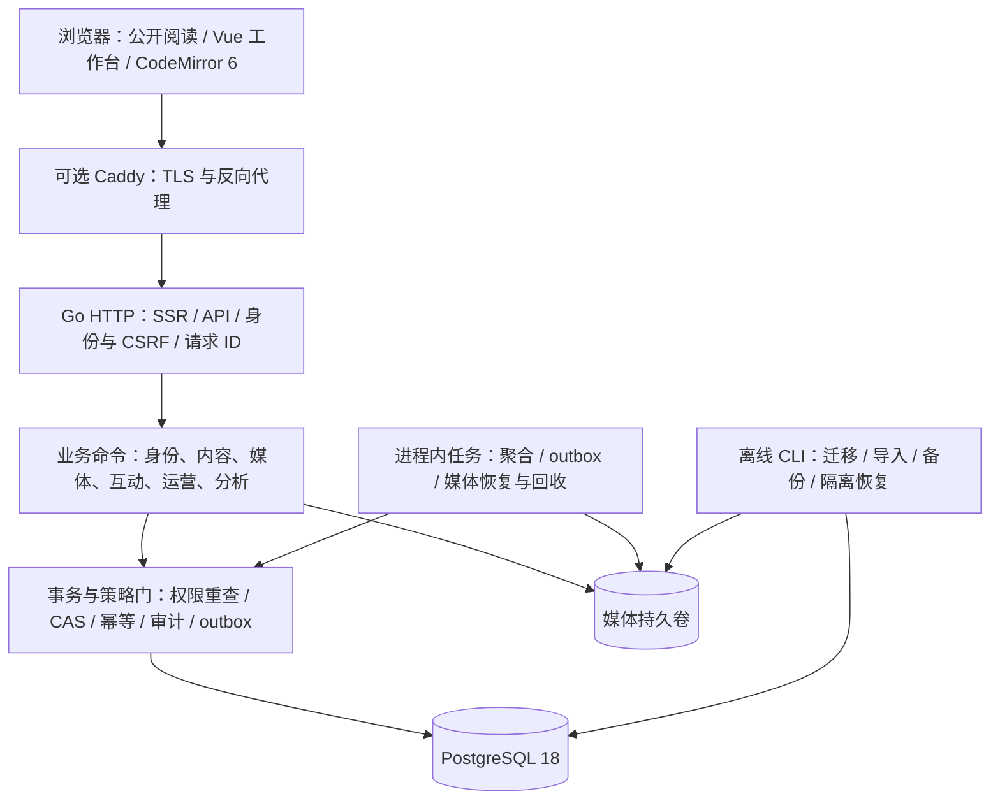
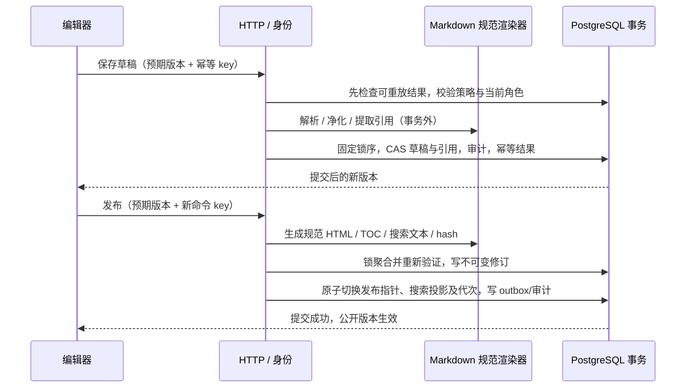

# Painter Next 实现架构

2026-11-02 更新，含网页安装、本地账号、可选GitHub、统一标签、封面/搜索、友链、部署维护/管理员工具与作者主页。本文描述当前代码，设计背景见[原始技术基线](design-baseline/README.md)，其中的表数与初期方案不代表当前实现。数据库仅支持 PostgreSQL 18，DDL 以 [`migrations`](../migrations) 为准，禁止 SQLite 降级。

2026-11-14 增量：连载专栏、三层分享、个人中心与请求协调已落地，详见 [专栏与分享](SERIALS_AND_SHARING.md)。数据库迁移更新至 24；继续使用单进程服务与 PostgreSQL 18。

## 运行结构与分层

运行时一个 Go 服务和一个 PostgreSQL 服务；构建前端需要 Node，生产运行不需要。静态资源与模板通过 `go:embed` 打入二进制。公开列表、详情、搜索、作者、友链、片语、按开关提供的 RSS 和 sitemap 由服务端渲染；旧标签入口跳转搜索；点赞、评论、关注是按需加载的交互岛。后台及个人空间是 Vue 应用，编辑器单独延迟加载。

| 层 / 责任 | 当前代码 |
| --- | --- |
| 组合根、CLI、HTTP 超时和退出 | `cmd/painter/main.go` |
| HTTP 包装、统一错误、请求 ID、幂等、限流、事务策略门 | `internal/app/core.go` |
| 配置、数据库连接、版本检查、迁移 | `config.go`、`db.go` |
| 本地账号、可选GitHub、会话、角色、用户资料 | `auth.go`、`github_settings.go`、`setup.go`、`local_auth.go`、`passwords.go`、`local_auth_cli.go`、`users.go` |
| 工作副本、修订、发布、回收站、权限投影、封面 | `content.go`、`covers.go` |
| 统一 Markdown 解析、净化、TOC、纯文本、媒体引用 | `render.go` |
| 站内搜索、公开建议、签名游标、发布代次 | `search.go`、`search_suggestions.go` |
| 媒体状态机、授权读取、恢复与 GC | `media.go` |
| 作者主页背景、独立版本与作者文章查询绑定 | `author_profile.go` |
| 评论、赞、收藏、关注、阅读历史 | `interactions.go` |
| 站点、标签、成员、任务、审计、存储概览、浮控场景 | `admin.go`、`site_experience.go` |
| 埋点接收、聚合、outbox 和保留期 | `analytics.go` |
| 健康、受保护 metrics、实际备份观测 | `operations_http.go` |
| 备份与恢复、可信离线导入 | `ops.go`、`ops_import.go` |
| SSR 页面与 Web 入口 | `web.go`、`web/templates/page.html` |
| 前端应用、编辑器、公开交互、遥测 | `web/frontend/src/` |

以上 Go 文件在同一个 `internal/app` 包中，是文件和职责边界，尚非编译器强制的独立模块。这样可以让跨内容、媒体、审计和 outbox 的事务直接共享 `pgx.Tx`，避免首版引入分布式事务。扩展时应先把查询模型和外部适配器抽出接口，再按业务域移动包；不能把共享写事务拆成多个独立提交。

### 前端内容与列表的公共职责

工作台的文章、动态、片语、专栏、章节选择器，以及收藏、足迹、成员等通用列表使用 `web/frontend/src/useCursorList.ts`：统一加载状态、游标、追加去重、失败重试、替换请求的取消与代次隔离、组件卸载清理。筛选刷新立即作废旧游标，避免失败后把另一组筛选的下一页混入当前结果。页面只提供请求、行校验、业务限制和必要的响应元数据；表单与列表错误可以分开管理。

`pagination.ts` 负责替换游标并保留查询条件，`contentClient.ts` 统一文章与动态的读取、创建、保存草稿、发布、撤回和删除请求。编辑器、管理列表与章节选择器复用同一客户端，不自行拼接内容端点。版本号、草稿版本、创建与保存的幂等 key 仍由业务流程提供；客户端通过原有 `api.ts` 保留 CSRF、错误处理和并发 GET 协调。

公共内容流程不要求不同内容共用一个存储模型：文章的修订、检查点、历史恢复与回收站仍为文章专属；动态保留图片和独立公开快照；片语、专栏保留各自的权限与写入协议。新增列表优先复用公共加载器，新增内容操作放在客户端，页面保留确认、冲突处理和本地输入保护。

`useMutationAttempt.ts` 为具有服务端幂等记录的命令保留不可变的请求路径、方法、版本、JSON 正文和 key。网络失败、408、429、5xx 与不完整的成功响应保留该请求，用户手动重试时发送原命令；只有校验通过的确认、明确拒绝或用户确认放弃编辑才清除。确认旧请求时，新输入保留为未保存修改，并采用已确认记录的 ID 和版本。专栏新建/更新、片语和友链新建、首页设置保存使用此机制；片语/友链更新、删除与友链页面设置继续遵守原有接口协议。该状态仅属于当前编辑页面，不自动重放，也不跨账号或刷新持久化。

`mediaUpload.ts` 统一图片 multipart 传输与成功响应校验：只有 `state=ready` 且媒体 ID 非空才交给调用者。动态、产品和首页通过 `useMediaUploadQueue.ts` 复用串行上传、失败状态与作用域取消；手动重试继续使用原文件和 key，页面卸载后迟到响应不再更新引用。格式/大小问题分类和预览 URL 释放也复用公共函数。页面仍负责数量上限、重复图处理、描述与排序，以及上传后的保存/发布，不自动公开、不自动重试或删除远端媒体。头像、背景、专栏封面、正文和卡片图片使用同一传输入口，沿用各自的编辑保护与大小限制。

首页管理通过 `useHomeSettings.ts`、`useHomeProjects.ts`、`useHomePlayStation.ts` 分开维护首页/Steam 设置、项目库和 PSN 连接。首页与 Steam 沿用同一聚合版本；PSN 保留自己的版本、临时凭据、命令 key、轮询和错误状态，切换出账号分区或卸载时取消轮询。模块只通过显式的 busy/locked 状态和列表刷新回调协调，互不拼接对方的写入 payload。展示墙列表也使用 `useCursorList`，兼容原响应游标；筛选失败后不会继续使用上一种展示墙的游标。歌单预览、条目编辑、照片核对和页面编排仍由首页组件协调。

文章与互动审计通过同一个 `audit` 函数写入调用方事务，统一沿用命令上下文的 request ID。互动原因的 500 字限制、审计动作、目标和失败回滚行为保持在原边界内。

## 数据表与归属

共48张表（迁移0001–0014），以及2个统一标签视图。用户、文章、标签等数值 ID 以及版本、计数、毫秒时间使用 BIGINT；修订、媒体、outbox、备份及会话管理 ID 等使用 TEXT opaque ID，HTTP 资源 ID 统一以字符串返回。结构化值使用 JSONB，密钥密文为 BYTEA。日期按 Asia/Shanghai 聚合，时间戳保存 UTC 毫秒。

| 域 | 表 | 关键不变量 |
| --- | --- | --- |
| 基础 | `schema_migrations`、`policy_barrier` | 数字迁移顺序、checksum；全局权限/维护门 |
| 身份 | `users`、`local_accounts`、`oauth_accounts`、`oauth_states`、`sessions` | 规范用户名唯一；Argon2id凭据独立；provider/issuer/数值 subject 唯一；state 一次消费；数据库不存明文会话令牌 |
| 安装与 provider | `installation_state`、`github_auth_settings` | 完成不可逆；已有真实身份关闭安装；provider 单例 CAS 与 secret 加密；OAuth state 绑定配置指纹 |
| 站点 | `site_profile`、`site_settings` | 单例版本 CAS；SMTP 密码加密且不回显 |
| 组织 | `tags`、`tag_aliases`、`category_tag_map`，历史 `categories` | 产品只用标签；effective视图兼容旧分类，旧修订及hash不改写 |
| 片语 | `phrases` | owner管理、版本CAS、同事务审计；SQL固定公开过滤，SSR直接读表，无异步投影 |
| 创作 | `posts`、`post_drafts`、`post_draft_tags`、`post_draft_media_refs` | 作者与 client_draft_id 唯一；工作副本独立版本，JSONB cover与正文一起保存 |
| 修订 | `post_revisions`、`post_revision_tags`、`post_revision_media_refs` | 不可变；先写关联再封存修订，延迟外键在提交时检查 |
| 公开投影 | `post_publications`、`search_documents`、`search_state` | 仅已发布修订可见；发布/撤回与检索代次同事务更新 |
| 媒体 | `media_assets`、`media_aliases` | staging → ready → deleting → deleted；引用保护含历史修订 |
| 互动 | `comments`、`comment_likes`、`post_likes`、`bookmarks`、`follows`、`reading_history` | 关系唯一键；读写需重新检查当前可见性 |
| 命令和事实 | `idempotency_keys`、`outbox`、`outbox_consumptions`、`audit_logs`、`business_daily` | 幂等结果与业务同事务；消费收据防重；审计关联请求 ID |
| 访问分析 | `analytics_events`、`analytics_daily`、`analytics_scope_visitors`、`analytics_rollup_state` | 传输/语义去重；事件持久后 ACK；站点/文章分别去重 UV |
| 迁移与运维 | `legacy_counters`、`backup_records` | legacy 不混入新埋点；备份成功/恢复验证有真实记录 |

已交付迁移为初始表结构，以及空标题恢复快照、运行角色授权限制、备份记录、本地凭据、统一标签、文章封面、RSS/浮控设置共七项增量。不要修改已应用迁移；新增迁移须使用更大的数字版本。

## 内容写入、发布和恢复

编辑器本地 IndexedDB 保存标题、摘要、正文、标签、cover、服务端基准版本；服务器是持久事实来源。本地恢复需要显式确认；首次联机创建前的新稿可按当前账号和origin从IndexedDB恢复列表找回，关闭标签后不依赖原sessionStorage入口。恢复稿保存前先用原client_draft_id查询服务器映射，避免已提交但丢响应时重复创建；先持久化postID恢复点再清理旧clientID记录。冲突界面保留本地内容并展示服务器版本，不静默覆盖。IME 组合期间不发送半完成文本。

创建使用持久 `client_draft_id` 映射和 Idempotency-Key，网络结果不确定时可以查询原映射；保存携带预期聚合/草稿版本执行 CAS。上传引用以服务端 Goldmark AST 为准，不能依赖前端正则判断 Markdown 的语义。

所有公开查询从发布指针获取修订，不读取工作副本。保存草稿不会改变公开文章；恢复历史先保留当前草稿快照，然后恢复为新工作副本，仍需另一次发布。撤回会同时撤销公开投影和检索结果；移入回收站同样不再公开，恢复回收站不会自动发布。历史快照允许保存尚未填写标题的工作副本，发布/手工检查点仍校验有效标题。

## 事务、并发与幂等

普通写入在 READ COMMITTED 下按固定顺序取得锁：

1. 幂等命令 advisory lock。
2. `policy_barrier` 共享锁；修改角色、封禁、站点策略或全站备份时使用排他维护门。
3. 当前操作者用户行，再按 ID 排序的文章聚合行。
4. 草稿/发布/评论 → 标签 → 按 key 排序的媒体 → 关系、审计、outbox。

获得锁后重新验证当前权限、角色、内容可见性和版本；不能依赖 HTTP 入口的旧权限快照。管理变更会撤销相关会话。CAS 失败返回冲突，不做最后写入者覆盖。同 key 同 payload 重放原结果；同 key 不同 payload 报错。JSON 业务变更及其幂等结果、审计和 outbox 在同一个事务内提交。

渲染、网络和文件传输在长事务外执行；媒体/标签在提交前再次核验。恢复修订先锁当前和目标引用的并集，避免两个恢复操作按相反媒体顺序死锁。媒体 GC 只锁媒体行，再用新 SQL 快照检查引用，不能反向取得文章锁。

## 媒体与文件系统

上传支持 JPEG、PNG、WebP、GIF，校验图像格式头与尺寸、10 MiB 上限及 hash，不在请求中解码全部像素。先将上传流写入临时文件、解码校验并计算 hash，完成 fsync/关闭后，再通过事务保存 staging 元数据；随后原子 rename 到正式对象、fsync 目录，最后标记 ready。文件和 PostgreSQL 不是跨系统 ACID；任务扫描过期 staging/deleting 行恢复中断流程。进程在 staging 元数据提交前崩溃可能留下无行对应的 `.upload-*` 临时文件，目前不自动扫描删除；运维应在停写后按文件年龄核对清理，避免误删进行中的上传。

只提供 `/media/{id}` 授权读取，不开放裸目录。公开发布、当前个人/站点头像的引用可公开；其余需要所有者或相关文章作者权限。媒体响应使用私有缓存策略，避免撤回后共享缓存继续泄漏。GC 只清理超过宽限期且所有草稿、发布、历史修订和头像均未引用的对象；因此保留的修订也会保留对应图片。

## 搜索链路

发布时同步生成 NFKC → Unicode casefold → NFKC → 空白规范化的标题/摘要/正文列，使用 PostgreSQL pg_trgm GIN；无独立检索服务。词间 AND，字段间 OR；1～2 字短词使用字面子串匹配，长词使用转义 LIKE，`%`、`_` 不会被当成用户通配符。

排序由字段命中和发布时间确定，签名游标包含过滤条件 hash、排序/渲染版本、发布代次及 offset。查询在短 REPEATABLE READ 事务中取得代次和结果；发布代次变化后旧游标失效，要求重新查询，避免混合两份结果。最多两个并发检索，500 ms 超时，超时有明确错误，不返回悄悄截断的结果。

## 埋点、有效阅读与后台任务

浏览器只发送白名单事件；单批最多 50 条、64 KiB。服务端在事件已持久化后 ACK，客户端才能移除重试队列。既按事件 ID 去重，也按有效阅读语义去重；阅读收据签名且有 24 小时有效期。自身/站长/已识别机器人不计有效阅读。匿名身份使用按日 HMAC，报告不公开可复用追踪标识。

聚合使用待处理事件行 `FOR UPDATE SKIP LOCKED`，标记与日聚合同事务完成。禁止按最大 sequence 作为处理高水位，因为较小 ID 可能较晚提交。站点 UV 与文章 UV 分别去重，不能将文章 UV 求和当站点 UV；登录阅读历史与有效事件在同一事务写入。事件详情和日指标按既定保留期清理，当前阅读计数是 **400 天窗口**；旧站历史量放在 `legacy_counters` 独立展示。

业务 outbox 在原命令事务写入，任务通过 lease 和 fencing 令牌认领，消费者收据唯一键保证本地消费去重。失败重试，耗尽进入 dead；任务状态可以查看。当前消费者记录内部业务事实，不自动向外部邮箱发信。SMTP 仅提供加密配置扩展点；接入真实邮件或其他外部系统须使用提供方幂等键，不能将数据库收据当成外部“恰好一次”保证。

## 身份、隐私和部署边界

默认本地用户名与密码；生产注册默认关闭，新注册固定reader，首位owner由离线CLI创建。Argon2id 19MiB/t2/p1、有限哈希并发及账号/IP回退；登录有匿名CSRF，改密/离线重置撤销会话，普通写取得用户锁后以新语句重查会话。可选 GitHub OAuth 使用固定可信端点，PKCE S256、一次性 state、浏览器绑定、加密 verifier；登录后不长期持有 GitHub token。使用 GitHub 数值 ID 绑定身份，不按同名或邮箱合并。会话令牌只在浏览器，库内保存 hash；变更请求同时验证 Origin 和 CSRF。公开用户字段与个人资料分开投影，管理员、邮箱、手机号、会话及密钥不可通过公开接口读取。

运行角色只有业务 DML、序列 USAGE 和迁移表 SELECT，无建库、建角色、建 schema 权限；迁移用另一角色。隔离恢复校验使用单独维护账号。`/metrics` 需要 owner，健康探针不返回凭据。进程内限流不是多实例全局配额；当前部署目标是单实例，多个写实例需要先设计共享限流及本地文件存储的一致访问。

备份取得全站维护门，生成数据库 dump、ready 媒体对象和 hash manifest，全部持久后登记 `backup_records`。恢复验证真实创建临时库、恢复并核验、删除后才记录验证时间。实际生产恢复不自动覆盖原库，操作步骤见 [README](../README.md)。异机同步、定时调度、物理机容灾和容量目标仍由实际部署验证。

## 扩展原则

- 身份提供方已经使用 provider/issuer/subject 模型；添加提供方须沿用独立绑定和显式关联流程。
- 媒体按 opaque ID 解耦存储路径；切对象存储须保留授权网关、状态机、完整性检查和历史引用保护。
- 前端只依赖 `/api/v1`；可独立升级工作台或新增客户端，公开 SSR 无需加载整个编辑器。
- 搜索使用发布投影，可在以后增加 outbox 驱动的外部索引；同步前要明确代次与最终一致性，不能从草稿建立公开索引。
- 任务保留 outbox、lease 和消费者收据，可拆为单独 worker 进程；拆分前不得移走全站维护门和锁协议。
- 需要增加领域功能时新增表/迁移与命令，保持发布事实、用户工作副本、分析投影各自职责；避免可任意改表的通用 CRUD 接口。

统一标签、封面媒体引用、修订与公开指针、搜索建议沿用上述事务和权限边界。本地账号操作见 [本地账号指南](local-accounts.md)。

## V7 安装与身份扩展

`/setup` 使用单独 Vue 入口；Go 的 `setup.go` 负责匿名安装授权，复用有限并发密码派生与已有事务维护门。站点资料、owner/凭据、关闭注册、outbox、封闭状态及审计同一次提交；详细数据时序见 [网页安装](INSTALLATION_V7.md)。`github_settings.go` 管理 owner-only 配置，OAuth adapter 使用有效数据库/环境配置与版本指纹，回调二次复查，成功登录原子替换当前旧会话；接口见 [GitHub 配置](GITHUB_LOGIN_V7.md)。

身份认证与内容授权仍在同一个 Go 进程。当前已实现 TOTP、单次恢复码、账号访问策略与标准 OIDC 授权；其他应用复用 Painter 身份，仍自行管理其业务角色。因素、会话与撤销边界见 [账号安全](ACCOUNT_SECURITY.md)，协议与客户端接入见 [认证中台](IDENTITY_PROVIDER.md)。WebAuthn、Passkey 和设备码仍未实现。

## V8 工作台与片语

后台布局为独立侧栏工作台，自定义选择/确认弹层仍使用原API与保存协议。片语 `phrases.go` 通过现有Write事务维护门与角色重查，管理短句/词语、草稿/公开和版本CAS；公开 `/phrases` 与API使用同一SQL公开过滤查询，正文/来源由模板转义，不接触私有集合。没有新增队列、运行服务或搜索投影；数据由现有备份与隔离恢复流程覆盖。

## V16 作者主页的数据链路

`author_page_profiles`以用户为主键，保存受限背景配色、可空ready媒体引用、独立version及更新时间。个人GET/PUT接口仅作用于本人，通过现有会话/CSRF/Write事务门；更新要求If-Match并参加幂等与审计。背景版本与资料版本独立，防止互相覆盖。

上传先走媒体staging→ready，再保存自己的媒体ID为背景引用。保存时锁主页与目标媒体；删除/GC锁媒体并重查全部引用，避免保存与回收竞争。公开读取只返回active作者的ready背景，失败图片保留配色。pg_dump和ready媒体的完整备份/隔离恢复覆盖此表。

作者页SSR使用路径用户强制限定查询，关键词结果仍渲染在作者页，游标绑定作者和查询条件。工作台文章管理搜索标题/摘要，保留本人/全站权限与分页；全站仅owner。增量迁移以 [`migrations`](../migrations) 为准，恢复到隔离库后核验账号、发布指针、媒体与搜索结果，再按 [备份恢复流程](AUTOMATIC_BACKUP_RECOVERY.md) 切换。
