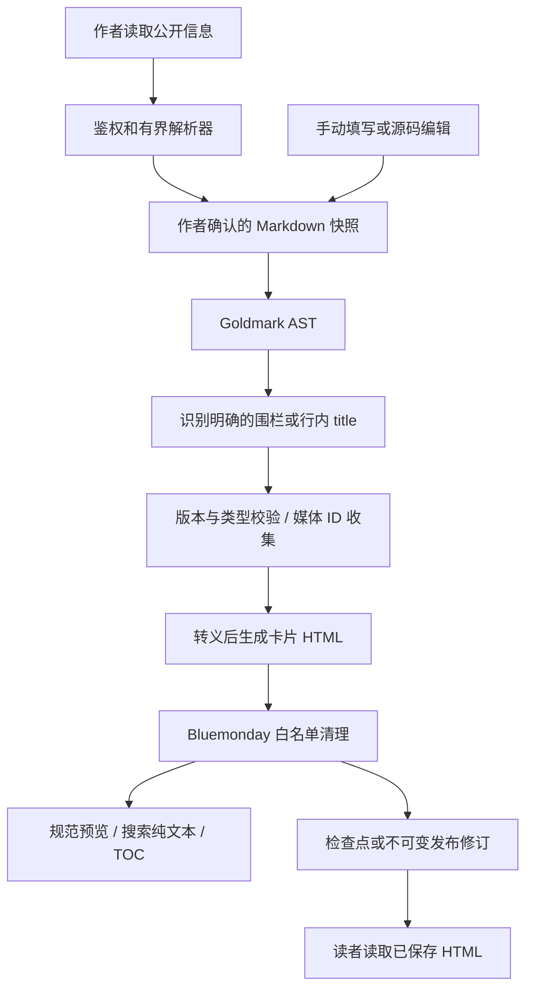

# V24 文章内容卡片

V24 把外部内容参考保存为文章 Markdown 内的版本化快照。富文本编辑、源码编辑、规范预览、检查点、发布与恢复使用同一份内容；读者打开文章不会触发供应商解析。实现是 Painter 自有的轻量注册表和渲染扩展，没有引入 A2UI、MDX 执行环境或任意 HTML 组件运行时。

本文记录当前实现、作者使用方式和后续组件池的边界。文档中的 JSON 示例用于说明语法，不表示站点已经添加相应文章或收藏。

## 已实现的内容

| 类型 | `type` | 当前能力 |
| --- | --- | --- |
| GitHub 仓库 | `github` | 公开仓库名称、简介、语言、头像，以及供应商实际返回的 stars/forks |
| Steam 游戏 | `steam` | 商店游戏名称、简介、官方封面和商店链接 |
| Apple Music | `apple_music` | 公开专辑或歌单的标题、说明/艺人、官方封面和原始内容链接 |
| 网页参考 | `link` | 完整卡片、单行标题、社交分享，或带文字/Emoji 的行内链接与来源预览；支持读取公开网页，也支持作者手动填写标题、简介 |
| B站视频 | `bilibili` | 规范视频链接、作者填写的标题/说明和本地封面；读者点击后加载官方播放器 |

普通正文图片的点击浏览复用现有图片灯箱，不是独立的图片卡片类型。供应商卡片内的图片属于原始外链，点击仍打开供应商页面。图片已经指向其他导航目标时，运行时保留作者设置的链接。

播放器仅限B站受控视频卡片，在读者主动点击后加载。当前不提供任意 iframe、平台脚本、MusicKit 授权、私人收听记录、Steam 个人游玩时间、价格或自动更新的实时 GitHub 数字。Apple Music 歌单卡片保存页面参考信息，不承诺完整曲目列表；首页歌单导入是独立能力。

## 作者操作

1. 在文章文档工具栏选择“卡片”，或输入 `/` 后选择 GitHub 仓库、Steam 游戏、Apple Music、网页参考、社交分享或B站视频。
2. 选择类型、填写链接，点击“读取网页信息”。读取成功后可以调整标题和简介。供应商读取失败会保留输入，供稍后重试。
3. 网页参考可以直接手动填写标题和简介，在“展示方式”选择“行内”“卡片”“单行标题”或“社交分享”。行内可设置正文链接文字和可选 Emoji；独立展示使用网页标题。社交分享可填写作者或账号说明、多行分享文字及上传封面。手动参考不要求先抓取网页。B站视频可直接填写规范视频链接与标题、上传本地封面；链接解析只做本地规范化，不获取平台元数据。
4. “预览卡片”和最终“插入卡片/保存卡片”都会调用服务器规范预览。通过校验后才写入当前编辑内容；实际发布仍使用原有发布操作。
5. 选中已有区块卡片，使用“编辑卡片”；已有行内引用可通过链接/卡片工具继续编辑。切换到 Markdown 源码仍可编辑完整快照。光标位于已知区块卡片围栏内时，源码工具栏的“卡片”会打开该卡片进行编辑。

富文本区块使用 Tiptap atom；行内引用使用普通 link mark。它们的 Markdown 往返保留快照字段、原始链接和文字。普通正文编辑不会自动读取新元数据，也不会把已知卡片强制切到源码模式。原有不受支持的其他 Markdown 语法仍遵循既有兼容性保护。

单行标题与完整卡片使用同一种 v1 网页快照；只增加 `display: "title"`，缺省或 `card` 保持旧卡片。单行不展示简介或图片，仍保存它们供切回完整卡片使用。阅读时直接打开来源，不触发行内预览的首次点按逻辑。已发布内容仍需重新发布才会改变。

社交分享使用同一份 `link` 快照的 `display: "social"`。平台名称从链接主机识别，作者说明、文字与封面保存为作者快照，不代表平台认证。只有此呈现允许 `description` 中的 LF / CRLF 换行；其他 v1 外部卡片仍保持单行字段规则。切换到行内或其他呈现前，需要整理不符合目标字段规则的多行文字。社交卡片不执行社交平台脚本。

卡片节点优先级位于正文 Paragraph 之后、普通 CodeBlock 之前：空新稿仍由正文段落填充，只有明确的 `painter-card` 语法才进入卡片解析。空稿检查不会通过放宽 HTML 或未知语法保护来实现。

读取或调整卡片只影响当前草稿。已发布内容要通过明确的发布操作才会变化。检查点和恢复遵循既有 CAS、修订和媒体引用机制。

## Markdown 快照语法

### 区块

使用语言名称精确为 `painter-card` 的 fenced code block，内容必须是一个 JSON 对象：

````markdown
```painter-card
{
  "v": 1,
  "type": "github",
  "url": "https://github.com/openai/codex",
  "title": "openai/codex",
  "description": "作者写下的参考说明",
  "metadata_source": "author"
}
```
````

当前 v1 字段如下。长度按服务端 Unicode/UTF-8 校验执行；以服务器返回的错误为准。

| 字段 | 规则 |
| --- | --- |
| `v` | 当前已知版本为整数 `1` |
| `type` | 外部快照为 `github`、`steam`、`apple_music`、`link`、`bilibili`；站内 `moment`、`phrase` 仅保存引用身份，规则另见导入说明 |
| `url` | 必填，最长 2048 字节的 HTTPS 网址；不接受账号、显式端口、本地/私有 IP 字面量、显式本地主机名或含控制字符的地址；供应商类型另有精确主机和路径校验，实际服务器抓取另检查 DNS |
| `title` | 必填，最多 200 个 Unicode 字符，不含控制字符 |
| `description` | 可选，最多 1000 个 Unicode 字符，按纯文本显示；仅 `link` 的 `social` 呈现允许 LF / CRLF 换行，不接受制表符 |
| `subtitle` | 可选，最多 200 个 Unicode 字符，例如艺人、仓库语言、作者或账号说明；单行纯文本 |
| `image_url` | 可选；使用 `/media/{id}`；仅 GitHub、Steam、Apple Music 另允许各自受控官方 HTTPS CDN 图片 |
| `display` | 仅 v1 `link` 使用：`card`（缺省）、`title`、`social`；行内只允许缺省或 `card` |
| `stats` | 可选，仅 GitHub 使用，支持 `stars`、`forks` 非负整数；缺失值应省略，供应商明确返回的 `0` 保留为零 |
| `metadata_source` | 可选，生成器使用 `provider` 或 `author`，区分获取的快照与作者填写的内容 |
| `resolved_at` | 可选，RFC3339 时间；供应商解析结果记录实际获取时间 |

已知 v1 类型拒绝不认识的字段、错误字段类型和越界计数。快照不是任意键值或 HTML 插槽。每个快照最多 **8 KiB**，每篇文章最多 **128 张卡片**，文章本身仍受原有 1 MiB UTF-8 正文限制。

`metadata_source` 是内容来源说明，不是不可伪造的签名。作者有权编辑文章和快照；读者看到的是作者保存的内容，不应把快照数字描述为当前实时值或平台认证结果。

### 社交分享与B站视频

社交分享复用网页类型，不增加可执行嵌入协议：

```json
{"v":1,"type":"link","display":"social","url":"https://example.org/share","title":"作者保存的分享标题","subtitle":"作者或账号说明","description":"分享文字第一行\n第二行","metadata_source":"author"}
```

社交封面只允许本地 `/media/{id}`。X、微博、小红书、抖音、B站显示对应平台名称；其他公开来源显示“分享”。平台名按精确主机或其子域识别，不接受用相似主机冒充来源，不加载外部平台脚本。

B站独立使用受控类型：

```json
{"v":1,"type":"bilibili","url":"https://www.bilibili.com/video/BV1B7411m7LV/","title":"作者填写的视频标题","description":"作者填写的视频说明","metadata_source":"author"}
```

示例只说明格式，不声称标题或说明来自该视频。合法快照地址必须为 `https://www.bilibili.com/video/BV` 加 10 位英文字母或数字加 `/`，或 `/video/av` 加 1–18 位正整数加 `/`；ID 区分大小写，av 编号不以零开头。只允许 `p=2` 至 `p=1000`，第 1 分P省略参数；快照保留尾斜杠。解析接口可接收缺少尾斜杠或 `p=1` 的同类地址并返回规范形式。fragment、短链、非精确主机、账号、端口、player URL 和 iframe HTML 均拒绝。

为兼容B站网页复制链接，编辑器输入及解析接口可额外接收 `spm_id_from`、`vd_source`，各至多一个；解码后的值各最多 512 UTF-8 字节，校验后丢弃，不进入快照。比如 `...?spm_id_from=333.337.search-card.all.click&vd_source=abc&p=2` 规范化为 `...?p=2`。`p` 仍须唯一、介于 1–1000 且不含前导零；其他未知参数、重复追踪参数、空查询符均拒绝。已保存快照与结构化导入仍只允许前述无追踪参数的规范地址。

标题必填；可选作者说明、简介及本地封面沿用上述长度和权限规则，不接受远程封面。B站解析器不发起平台网络请求；手填标题原样保留，未提供时只使用通用标题“哔哩哔哩视频”，不补写真实标题、作者、时长或播放量。

服务端只渲染静态占位、隐藏的加载按钮和“在B站打开”链接，不输出 iframe 或 player src。统一阅读脚本在用户点击后重新验证视频身份，再创建固定官方播放器。CSP 仅为官方 `https://player.bilibili.com/player.html` 开放 frame-src，正文 HTML 清理器仍拒绝任意 iframe；其他脚本、连接和防嵌入策略不放宽。首次点击前不加载平台播放器；无 JavaScript 或加载失败时可以打开原视频。官方参数依据[B站嵌入式播放器文档](https://player.bilibili.com/)，文章数据不保存可自定义的播放器网址、HTML 或脚本。

`social` 与 `bilibili` 都只允许独立卡片，不接受行内快照或 v3 布局嵌套。新功能不会回写既有发布修订；需要更新公开内容时，仍须明确重新发布。

### 行内引用

行内引用仍是标准 Markdown 链接，文字和 Emoji 位于正常 link text；扩展数据位于 title：

```text
[正文文字](<https://example.com/reference> "painter:v1:base64url(JSON)")
```

这里的 `base64url(JSON)` 是编码规则说明，实际 title 必须使用无 padding 的 URL-safe Base64，不能直接写该占位文字。被编码的对象使用上述 v1 结构，且 `type` 必须是 `link`、`display` 必须省略或为 `card`、快照 `url` 必须与 Markdown 链接目标完全一致。`title`、`social` 块呈现与 `bilibili` 类型不能进入行内。编辑器和解析 API 会自动生成完整语法，作者无需手工编码。

例如，下面是包含作者填写来源说明的有效完整引用：

```markdown
[🔎 Cali Castle](<https://cali.so/> "painter:v1:eyJ2IjoxLCJ0eXBlIjoibGluayIsInVybCI6Imh0dHBzOi8vY2FsaS5zby8iLCJ0aXRsZSI6IkNhbGkgQ2FzdGxlIiwiZGVzY3JpcHRpb24iOiLkvZzogIXkv53lrZjnmoTkuKrkurrnvZHnq5nlj4LogIMiLCJtZXRhZGF0YV9zb3VyY2UiOiJhdXRob3IifQ")
```

普通 Markdown 阅读器仍可显示链接文字并打开原始网址。Painter 增强为悬停/键盘聚焦的来源预览；触摸设备先点查看来源，再点按打开原目标，Escape、移出焦点或点按外部可关闭。键盘 Enter、修饰键和原生新标签行为保留。

## 单一渲染链路



- [`RenderMarkdown`](../internal/app/render.go) 是文章预览、检查点与发布的唯一正文管线。卡片只在 Goldmark AST 中被明确识别：普通 JSON、普通代码块、较大代码块里的示例围栏不会被误当作卡片。
- [`content_cards.go`](../internal/app/content_cards.go) 保存当前类型注册表、严格解码/校验、AST 转换、转义渲染与 Markdown 生成器。卡片文字始终作为文本处理，原始 HTML 不进入信任链。
- [`content.go`](../internal/app/content.go) 沿用现有保存、引用检查、修订、CAS、发布和恢复流程。卡片字段直接位于 Markdown，不需要额外的文章卡片表或数据库迁移。
- 纯文本由清理后的 HTML 提取，包含可读标题、说明和来源，供搜索使用。正文卡片不会虚构目录项；标题内的行内链接保留其正文文字作为 TOC 文本。
- 前端 [`articleCards.ts`](../web/frontend/src/articleCards.ts) 定义编辑表示、编码/解码和安全 DOM 结构；[`ArticleCardComposer.vue`](../web/frontend/src/components/ArticleCardComposer.vue) 使用服务器规范预览，而不是接收或执行作者提供的 HTML。
- 行内预览的额外说明存在于编辑器 mark view，复制/导出 HTML 仍序列化为正常链接，避免把预览说明重复粘贴进正文。

当前 renderer version 为 `goldmark-gfm-v1;painter-cards-v1;painter-link-title-v1;painter-panels-v2;layout-v3;social-video-v1;unicode-nfkc-fold-nfkc-v1`。它参与新渲染与内容 hash；升级没有批量重写旧发布修订。旧文章继续读取原来保存的 `sanitized_html`。恢复会产生当前工作草稿，原发布指针和其不可变 HTML 在再次发布前保持不变。

## 解析 API 与网络边界

[`content_cards_resolve.go`](../internal/app/content_cards_resolve.go) 提供：

```http
POST /api/v1/editor/cards/resolve
Content-Type: application/json
X-CSRF-Token: <当前会话 token>
```

```json
{"type":"github","url":"https://github.com/openai/codex"}
```

网页参考可额外提交 `title`、`description`。有明确标题时按作者填写内容生成快照，无须访问该网页。成功返回 `card`、区块 `markdown`；`link` 还返回 `inline_markdown`。结果不会自动创建文章、保存草稿或发布。

B站请求为 `{"type":"bilibili","url":"https://www.bilibili.com/video/BV1B7411m7LV/","title":"可选手填标题"}`。该分支只校验并规范化地址，返回作者快照与区块 Markdown，不返回行内 Markdown，不访问平台网络、不获取标题或封面。

仅 author/owner 可以使用；服务端验证同源与 CSRF，外部请求结束后再次检查角色/会话权限。前端统一使用现有 [`api.ts`](../web/frontend/src/api.ts) 请求封装。网络失败使用固定错误，不把原始传输错误、凭据或配置中的密钥回显给作者。

| 解析器 | 来源与校验 |
| --- | --- |
| GitHub | 固定 `api.github.com/repos/{owner}/{repo}`；使用公开无凭据请求，拒绝重定向；验证返回仓库名、owner、full name 和 GitHub URL 的身份一致性，不使用站点 OAuth secret |
| Steam | 固定 Steam store appdetails API；验证 app ID 与成功结果，不请求账户库或私有 API Key |
| Apple Music 专辑 | 固定 iTunes lookup；仅选取目标 collection/album，不把其他搜索结果冒充目标专辑 |
| Apple Music 歌单 | 读取同一公开内容身份的 `music.apple.com` 页面元数据；重定向不能改变内容 ID 或地区 |
| 普通网页 | 公开 HTTPS HTML；读取标题与说明，不执行 JavaScript，不导入任意 Open Graph 图片 |
| B站视频 | 本地校验 BV/av 规范地址和可选分P；零平台网络请求，不补全平台元数据 |

专辑卡片当前使用 lookup 实际返回的 `artworkUrl100`，没有把 URL 中的 `100` 任意改写成更大尺寸。它与首页单专辑导入中“验证公开页返回模板后再生成 632px 图片”的增强路径不同。未来若复用该增强，应保留同一公开内容身份校验、请求预算和原始 URL 回退；这属于后续改进，不是本次已经接入卡片的能力。

网络请求使用禁用环境代理的专用传输、TLS 主机验证和公有 DNS 地址检查。每次拨号解析结果中的所有地址都须通过检查，再连接已检查的地址，避免后续 DNS 解析替换目标。私有、loopback、link-local、shared/reserved 网段以及代码中列出的 IPv6 转换/保留范围被拒绝。

请求的整体上限为 8 秒，最多占用 4 个共享供应商并发位；JSON 响应最多 2 MiB，普通网页 HTML 最多 1 MiB，Apple Music 页面最多沿用既有 4 MiB 上限。允许的网页重定向最多两次，每跳重新验证；GitHub、Steam、iTunes 不跟随重定向。每用户每分钟最多解析 20 次，该限流保存在进程内，重启会重置；供应商自身仍可能施加额外限制。

常见错误包括 `CARD_INVALID`（快照/网址校验）、`CARD_PROVIDER_UNAVAILABLE`（公开信息不可用）和 `CARD_RATE_LIMIT`（限流）。未知版本/类型的降级不等于已知无效数据被静默接受：后者明确返回编辑错误。

## 图片、媒体与备份

`image_url` 的远程允许范围按卡片类型限制：GitHub 头像使用 `avatars.githubusercontent.com`；Steam 使用官方 `steamstatic.com` 域及其子域；Apple Music 使用 `mzstatic.com` 域及其子域。普通网页参考、社交分享与B站视频不引入远程缩略图，只使用已上传的 `/media/{id}`。

本地卡片图片与普通正文图片一起收集到 `Rendered.MediaIDs`。保存和发布时，既有媒体引用逻辑检查 ready 状态、所有权或已有文章引用授权，并维护 draft/revision refs。因此只存在于卡片中的可见图片也会保护删除和 GC，撤下当前草稿卡片不会删除历史修订所需的媒体。

Markdown 导出包含完整卡片元数据，不依赖一个临时解析缓存 ID。相对 `/media` 地址仍需要对应媒体文件；备份/迁移必须保留现有数据库与媒体存储，单独的 Markdown 文件不是上传文件的字节归档。远程官方图片保存的是 URL 快照，无法保证供应商将来的 CDN 字节不变或始终在线。

[`contentCards.ts`](../web/frontend/src/contentCards.ts) 为公开普通文章图片添加原图链接并接入 [`momentGallery.ts`](../web/frontend/src/momentGallery.ts) 的同一个 dialog；无 JavaScript 时原图仍作为正常正文图片显示，作者原本设置的链接仍保留。灯箱提供上一张/下一张、Home/End、原图链接、加载失败提示、Escape 与关闭后的焦点返回，不截获 provider card 的图片外链。

## 未来组件池：建议，尚未实现

当前外部卡片覆盖上述类型与受控展示。下面是后续顺序和架构建议，**不属于 V24 已交付功能**：

| 建议类型 | 写作用途 | 扩展前须确定的约束 |
| --- | --- | --- |
| Callout / aside | 提示、警告、补充信息 | 限定语义枚举、标题/正文语法、目录与搜索处理，保持无 JS 可读 |
| Download | 文件附件入口 | 仅本地受授权资产、文件名/MIME/大小快照、下载权限与 revision refs，避免任意抓取远程附件 |
| Code tabs | 等价命令/语言示例切换 | 受控代码段与标签、键盘 tab 模式、无 JS 顺序展开、原始代码导出与高亮一致性 |
| Book | 书目和个人书架参考 | 稳定书目标识、作者/版本/封面来源、手动内容和抓取来源的明确区分 |

实现新类型时，应把“注册名称”扩展为完整定义：版本与 typed schema、严格校验、受控 resolver、SSR renderer、纯文本投影、媒体引用收集、编辑器节点/面板、Markdown 编解码和回归样例。前后端仍按编译期白名单发布；不要让管理端配置上传可执行渲染器或任意 HTML。

新增类型若仍使用兼容的 envelope，可单独注册；字段结构或语义不兼容时采用新版本并保留旧 decoder。不要通过放宽当前 v1 的未知字段校验来绕过版本设计。每次扩展都要验证未知版本降级、代码字面量、XSS/协议、图片授权、导出/恢复、搜索/TOC、主题和键盘/触摸；只有新增关系确实需要持久查询/授权时再考虑新表。

### 一手参考与采用范围

- [Cali Castle](https://cali.so/)：参考紧凑、可读的个人出版与外部内容呈现。2026-11-03 在真实 Chromium 的 1440px 页面上测得 Geist 为主要西文字体，介绍正文约 14px/24px、文章链接约 15px/22.5px。Painter 卡片沿用自身 Geist/中文字体与中性 token，以 14px/22px 的说明和 17px/25px 的标题建立层级；没有复制该站内容或把其整站样式替换进 Painter。
- [Quarto Callout Blocks](https://quarto.org/docs/authoring/callouts.html)：为未来提示类内容参考明确的结构与语义。只借鉴作者可理解的受控类型，不在本项目引入 Quarto 引擎或声称已支持其语法。
- [Starlight Asides](https://starlight.astro.build/components/asides/)：参考主文之外补充信息的定位、有限语义类型与自定义标题；V24 没有实现 aside。
- [Starlight Tabs](https://starlight.astro.build/components/tabs/)：参考等价信息分组、可读标签及同步选择的交互；未来 code tabs 需要先完成自己的 Markdown/SSR/无 JS 合同，不能直接执行 MDX 组件。

## 验证与维护

后端解析、公开权限、媒体引用与 HTML 安全由 `internal/app/*cards*_test.go` 等测试覆盖。独立编解码与运行时测试位于 `tests/browser`。所有真实写入验收仅使用显式可丢弃候选，截图和报告输出到忽略目录 `tests/artifacts/`。

## v2 内容面板与 AI 导入

现已增加提示 `callout`、指标组 `metrics` 与摘要组 `summary` 三种 v2 面板；不改变已有 v1 引用卡片。文档与源码共用同一份数据，支持插入、编辑、预览和发布。字段、示例、AI 提示词及整篇 JSON 导入见[结构化文章导入](ARTICLE_IMPORT.md)。真实表格继续使用 Markdown，不把邮件布局表格当作数据表。
