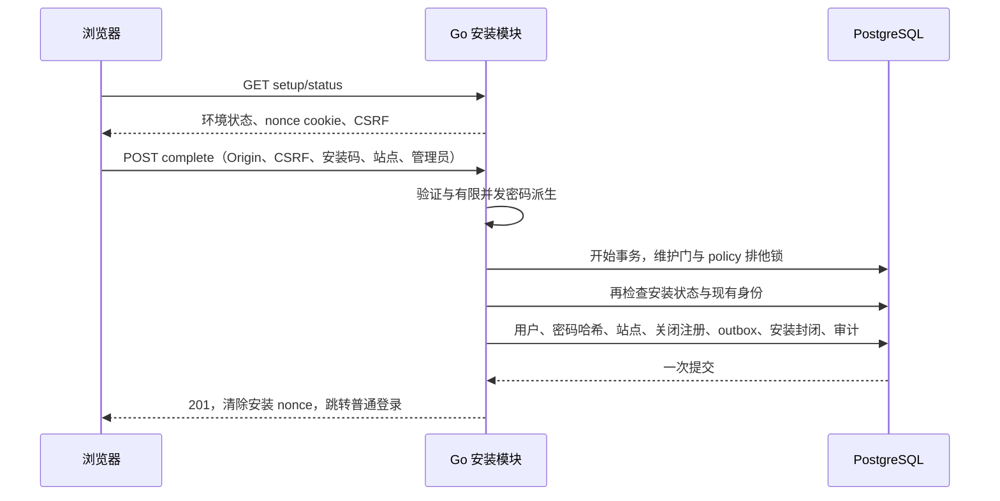

# 网页安装引导与首位管理员

首次安装分为服务器准备与浏览器设置两个阶段。仍是 Go 模块化单体与 PostgreSQL 18，不增加数据库服务或 Node 运行依赖。数据库继续禁止 SQLite。安装状态与 GitHub 配置均由版本化迁移维护；已交付的迁移不可修改。

## 新站安装

1. 在服务器的部署目录运行 `./install.sh`，选择局域网、仅本机或 HTTPS。脚本准备私有配置、数据库、迁移和应用。
2. 服务健康后，在同一目录执行 `./scripts/painter setup-token`，读取安装码。仅这个显式操作会输出安装码；不要转发、写进 URL、截图、日志或仓库。
3. 打开安装输出地址的 `/setup`。页面依次确认 PostgreSQL/迁移/公开地址，填写站名与一句介绍，然后创建管理员。
4. 提交安装码、用户名、昵称与独立长口令。成功后安装立即封闭，再通过普通 `/login` 登录。没有默认管理员密码，也不会自动生成登录会话；公开注册默认关闭。

新配置会生成独立随机的 `SETUP_TOKEN` 并写入权限 `0600` 的 `.env`。已有部署原样保留配置和密钥，不会因为更新而生成新安装码或重开安装。直接二进制部署需要在私有进程配置中设置随机 `SETUP_TOKEN`（例如用 `openssl rand -hex 32` 在服务器生成，32–256 字节），完成迁移后启动服务，通过 `painter setup-token` 读取。不要直接 `source .env`。

网页不接收数据库口令，不修改服务器 `.env`，也不尝试从浏览器安装 PostgreSQL。数据库连接、媒体位置及进程密钥属于服务器配置；页面只确认真实环境并写入站点业务数据。旧的离线 `create-local-user --role owner` 与密码恢复命令继续可用，见 [本地账号](local-accounts.md)。

## 请求与数据时序

`GET /api/v1/setup/status` 返回是否已安装/可安装、PostgreSQL 就绪、schema 版本与公开地址，以及绑定匿名 HttpOnly cookie 的 CSRF token；不返回安装码、数据库连接或任何凭据。

`POST /api/v1/setup/complete` 接收安装码、站名、介绍及管理员字段。校验精确同源 Origin、nonce 绑定 CSRF、安装开关与安装码，再验证输入并通过已有有限并发 Argon2id 派生密码。请求上限 12 KiB，每个直连 IP 每 10 分钟最多 10 次；限速仍是单进程保护，公网反代需配套边缘限制。口令为 15–1024 个 Unicode 字符且最多 4096 字节，不截断。

创建 owner、local credential、站点资料、关闭注册、outbox、`installation_state` 与 `system.bootstrap` 审计同一事务提交；任何一步失败全部回滚。两个并发请求只有一个能完成，另一个收到 `409 SETUP_COMPLETED`。安装码采用常数时间摘要比较，密码与安装码不写入审计、幂等记录或浏览器持久存储。安装不自动登录，使用普通登录完成会话生成与轮换。

## 封闭规则与升级

`installation_state` 是单行状态，记录完成时间与可选的完成者。数据库触发器禁止已完成状态被改写、重开或删除；运行角色只有读取与更新权限。迁移时已有 owner（包括停用的 owner）、本地凭据或 OAuth 身份都会封闭安装，运行时也检查这些条件，防止迁移后导入真实身份再开放安装。只有无凭据的示例作者不算已安装身份。

已运行站点访问 `/setup` 只显示“安装已完成”，不能覆盖站点、重建 owner 或借公开注册提权。`setup-token` 在安装完成后拒绝输出。恢复备份会恢复安装状态；不要为重跑向导直接改表。备份时仍需独立保存原应用密钥。

## GitHub 登录

owner 在后台设置中填写 OAuth App 的 Client ID/Secret 与启用开关，页面给出当前准确回调。读取接口只显示是否配置，secret 经服务端加密保存；空输入保留原密钥，修改有版本冲突保护。未存后台配置时兼容原环境变量；存储后后台值优先，包括显式停用。详细配置与身份边界见 [GitHub 登录](GITHUB_LOGIN_V7.md)。

接入不需要购买独立认证 SaaS，但需要操作者登记自己的真实 GitHub OAuth App。当前只验过本地配置、官方授权跳转以及模拟交换的集成测试，没有用真实外部凭据完成回调。新 GitHub 身份遵守注册开关并获得 reader；不会按邮箱或用户名合并本地账号，也没有在线绑定/解绑页面。

## 账号安全与其它应用接入

本地密码、可选 GitHub 登录、TOTP 两步验证、一次性恢复码、近期身份验证与会话撤销均通过同一身份边界管理。绑定与恢复步骤见 [账号安全](ACCOUNT_SECURITY.md)。

站长可登记其它应用，使用标准 OIDC Authorization Code + PKCE S256 接入身份，详见 [OIDC 身份服务](IDENTITY_PROVIDER.md)。OIDC 提供身份认证，不自动授予博客业务 API 的管理权限。邮件找回、Passkey 和设备码仍需后续实现。

安装回归使用显式可丢弃 PostgreSQL 测试库，不在正在运行的站点重开安装或导入测试账号。部署脚本的合同测试是模拟 Docker 行为，真实容器网络与外部 OAuth 回调需在自己的环境分别验证。
