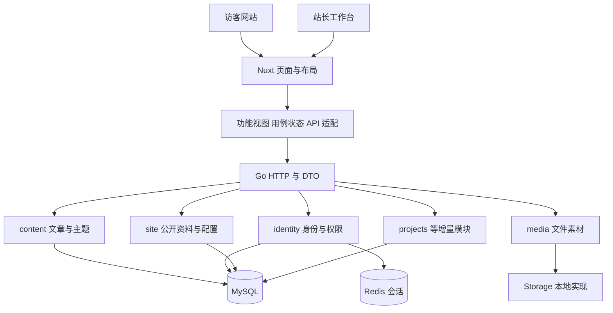

# Painter 个人博客架构分析与改造计划

> 2026-10-21 新要求的最终目标方案见 [Painter Next 新项目技术设计](next/TECHNICAL_DESIGN.md)：Go模块化单体、PostgreSQL、内嵌前端，取代此前Nuxt/MySQL/Redis渐进改造方向。本文保留原分析供追溯。

状态：规划，尚未实施。分析基于 2026 年 10 月 18 日的当前工作区。

## 1 目标与主要决策

Painter 的后续目标是一个可以长期维护的个人网站：**让访客认识站主、阅读内容和了解成果，让站主方便地创作与管理；增加新内容或更换展示方式时，改动集中在对应模块。**

现有代码包含多用户博客和社交关系，但本次规划以个人博客为主。默认产品结构收敛为“个人展示、内容阅读、站长工作台”，账号注册、关注、收藏等作为可选兼容能力保留。历史作者、文章和互动记录保持原有归属。

| 决策 | 采用的方案 | 原因 |
| --- | --- | --- |
| 技术栈 | 继续使用 Nuxt 3、Vue、Go、Gin、GORM、MySQL、Redis | 现有基础足以支持个人博客，优先解决职责和流程问题 |
| 架构形态 | 功能模块清晰的单体后端，公共网站和工作台共用一个 Nuxt 工程 | 控制个人维护成本，同时给内容扩展留出边界 |
| 实施方式 | 按完整用户流程逐条迁移，先修正确性，再拆职责和调整展示 | 每阶段可使用、可验证、可回退 |
| 默认用户任务 | 访客公开阅读，站长创作维护；读者账号可选 | 阅读不依赖注册，个人表达与内容优先 |
| 扩展方式 | 编译期接入功能模块；有限配置决定导航、首页区块、主题和启用状态 | 可增加功能，无需开发任意代码执行式插件平台 |
| 第一个扩展试点 | 项目展示，完成从后台录入到公开展示的整条流程 | 比增加空目录更能证明边界是否有效 |
| 路由演进 | 先保留文章 ID，规范为 `/articles/:id`；slug 后续按需增加 | 降低迁移成本，保持已有分享链接可达 |

本文件是后续目标架构与执行顺序。此前的 [接口清单](API_INVENTORY.md) 和 [产品功能分析](PRODUCT_MAP.md) 用于理解现状，其中的多用户社区描述不作为本轮建设目标。

## 2 当前前端是什么样

### 2.1 检查范围

已阅读页面、组件、布局、主题、API 和 store，并启动本地 Nuxt 开发服务。`/`、`/articleList`、`/login`、`/editarticle?type=2`、`/admin` 均返回 HTTP 200 的 HTML；这些响应未包含 title、description 或 Open Graph 元信息，文章列表首屏 HTML 只有页面框架。数据列表多数在浏览器挂载后请求。

本地后端没有启动，因此这次没有验收真实文章数据、登录或写入。浏览器通道不可用，以下外观判断来自模板、CSS 与实际 HTML，尚未完成桌面和移动端截图验收。HTTP 200 只说明页面能返回，不能代替业务流程验收。

本地安装版本为 Nuxt 3.13.2、Vue 3.5.11、Naive UI 2.40.1。先固定当前可复现基线；框架升级单独安排，不与本次架构迁移混在同一批变更中。

### 2.2 页面与外观分析

| 部分 | 当前形态 | 建议保留 | 改造方向 |
| --- | --- | --- | --- |
| 首页 | 三段接近整屏的滚动介绍，Painter 字样动画、站主标签及社交链接 | 个人表达、蓝色强调色、轻量动效 | 首屏即可看到站主简介和文章入口，下面展示最近文章；文案和链接配置化 |
| 页头 | 固定 60px 页头，文章、分类、标签，以及账号、主题、GitHub 图标 | 轻量导航、主题切换 | 默认导航为首页、文章、关于；分类标签放入文章页；补完整移动菜单 |
| 内容列表 | 浅色背景、圆角卡片，桌面两列，较窄屏单列；卡片固定约 155px 高 | 简洁卡片与摘要信息 | 内容长度决定高度或按明确行数截断，保证键盘链接操作和长标题可读 |
| 阅读页 | 大标题、元信息、Markdown、代码高亮和互动区 | Markdown 内容与基本阅读结构 | 建立正文阅读宽度、排版尺度、目录和图片规则；互动区按需启用 |
| 编辑器 | 标题摘要、正文与预览双栏，右侧分类标签和状态 | 已有编辑、预览、贴图和快捷工具 | 拆开编辑状态、保存发布、上传和呈现；明确未保存、保存中、失败和冲突状态 |
| 个人中心 | 资料、社交统计、头像上传和文章管理集中在一页 | 本人文章及草稿入口 | 站长使用独立工作台；读者个人空间保留为可选能力 |
| 管理页 | 四个管理页签共用公共页头页脚，子面板放在 pages 下 | 已有设置及分类标签管理 | 改为工作台布局；子面板移入功能目录，旧地址做兼容 |
| 主题与样式 | CSS 变量支持深浅色，Naive UI 另有主题覆盖；大量未 scoped 页面样式 | 现有蓝色、圆角、明暗主题基础 | 合并语义化 token，限定组件样式作用域，正文样式单独管理 |

依据：[首页](../painter-frontend-nuxt/pages/index.vue#L145)、[卡片](../painter-frontend-nuxt/components/article_card.vue)、[页头](../painter-frontend-nuxt/layouts/components/layout-header.vue#L89)、[公共布局](../painter-frontend-nuxt/layouts/default.vue)、[CSS 变量](../painter-frontend-nuxt/assets/main.css)、[编辑器](../painter-frontend-nuxt/pages/editarticle.vue)。

### 2.3 影响扩展的结构问题

| 问题 | 当前证据 | 增加功能时的代价 |
| --- | --- | --- |
| 页面承担过多职责 | 文章页 411 行、编辑器 546 行、个人中心 381 行，包含请求、状态、操作、模板和样式 | 修改保存或上传会牵动大页面，难以复用与验证 |
| 页面直接理解数据库形状 | 前端使用 ArticleTable、ArticleContentTable 等嵌套结构及 any 参数 | ORM 或接口字段调整直接影响展示组件 |
| 布局和业务入口耦合 | 默认布局挂载搜索与账号弹层，前台和管理界面共用 | 新增入口要反复修改公共壳，管理需求影响阅读体验 |
| 文章获取方式不一致 | 多数列表用 onMounted；文章 useAsyncData 修改外部 ref 且没有返回数据 | SSR、路由切换、缓存和错误态难以统一 |
| 配置边界不完整 | 首页身份和页脚硬编码；Axios 在模块级读取 VITE_BASE_API_URL | 更换站主或部署地址需要改代码或重新构建 |
| 数据访问路径重复 | 后端 models、repository、database/storage 并行；还有反射字段更新 | 新功能难以判断该复用哪一条存储路径 |
| 发布链与当前前端脱节 | Dockerfile、build.sh 仍构建后端内旧 server/static/webroot | 源码改对了，部署却可能仍发布旧前端 |

依据：[文章请求](../painter-frontend-nuxt/pages/article.vue#L78)、[请求封装](../painter-frontend-nuxt/apis/axios.ts)、[编辑器保存](../painter-frontend-nuxt/pages/editarticle.vue#L221)、[后端仓库注册](../painter-backend/database/repository/DB.go#L26)、[Dockerfile](../painter-backend/Dockerfile)、[构建脚本](../painter-backend/build.sh)。

## 3 个人博客的信息架构

### 3.1 面向访客

默认导航采用“首页、文章、关于”。搜索只有全链路可用后才显示；项目模块完成后再加入“项目”。分类、标签和归档作为文章发现方式，避免每种数据结构都占据一个一级入口。

| 页面 | 首期职责 | 可扩展位置 |
| --- | --- | --- |
| `/` | 站主姓名头像、简短介绍、文章入口、最近文章、社交链接 | 已启用模块提供的项目等首页区块，支持有限的排序与显隐 |
| `/articles` | 已发布文章、分页、分类标签筛选、搜索与明确空态 | 年份归档、专题；这些可复用公开文章读模型 |
| `/articles/:id` | 标题正文、作者日期、分类标签、目录、返回列表 | 相关内容、可选评论；保持正文为主体 |
| `/about` | 站主介绍、经历与联系方式 | 按真实需求扩展时间线 |
| `/projects` | 首个扩展试点交付后展示项目列表与详情 | 独立的数据与工作台管理，不塞入文章分类 |

保留历史文章的真实作者。个人定位不意味着把其他作者文章批量改为站主作品。

### 3.2 面向站长

工作台统一放在 `/studio`，使用独立布局，包含文章、分类标签、站点资料和必要设置。概览先展示草稿、最近编辑与发布情况，待统计口径修复后再添加访问指标。

首期编辑流程为“新建 → 返回确定 ID → 后续保存同一篇 → 发布或撤回”。保存、发布和删除都有明确结果。切页或关闭页面时提示未保存修改；多标签页覆盖用版本冲突反馈解决，不用最后一次静默覆盖。

默认站长身份需要显式关联现有账号，不能推断数据库第一位用户就是站主。现有多作者管理能力通过兼容模式保留；普通登录成员不应因为进入新地址就得到站长权限。

## 4 目标架构与依赖规则

采用模块化单体：后台仍是一个 Go 服务，前端仍是一个 Nuxt 工程。变化在于业务边界、接口和装配方式。



| 边界 | 责任 | 依赖限制 |
| --- | --- | --- |
| 页面与布局 | 路由、布局选择、组合功能视图 | 不写 SQL、上传实现或文章发布规则 |
| 前端 feature | 自己的视图、组件、composable、API 适配与类型 | 不深层引用其他 feature 的私有文件；确需协作只用公开入口 |
| shared | HTTP 基础、通用 UI、格式化和设计 token | 不反向依赖文章、项目等业务模块 |
| 后端 HTTP | 输入校验、principal、调用用例、HTTP 与 DTO 映射 | 不直接拼事务或返回 GORM row |
| 应用用例 | 授权、状态转换、事务范围和提交后操作 | 不依赖 gin.Context，不在事务中等待 SMTP、Redis 或文件上传 |
| 领域规则与仓储接口 | 内容规则和实际需要的窄接口 | 不建设一个接受任意表名列名的万能业务引擎 |
| 基础设施适配 | GORM、Storage、连接池、日志与迁移 | 通过接口接入，由组合根构造与注入 |

简单功能允许少量文件完成，不要求每个列表都复制四层对象。复杂规则放进领域对象，只读页面可直接使用专门的查询结果。

## 5 前端的可扩展结构

以下是目标目录示意，按迁移切片逐步建立；继续采用 Nuxt 3 当前目录约定。

```text
painter-frontend-nuxt/
  app.vue                         # 全局 provider，保持简短
  layouts/
    default.vue                   # 公共网站
    studio.vue                    # 站长工作台
    auth.vue                      # 登录等身份页面
  pages/
    index.vue                     # 路由薄包装，组合 feature 视图
    about.vue
    articles/index.vue
    articles/[id].vue
    studio/articles/index.vue
    studio/articles/new.vue
    studio/articles/[id].vue
    studio/settings.vue
    projects/                     # 扩展试点时新增
  features/
    site/                         # 首页、关于、公开站点资料与设置视图
    content/                      # 文章列表、阅读、编辑、主题管理
    identity/                     # 会话和当前用户能力
    media/                        # 上传与素材引用
    engagement/                   # 可选评论收藏等，迁移到时再建立
    projects/                     # 首个新增内容模块
  shared/
    api/                          # client、错误、分页、契约类型
    ui/                           # 导航、容器、空态、按钮等无业务组件
    styles/                       # token、排版和正文样式
    lib/                          # 日期、URL、Markdown 渲染等纯工具
  composables/                    # Nuxt 上下文相关的薄入口
  plugins/                        # 请求级客户端等 Nuxt 装配
  config/
    features.ts                   # 编译期模块装配与展示元信息
    theme.ts                      # 默认主题 token
  middleware/                     # 工作台访问引导，后端仍最终鉴权
```

每个 feature 按需要拥有 `api.ts`、`types.ts`、`composables/`、`components/`、`views/` 和 `index.ts`。只有跨模块使用的稳定能力从 `index.ts` 导出；避免建一个所有业务都往里放的 utils 或 stores 目录。

### 5.1 页面和状态

- 页面负责读取路由、选择布局并挂载视图。列表、详情与编辑的服务端数据由对应 composable 管理，表单内容留在编辑 feature 内。
- Pinia 只保存确需跨页面共享的会话、主题等状态，不再为每个接口建全局 store。服务端状态不能保存在跨请求共享的模块变量中。
- API 适配把旧 `ArticleTable/ArticleContentTable` 转为明确的 `PostSummary`、`PostDetail`、`PostEditor`。界面不接触字段大小写和历史嵌套差异。
- 路由参数变化需要重新取数；统一 loading、空态、404、临时错误和重试，不把请求失败显示为空列表。
- 按 Nuxt 3.13.2 的字符串 data key 与 watch 设计刷新：文章 ID 变化可通过 page key 重建，列表使用稳定的当前列表 key 配合筛选分页刷新；不照搬较新版响应式 key 语法，也不能把另一篇文章写入旧文章的缓存 key。
- 编辑状态至少包含未修改、已修改、保存中、已保存、保存失败与版本冲突。新建成功立即记录 ID 并转编辑态；发布操作接收当前保存版本。

### 5.2 SSR 与请求边界

公开文章、文章列表、关于和站点资料应在服务器返回的 HTML 中提供可读内容。Nuxt `useAsyncData/useFetch` 的 handler 返回可序列化数据，不通过修改外部 ref 代替返回；初次水合不重复获取同一资源。现有文章页需要修正的正是这一边界。[Nuxt 3.13.2 数据获取约定](https://raw.githubusercontent.com/nuxt/nuxt/v3.13.2/docs/3.api/2.composables/use-async-data.md)。

| 请求场景 | 目标方式 |
| --- | --- |
| 浏览器请求 Go API | 使用同域 `/api`，反向代理转到 Go；统一解析 HTTP 与业务错误 |
| Nuxt SSR 请求 Go API | 请求级 client 使用 server-only runtimeConfig 中的固定内部地址；不假设 Node 请求自动经过公网反向代理 |
| 公开正文与列表 | 不携带个人 cookie，只返回可公开数据；后续可按需求缓存 |
| 编辑、草稿预览和私有资料 SSR | 仅向受控 Go 内部地址转发必要会话信息，私有数据不进入公共缓存 |
| 本人点赞收藏等状态 | 与公共正文分开读取；界面增强不能污染共享 HTML 或缓存 |

运行时地址迁入 `runtimeConfig`，浏览器只获得公共 API 路径等公开字段；数据库、SMTP 和内部服务地址不放入 public 配置。认证 cookie 不转发至用户输入或第三方 URL。`withCredentials` 不能替代服务器请求时的 cookie 处理。[运行时配置](https://raw.githubusercontent.com/nuxt/nuxt/v3.13.2/docs/2.guide/3.going-further/10.runtime-config.md)、[SSR 请求头处理](https://raw.githubusercontent.com/nuxt/nuxt/v3.13.2/docs/1.getting-started/6.data-fetching.md)。

先实现正确且不共享缓存的 SSR。旧文章详情同时返回正文、个人互动状态并尝试写入阅读量，不能直接把整包缓存；后端拆出公开正文、个人状态与独立阅读事件后，再评估共享缓存。实际代理配置需覆盖开发和生产，不能只在图上假设 `/api` 已自动转发。

SSR 页面使用 Nuxt 的页面元信息能力生成 title、description、canonical 和分享信息；工作台及草稿预览设置不索引。旧地址重定向和不存在的公开文章需要真实 HTTP 状态码，不依赖客户端跳转或全站回首页。[Nuxt 3.13.2 页面元信息](https://raw.githubusercontent.com/nuxt/nuxt/v3.13.2/docs/1.getting-started/5.seo-meta.md)。

### 5.3 视觉系统

延续现有蓝色强调、圆角和深浅主题，先收敛规则，再调整各页。建立颜色、间距、圆角、字号、页面宽度和动效 token，CSS 变量与 Naive UI 配置从同一份语义定义映射，避免两套主题各自维护。

公共阅读页以语义 HTML 和轻量组件为主，Naive UI 保留为工作台表单、弹窗和管理列表的主要工具。文章正文统一由限定作用域的 prose 样式控制；Markdown 的目录锚点、中文标题、重复标题、图片、链接转义和代码高亮需一致验证。

移动端采用完整导航菜单与可单栏操作的编辑器。按 375、768、1440px 检查布局，兼顾长标题、长链接和代码块；链接与按钮可用键盘操作，焦点可见，动效遵从减少动态效果偏好。当前大面积未 scoped 样式逐页迁移，避免工作台样式影响正文。

## 6 后端与数据边界

### 6.1 模块职责

| 模块 | 拥有的数据和用例 | 稳定协作边界 |
| --- | --- | --- |
| content | 文章正文、元数据、分类标签、保存、发布、撤回、删除、公开查询 | 提供公开摘要与详情查询，不负责账号或文件落盘 |
| identity | 认证、会话、密码、当前身份与能力 | 向用例提供 typed principal 和权限判断 |
| site | 站点公开资料、导航区块配置、管理设置 | 公开配置与管理配置分开，不能把完整设置对象发给前台 |
| media | 媒体元数据、稳定 key、上传与存储实现 | 提供 Storage 接口；当前先实现本地存储 |
| engagement | 原有评论、赞、收藏、关注和历史 | 可选保留，不作为个人阅读和发布的前置依赖 |
| projects | 试点时新增的项目对象与工作流 | 自己的表、DTO、用例和路由；复用媒体与身份能力 |

```text
painter-backend/
  main.go                         # 保留当前入口，逐步收敛为显式装配
  internal/
    app/                          # 构造依赖，启动和停止，注册路由
    content/
      http/                       # handler 和 DTO
      application/                # 发布、保存、查询等用例
      domain/                     # 状态、所有权、可见性规则
      repository/                 # 使用方需要的窄接口与 GORM 适配
    identity/
    site/
    media/
    projects/                     # 试点阶段新增
    platform/                     # DB、事务辅助、配置、日志等薄设施
  server/                         # 未迁移路由与旧 API 适配
  database/                       # 未迁移存储路径，逐步缩小
  migrations/                     # 有版本的增量迁移
```

### 6.2 保存、发布和并发

先将文章作为第一条完整迁移切片。应用用例负责文章、正文、标签的同一个 MySQL 事务，返回 commit 错误；旧路由和新路由调用同一用例，不能各保留一套保存逻辑。

新建返回确定 ID；`Save` 保存内容，`SaveAndPublish` 原子保存并发布，`Unpublish` 撤回。公开读取统一要求已发布且未删除；作者编辑和预览走授权查询，且不增加公开阅读计数。多标签页用递增 version 做乐观并发控制，冲突返回 409 并保留用户本地未提交内容。

沿用现有两状态模型时，保存已发布文章即更新线上内容，工作台必须明确提示。若后续需要“编辑已发布文章但暂不影响线上”，再独立加入发布快照或 revision；本阶段不把当前版本号误称为已有完整版本历史或回滚能力。

### 6.3 收敛现有存储路径

`models/Mysql.go` 和 `database/repository` 是同库同表的重复 Go 表示，不是两套数据库。按用例选定私有 GORM row 与查询实现，适配原表名和列名；新功能停止新增反射式字段更新，旧 CRUD 暂时留给未迁移模块。

迁完一个用例，再删除其无人调用的旧路径。不要为了包名整洁复制表、双写或一次搬迁所有 86 个接口。正文与标签等约束变化先在备份副本盘点重复数据、明确处理规则，再增加约束，避免未经检查就上线唯一索引。

### 6.4 接口契约

先为迁移中的文章、身份和站点资料写明确 DTO 与契约样例。新接口采用 `/api/v1`，camelCase 字段，统一 `limit/offset/items/total`，限制最大页大小；输入错误、未登录、无权限、不可见资源、冲突分别有明确 HTTP 状态与稳定错误码。

建议新响应沿用熟悉的 `{ok, data, msg, code, requestId}` 形式，列表信息放在 data 内；字段是否存在由契约规定。前端 client 将非 2xx 和 `ok=false` 都转为统一错误。公开 DTO 不返回邮箱、权限组或 ORM 内部字段；编辑 DTO 与公开 DTO 分开。

旧 `/api/article/*` 等维持路径与旧 JSON 结构，由兼容适配转换为同一应用命令。可见性漏洞修复不受“保留旧行为”约束。生成类型可在契约稳定后加入，首期先集中维护有明确示例的类型；不同时增加 Axios、另一套查询库和第三套全局数据缓存。

### 6.5 配置、媒体与缓存

| 能力 | 首期方案 | 明确边界 |
| --- | --- | --- |
| SiteProfile | 展示名、头像、介绍、关于、社交链接、SEO 默认值、页脚与有限首页区块 | 与 User 登录资料分开；配置有类型和校验，不接受任意 JS 或模板代码 |
| 管理设置 | 注册、邮件等保留服务端私有 schema，分项更新 | 密码等字段不默认原文回显，未填写不能覆盖已有配置 |
| Storage | 小型接口加 local 实现，媒体记录稳定 key，URL 由统一根路径生成 | 未来接对象存储时替换适配，不重写文章编辑器 |
| 上传一致性 | 临时文件校验与原子改名，登记失败做补偿清理 | 文件与 MySQL 不承诺跨系统 ACID；旧 `/fs` 链接保留 |
| 缓存 | 查询正确后按测量需要缓存公开读模型，提交后失效 | 私有预览不缓存；认证会话失败不能降级为放行 |
| 发布后操作 | 先用提交后失效与短 TTL 补偿 | 不提前上消息队列；需要必须最终送达的通知时再做 outbox |

若启用公开缓存，第一版给出可配置的最大陈旧窗口，建议初始上限 60 秒；失效失败记录并重试，不能无限期返回旧发布内容。撤回、删除和可见性变更要求成功失效或暂时旁路缓存，不能接受“仍可公开一分钟”。只有打通这条链路后才启用共享页面缓存。

现有 Redis 仍承担会话，不能在迁移中直接称为完全可选；公开内容缓存可后置。稿件私密与图片私密也是不同需求：首期公共图片 URL 可直接读取，私有素材需要另行设计鉴权读取。

## 7 扩展能力怎样落地和验证

### 7.1 三种扩展点

1. **展示配置**：换站主、社交链接、主题色和首页区块顺序，通过有类型的配置完成。
2. **基础设施适配**：本地文件存储换对象存储、邮件发送实现变化，通过小型接口替换，文章规则不变。
3. **业务功能模块**：增加项目、短笔记或留言，各自拥有数据、用例和视图，通过组合根接入。

一个功能模块可声明公共导航、工作台菜单和首页区块。公共页头只渲染解析后的导航项，不写“如果启用了项目就再查项目表”的业务条件。Nuxt 路由仍由 pages 的薄包装生成，模块元信息不再建立另一套路由器。

首页只允许已注册的区块组件和有限排序，不建设任意页面搭建器。模块关闭时不挂载对应区块，也不发其数据请求；无内容时有明确的隐藏或空态规则。

### 7.2 开关与兼容策略

新安装默认个人模式、公开注册关闭。已有安装先读取当前配置并形成迁移预览，不静默关闭正在使用的能力或批量更改用户组。

| 开关行为 | 前端 | 后端与数据 |
| --- | --- | --- |
| 关闭公开注册 | 隐藏注册入口 | 拒绝新注册，已有账号仍可登录 |
| 关闭评论新增 | 去掉输入框，按设置保留历史评论 | 拒绝写入；是否展示历史是独立配置，不删除记录 |
| 社区入口不展示 | 公共导航不强调关注收藏和成员空间 | 保留历史数据与必要兼容路由；隐藏导航不等于撤销权限 |
| 项目模块停用 | 移除菜单与首页区块，不请求项目数据 | 对外访问按已定义停用策略返回 404，数据保留；私有访问仍需鉴权 |

开关需使用同一服务端配置来源，并在变更时使相关配置、页面与接口缓存失效。客户端篡改开关不能获得后台写入能力。

### 7.3 用项目展示验证边界

项目是本规划建议的第一个新增内容试点，尚不是已有功能。最小数据按实际需要取 `id/title/summary/body/cover/links/status/sortOrder`，需要友好 URL 时再给项目加入 slug。

验收时新增项目模块、薄路由页、迁移、契约和组合根注册项是正常集成改动；**不应修改公共 Header/Footer、文章保存用例或通用权限核心来插入项目特判**。

- [ ] 站长新建、编辑和发布项目，刷新后数据保留。
- [ ] 访客从项目页及启用的首页区块进入详情，草稿无法公开读取。
- [ ] 修改项目封面复用媒体能力，不复制上传逻辑。
- [ ] 停用模块后菜单、区块和请求消失，原有文章仍正常读写。
- [ ] 重新启用后原项目恢复，不靠重建或搬迁文章数据。
- [ ] 记录全部改动文件，检查是否跨越约定模块边界。

若这个试点仍需修改大量公共组件，应先修正边界，再考虑第三种内容。RSS、归档、sitemap 是公开内容的只读输出，通常无需新增一套发布系统；短笔记、友链、留言按真实使用需要逐项评估。

## 8 兼容迁移与部署

### 8.1 旧地址和数据

| 现有入口或资产 | 迁移方式 |
| --- | --- |
| `/article?id=42` | 兼容到 `/articles/42`；公开内容稳定后返回永久重定向，草稿不能借此绕过校验 |
| `/articleList` 与 `/articlelist` | 兼容到 `/articles`，明确处理两种拼写；映射 type/id 的分类、标签、作者筛选 |
| `/category`、`/tag` | 保留索引或映射到文章筛选，原 ID 保持有效 |
| 收藏列表 type=4 | 保留私有兼容语义，修正读取身份；不能把旧收藏悄悄当成站主精选 |
| `/dashboard` | 根据能力进入工作台或旧成员空间，不让所有成员进入站长后台 |
| `/editarticle?type=…&id=…` | 映射工作台新建或编辑，保留作者授权 |
| `/admin` 与 `/admin_*` | 映射对应工作台设置页；旧管理子面板不再作为新的公共页面维护 |
| `/user`、`/followList`、旧 `/follow` | 按既有用户与关系做兼容，个人模式可以移出主导航 |
| 旧 `/api` | 先留适配，统计调用点与完成契约回归后再讨论退役 |
| 文章、正文、用户及互动记录 | ID 和归属不变，不复制数据库、不全量双写 |
| `/fs/...`、debug `/f/...` 图片 | 提供一致的访问入口和旧路径别名；既有 Markdown 链接不因改布局失效 |

slug 若后续加入，使用唯一约束和旧 slug/ID 映射，改标题不自动破坏链接。永久重定向在服务端或代理层实现，丢失资源返回真实 404，不能用 SPA 首页回退代替。

### 8.2 构建与运行

目标发布结构为同一域名：页面交给 Nuxt Node 进程，`/api` 交给 Go，媒体进入统一路径。MySQL 和 Redis 为内部依赖，上传目录持久化。Nuxt SSR 产物不能继续按旧 Vite dist 的方式复制给 Go。

先更新发布路径指向根目录当前 Nuxt 工程，前后端产物绑定同一发布版本并使用锁文件安装。Node 和依赖版本以验证通过的基线固定，不保留 `vue/router=latest` 作为可重复部署的依赖策略。

后端启动按配置校验、依赖就绪、schema 版本检查、HTTP 和任务装配推进。当前并行启动和固定 sleep 改为显式依赖；任务可停止，服务优雅退出。ready 未就绪时用非 2xx，健康入口不依赖 debug cookie。[现有启动](../painter-backend/common/common.go)、[任务启动](../painter-backend/task/Task.go)、[健康路由](../painter-backend/server/Router.go#L179)。

### 8.3 迁移与回退

先盘点真实 schema、重复正文、索引和文件引用，再建立迁移基线。生产变更逐步从启动时 AutoMigrate 转为版本化部署步骤，采用“增加兼容结构 → 回填校验 → 切换调用 → 观察 → 后续清理”。MySQL DDL 不能按普通业务事务假定可自动回滚。

每次数据或媒体布局变更前备份数据库与媒体，并在独立环境恢复验证文章、作者、状态和图片。应用回退优先切回兼容 schema 的上一版产物；有新写入后不能直接恢复旧快照而忽略新数据。删除列或改写历史归属不放进首次架构切换。

## 9 分阶段实施计划

按依赖顺序推进，每阶段通过验收后可独立发布。以下是范围与完成条件，不预设未经评估的日历工期。

| 阶段 | 主要产出 | 完成条件 |
| --- | --- | --- |
| P0 建立基线 | 个人模式决策、当前页面与数据样例、兼容矩阵、可复现构建与备份 | 已知旧路径可追踪；隔离环境可恢复；当前 Nuxt 确为将要发布的前端 |
| P1 修复写作核心 | 身份、会话、持久化、内容可见性、连续保存和发布正确性 | 同一文章不重复创建；刷新可恢复；失败不误报；草稿仅授权访问；新旧 API 共用正确规则 |
| P2 建立模块边界 | content/site/identity/media 的首批切片，薄页面、DTO、独立布局和统一错误 | 编辑器不直接理解旧响应形状；已迁用例只有一条写入路径；业务失败可定位 |
| P3 形成个人网站 | 可配置首页关于页脚、公共阅读与工作台、SSR/SEO、移动导航、搜索和主题查询 | 不改代码可更换站主资料；HTML 有正文与元信息；访客不登录完成阅读；旧链接可达 |
| P4 验证真实扩展 | 项目模块、模块展示清单、首页区块与能力开关 | 后台录入到公开展示可用；模块停用再启用不丢数据；文章和公共核心无项目特判 |
| P5 发布与运行收尾 | 迁移演练、部署切换、恢复与回退、RSS/sitemap、统计校准 | 生产产物与源码对应；旧文章和图片抽检通过；发布回退演练可复现 |

### P0 可执行任务

- [ ] 在可用浏览器中记录首页、列表、阅读、编辑和管理界面，覆盖桌面与手机；补齐本次缺少的截图验收。
- [ ] 准备脱敏开发数据或明确标识的开发 fixture，覆盖长文、中文目录、图片、草稿、发布和旧作者。
- [ ] 固定依赖与构建命令，核对旧 webroot 与当前 Nuxt 的发布关系。
- [ ] 盘点 DB/schema/媒体，演练一次隔离恢复；形成旧 URL 与旧 API 的回归样例。
- [ ] 显式确认站长账号、现有成员兼容模式及公开注册策略，不自动批量改组。

### P1 可执行任务

- [ ] 修会话复用 cookie、改密、资料更新对象和事务提交问题，服务端执行注册开关。
- [ ] 统一公开列表、详情、主题及搜索的发布状态与计数口径，旧接口同样执行。
- [ ] 新建消费返回 ID，保存与发布按同一版本处理，commit 失败正确返回。
- [ ] 加入版本冲突和明确错误提示，失败保留编辑内容；补文章删除的受控入口。
- [ ] 用真实事务验证正文或标签保存失败时不产生部分更新，授权预览不记阅读量。

### P2 与 P3 可执行任务

- [ ] 首先迁移文章“读详情、保存、发布”这一条切片，再迁站点资料；不按文件类型整仓搬迁。
- [ ] 分离公共、工作台和认证布局，管理子面板移出 pages，保留旧路由适配。
- [ ] 建立 API client、DTO 适配和服务端读取 composable，处理路由切换与 SSR 请求身份边界。
- [ ] 建立 SiteProfile 表单与公开投影：首页、关于、页脚来自同一配置。
- [ ] 统一 token 和 Markdown 排版；修复中文目录锚点、图片链接渲染和高亮契约。
- [ ] 接通搜索端到端流程后显示入口，完善移动菜单、loading、错误与 404。
- [ ] 为公开页面输出元信息，补旧地址重定向；私有页面不索引、不共享缓存。

### P4 与 P5 可执行任务

- [ ] 按第 7 节完成项目试点，并检查实际改动边界。
- [ ] 统一媒体 key/URL 与失败补偿，演练容器重建后旧图片仍可读。
- [ ] 对齐新 Nuxt 与 Go 的构建发布、同域代理、启动停止和迁移执行步骤。
- [ ] RSS 与 sitemap 只输出已发布内容和规范 URL，发布、撤回后及时更新。
- [ ] 修正访客区间、提交与去重定义，再展示统计；不用未校准数字代替可靠性验收。
- [ ] 进行内容恢复和应用回退演练，输出本次升级的兼容报告。

## 10 验收矩阵与扩展完成标准

| 场景 | 必须得到的结果 |
| --- | --- |
| 访客关闭 JavaScript 打开已发布文章 | HTML 已有正文、标题与元信息，链接可用 |
| 新文章连续保存 | 一条文章、同一 ID，刷新后内容一致 |
| 保存失败或并发冲突 | 没有部分更新，不显示成功，用户输入仍在 |
| 草稿或撤回内容的旧地址、新地址、API、RSS | 都不能公开读取；授权预览可用且不计阅读数 |
| 已发布文章的保存 | 行为与界面说明一致，不虚假承诺版本回滚或发布快照 |
| 更新站主资料和主题 | 刷新、SSR 与客户端一致，不需修改组件源码 |
| 更换本地存储实现 | 文章用例和编辑器不变，旧媒体 URL 持续有效 |
| 登录、读者与站长的操作边界 | UI 引导正确，后端独立拒绝越权写入，不依赖隐藏按钮 |
| 新模块启用、停用、再启用 | 页面和请求按配置变化，数据保留，公共文章行为不变 |
| 数据备份恢复与上一版应用回退 | 内容、状态、作者和媒体可核对，没有未说明的数据损失 |

领域规则采用有意义的单元测试；事务、唯一约束和迁移使用隔离 MySQL 集成验证；旧新 JSON 使用契约验证；浏览器冒烟覆盖“登录 → 编辑 → 保存 → 发布 → 公开阅读”和旧链接。现有 CRUD DryRun 测试保留，但不能代替真实数据库提交与迁移验证。

架构扩展完成的判据是：站主改资料不改页面代码；增加项目时不修改文章核心；替换存储不修改编辑器；关闭社区入口不损坏文章和历史资产。目录数量、接口数量和抽象层数量不作为完成指标。

## 11 实施范围与后续候选

先完成可靠文章资产、可配置个人展示、统一工作台和一次真实扩展。微服务、运行时插件执行、多租户、任意内容 EAV、低代码页面搭建器及独立权限平台均不进入本路线。

短笔记、友链、留言、专题、订阅或社区增强在站主实际使用后逐项选择。每个候选都先回答“它服务什么任务、是否有独立数据和工作流、如何关闭、哪些历史链接必须保留”，再决定复用现有能力或新增模块。
