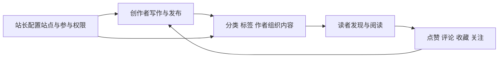
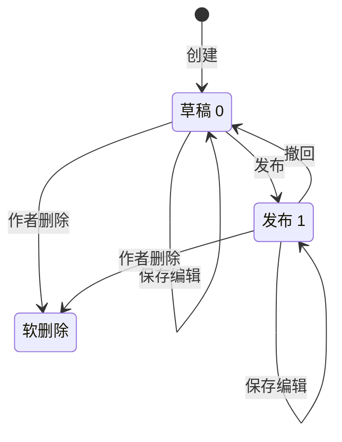

# Painter 产品功能与抽象

> 2026-10-21 新要求的最终目标方案见 [Painter Next 新项目技术设计](next/TECHNICAL_DESIGN.md)：Go模块化单体、PostgreSQL、内嵌前端，取代此前Nuxt/MySQL/Redis渐进改造方向。本文保留原分析供追溯。

本文记录现有功能与产品形态。后续建设以个人博客为主，目标架构、可扩展边界和实施顺序见 [个人博客架构分析与改造计划](PERSONAL_BLOG_ARCHITECTURE_PLAN.md)。

Painter 当前的产品形态是个人品牌主页、多作者 Markdown 博客、基础阅读互动和轻量站点后台。它可以重新表述为：**可自托管、支持多作者的轻量博客与内容社区，让创作者发布知识和日常，让读者发现、交流和积累内容，让站长组织内容及参与者。**

这一定位由现有功能推导。项目介绍强调创建和分享博客，首页同时展示站主个人身份与社区博客说明；文章按作者归属，账号权限允许多个成员创作。当前是一套站点中的多用户协作，没有多站点或组织工作区的产品模型。[项目介绍](../README.md)、[首页](../painter-frontend-nuxt/pages/index.vue#L170)、[文章模型](../painter-backend/models/Mysql.go#L118)。

完整的 11 组、86 个业务接口，以及健康检查、环境入口、未注册函数和前后端差异，见 [接口清单](API_INVENTORY.md)。下文的“已有实现”表示代码中有对应页面或处理逻辑；已发现的流程断点就近标明，尚未做运行环境验收。

## 用户价值与角色

产品的核心循环是：创作者发布内容，分类、标签和作者主页帮助读者发现，读者通过阅读和反馈建立连接，创作者据此继续创作。

这是产品希望形成的循环。当前关注关系还没有动态或通知承接，收藏列表也有查询缺陷，持续回访环节尚未完整。

| 产品角色 | 要完成的任务 | 对应条件与边界 |
| --- | --- | --- |
| 访客 | 发现文章、阅读正文、查看作者和主题 | 公开浏览，不需要注册 |
| 成员与读者 | 建立个人身份、点赞评论、收藏文章、关注作者 | 登录后互动；发表评论另需评论权限 |
| 创作者 | 写作、存草稿、发布、维护自己的文章、查看反馈 | 登录且具备文章权限；作者是文章所有权关系，并非独立账号类型 |
| 站长与管理员 | 配置站点、维护分类标签、授予成员权限 | 具备管理权限；现有后台没有全站内容审核和评论治理 |

### 权限名称需要统一

| 组 ID | 后端名称 | 前端管理页名称 | 初始化权限 |
| --- | --- | --- | --- |
| 1 | 管理员 | 管理员 | 管理、文章、评论 |
| 2 | 普通用户 | 创作者 | 文章、评论 |
| 3 | 限制用户 | 普通用户 | 评论 |

前后端的组名表达不同，但权限按同一组 ID 执行。组 3 只是没有文章权限，仍可评论及使用其他仅检查登录的功能，不能解释为封禁账号。管理员也没有通过现有文章编辑接口修改任意他人文章的特权。

注册目前创建 `UserGroup=0` 的账号，没有自动进入上述任何一组，因此默认没有文章和评论权限，但仍可阅读、点赞、收藏和关注。新成员的默认参与能力应成为明确的产品规则。前端则向所有登录用户展示写作入口，可能出现进入编辑器后才被拒绝的情况。实际授权依据是 `UserGroup → group_rule`，不是遗留的 `AdminFlag` 字段。[权限初始化](../painter-backend/database/repository/Rule.go#L12)、[后端判断](../painter-backend/database/Rule.go#L27)、[前端名称](../painter-frontend-nuxt/pages/admin_user.vue#L86)、[注册建用户](../painter-backend/database/User.go#L30)。

## 四个产品领域

按用户任务组织产品，比按 API 文件或数据库表组织更容易明确入口、权限和交付边界。

| 产品领域 | 用户目标 | 当前功能点 | 当前完成情况 |
| --- | --- | --- | --- |
| 内容发现与阅读交流 | 找到内容、理解内容并表达反馈 | 最近更新文章流；分类、标签、作者筛选；分页；Markdown 阅读与代码高亮；文章赞、评论及评论赞 | 有页面与接口；搜索为空入口，标签文章查询有缺陷，评论删除反馈与部分统计不正确 |
| 创作与发布 | 把知识和日常整理成可传播的内容 | 标题、摘要、Markdown 正文；单分类、多标签；编辑、预览和双栏；快捷工具、Tab、快捷保存；粘贴图片；草稿、发布与撤回；个人文章管理 | 有编辑器与状态接口；首次发布、连续保存、草稿可见性及删除入口尚需补齐 |
| 个人积累与社交连接 | 保存有用内容、连接作者、维护个人身份 | 注册登录、资料与头像；个人主页；收藏；关注和粉丝；个人文章及累计阅读；阅读历史接口 | 资料保存有缺陷；收藏文章查询和关注列表入口有断点；历史无页面且首次记录失败 |
| 站点运营 | 决定站点呈现、内容组织和成员参与规则 | 站点名、ICP、GitHub；注册与邮件设置；分类标签创建修改；用户列表与组分配；基础访客采集 | 后台有四个管理页签；无站内管理入口；注册开关未在服务端执行，访客指标待校准 |

账号会话、权限规则、图片文件和站点公共配置是支撑四个领域的基础能力。它们的价值应通过登录、创作和运营流程体现，无需成为独立的用户导航模块。

### 现有页面地图

Nuxt 的 `pages` 下共有 16 个页面文件，其中四个管理子页既被 `/admin` 引用，也因文件位置形成独立路由。

| 页面路径 | 产品用途 | 入口与限制 |
| --- | --- | --- |
| `/` | 品牌介绍与站主展示 | Logo 进入；身份文案和社交链接硬编码；获取的站点统计未在模板展示 |
| `/articleList` | 时间、分类、标签、作者或收藏文章列表 | `type=1/2/3/4` 对应分类、标签、作者、收藏；缺省为时间流 |
| `/category` | 分类索引及文章数 | 顶部分类入口 |
| `/tag` | 标签索引及文章数 | 顶部标签入口 |
| `/article?id=…` | 正文阅读、作者主题跳转、文章和评论互动 | 文章卡片进入 |
| `/user?id=…` | 作者主页、公开文章、关注操作 | 作者头像昵称进入 |
| `/login` | 邮箱或用户名密码登录、可选邮件验证 | 忘记密码仅占位；无手机号登录界面 |
| `/register` | 邮箱、用户名、密码分步骤注册 | 注册开关仅前端限制；配置异步加载还存在时序风险 |
| `/dashboard` | 个人资料、头像、创作概览和文章管理 | 列出本人所有状态的文章，可找回草稿；无筛选、分页或删除操作 |
| `/editarticle?type=1或2&id=…` | 编辑或新建文章 | 个人中心进入；角色入口未按权限收敛 |
| `/followList?type=1或2` | 我的关注或粉丝 | 当前导航误跳 `/follow`；请求按登录用户查询，URL 中 id 不决定列表归属 |
| `/admin` | 站点管理容器 | 校验管理员，但无站内导航入口 |
| `/admin_base` | 基本信息与邮件配置 | 管理容器的基础信息页签 |
| `/admin_category` | 分类创建与修改 | 管理容器的类别设置页签 |
| `/admin_tag` | 标签创建与修改 | 管理容器的标签设置页签 |
| `/admin_user` | 用户列表与角色分配 | 管理容器的用户设置页签 |

全局还提供浅色、深色和跟随系统主题，并保存在本地。较窄屏幕隐藏了分类和标签文本导航，尚无对应移动菜单。[主题逻辑](../painter-frontend-nuxt/stores/theme.ts)、[页头](../painter-frontend-nuxt/layouts/components/layout-header.vue)。

## 核心产品对象

| 产品对象 | 业务意义 | 关系与边界 |
| --- | --- | --- |
| 站点 | 内容与成员共同参与的空间 | 配置品牌、注册、邮件和展示信息；首页与页脚尚未完全配置化 |
| 用户 | 读者身份和创作主体 | 一个权限组；可拥有多篇文章和多条互动记录 |
| 文章 | 产品的核心内容资产 | 一个作者、一份正文、一个分类、多个标签；有状态与阅读反馈 |
| 主题 | 帮助发现和组织内容 | 由分类和标签承担；分类是文章的单选归属，标签是多选关联 |
| 反馈 | 表达认可或交流观点 | 文章点赞、平铺评论、评论点赞；`dislike` 是取消评论赞 |
| 个人积累 | 保存自己的阅读兴趣和足迹 | 收藏是用户与文章的关系；历史记录访问时间，二者没有收藏夹或笔记对象 |
| 关注关系 | 连接读者和作者 | 用户之间的有向关系；当前没有关注动态、更新订阅或通知 |
| 文件素材 | 支撑头像和文章贴图 | 本地上传文件；没有个人素材库、归属管理、列表或删除流程 |

文章元数据和正文分表、点赞和标签各自建关联表，是实现方式。产品上仍应把它们视为一篇完整文章及其组织和反馈，而不是要求用户理解多种技术对象。[数据模型](../painter-backend/models/Mysql.go)、[文章详情响应](../painter-backend/models/APIs/Response/Article.go)。

### 文章生命周期

创建接口固定保存草稿。编辑和发布是不同操作，统一更新接口不会顺带修改状态。删除接口采用软删除，但前端没有删除操作，也没有回收站或恢复接口。模型注释中的隐藏、限制、封禁没有活动状态转换接口，不能作为已交付的内容治理流程。

个人中心通过 `/user/self/full` 获取所有本人文章，因此能找回草稿；另一个 `/article/get/self` 分页接口只列已发布文章，两者口径不一致。公开文章详情未按发布状态或作者身份校验可见性，草稿状态尚未形成可靠访问边界。[个人中心数据](../painter-backend/database/User.go#L250)、[分页列表](../painter-backend/server/api/Article.go#L348)、[详情读取](../painter-backend/database/Article.go#L406)。

## 五条核心用户流程

| 用户流程 | 当前路径 | 主要断点 |
| --- | --- | --- |
| 加入站点 | 注册 → 登录 → 进入个人中心 | 注册无默认权限组；注册开关只在前端；已有会话复用时密码登录不重新写 cookie |
| 发现与阅读 | 文章流或主题 → 列表 → 正文 → 作者或相关主题 | 搜索未接通；标签查询失败；作者列表数量与已发布列表口径不一致 |
| 创作与发布 | 个人中心 → 新建 → 保存草稿 → 回个人中心 → 再次编辑 → 发布 | 新建时状态选择被忽略；未使用新文章 ID 切换编辑态，连续保存可能重复创建；更新失败仍可能显示成功 |
| 阅读后的积累与连接 | 阅读 → 点赞评论或收藏 → 关注作者 → 回个人中心查看 | 收藏列表的参数和查询错误；关注粉丝入口断链；互动失败缺少回滚，首次历史无法创建 |
| 维护站点 | 直接访问管理页 → 配置站点 → 维护主题 → 分配权限组 | 管理入口缺失；角色名称不同；资料与统计不能直接按成功回包认定生效；缺少内容治理 |

### 登录的产品语义

界面在邮件服务启用时先检查密码，再发送验证码并提交 `mailcheck`。但后端 `mailcheck` 实际只依赖邮箱和验证码即可登录已有账号，并不依赖前一步密码检查。因此可以描述为“支持邮箱验证码登录”，不能将当前实现定义为服务端强制的密码加验证码双因素认证。手机号登录路由被注释，忘记密码没有实际流程。[登录页面](../painter-frontend-nuxt/pages/login.vue#L109)、[验证码登录](../painter-backend/server/api/User.go#L567)。

### 内容发布的产品语义

目前能够通过“新建草稿后再次编辑”发布文章，但新建页的发布选择不会生效。新建成功后编辑器也没有保存返回 ID 或退出新建模式；重复快捷保存可能产生多篇草稿。修复应围绕同一篇文章持续保存和状态转换来验收，而不是只验证创建接口返回成功。[创建流程](../painter-frontend-nuxt/pages/editarticle.vue#L240)、[编辑流程](../painter-frontend-nuxt/pages/editarticle.vue#L221)。

## 功能交付边界

| 能力 | 当前应如何描述 |
| --- | --- |
| 搜索 | 有搜索外观及接口定义，尚未形成可用功能：界面无提交，前后端方法不一致，后端 SQL 也有缺陷 |
| 收藏 | 有文章收藏及取消操作；收藏文章列表需修复，没有收藏夹 |
| 评论 | 有平铺评论、删除本人评论和赞；没有回复树、编辑、通知、举报或审核 |
| 关注 | 有关注关系与列表实现；导航需修复，没有关注内容流 |
| 历史 | 有历史查询接口和自动记录意图；首次写入失败，无阅读足迹页面 |
| 内容治理 | 主要是作者编辑与软删除；没有全站文章评论管理、审核或举报处理 |
| 成员管理 | 可以切换固定权限组；没有自定义权限编辑、用户删除或完整封禁流程 |
| 文件 | 登录后可上传至本地，最大 10 MiB；没有云存储、素材库或文件生命周期管理 |
| 运营统计 | 有文章阅读数和访客采集；首页未展示聚合统计，没有运营看板，口径和实现仍需校准 |
| 通用站点框架 | 站点名等可设置，但首页身份、外链和页脚仍有个人硬编码 |

统计采集按 UA 加 IP 每日去重，更接近访客估计，不能称为 PV。日期查询区间反向，访客入库事务未提交；打开已有文章的编辑页也会读取详情并尝试增加阅读量，本地 Markdown 预览本身不计数。因此现有数值尚不能作为增长或内容效果的可靠依据。[访客采集](../painter-backend/cache/Visitor.go#L17)、[统计查询](../painter-backend/database/Visitor.go#L21)、[详情阅读数](../painter-backend/database/Article.go#L406)。

## 建议的信息架构

后续产品入口可以按四个领域收敛，账号与权限控制入口可见性。

| 一级入口 | 二级内容 | 主要角色 |
| --- | --- | --- |
| 首页 | 站点介绍、精选或最近内容入口 | 所有人；精选是后续设计选择，当前没有精选机制 |
| 发现 | 最近更新、分类、标签、搜索 | 所有人 |
| 我的空间 | 收藏、关注与粉丝、阅读足迹、个人资料 | 登录成员 |
| 创作台 | 新建、草稿、已发布、文章管理与反馈 | 具备文章权限的成员 |
| 站点管理 | 基本设置、主题管理、成员权限 | 管理员 |

文章详情和作者主页承担内容与人物之间的连接。创作台应与当前兼有资料、统计和写作入口的个人中心分清任务；一篇文章的保存、发布、撤回和删除应放在一致的位置。管理子页适合作为管理区域内部页面，而不是与公共内容平级的独立入口。

## 建议的推进顺序与验收结果

优先将已有核心流程做成可靠结果，再决定社区能力的扩展范围。

| 顺序 | 工作范围 | 产品验收结果 |
| --- | --- | --- |
| P0 核心流程可靠 | 默认权限组与角色文案；注册开关服务端执行；会话登录；资料持久化与改密；新建保存和首次发布；草稿可见性 | 新成员获得明确能力；重新登录真正建立会话；修改后刷新仍保留；连续保存始终更新同一篇文章；发布后可发现，草稿仅本人可读 |
| P1 补齐现有入口 | 搜索全链路；标签与收藏文章查询；关注粉丝路由；文章删除；评论删除反馈；管理入口；互动失败反馈 | 已展示的入口都能完成对应任务；错误不会被显示成成功；本人内容和关系可以查看与撤销 |
| P2 明确留存与运营范围 | 历史写入与页面；统计口径；品牌配置和移动导航；按社区目标选择通知、回复、关注动态或内容治理 | 成员能再次找到内容；站长知道内容与成员的实际活跃情况；新增功能有明确服务的用户任务 |

密码找回应作为独立身份恢复流程设计，不能直接把当前“输入旧密码改密”的接口接上菜单就算完成。内容审核、通知、回复和动态也需要先确定站点的参与规模与管理方式，避免只有接口或界面而没有对应规则。

### 建议追踪的产品指标

| 目标 | 指标建议 | 所需定义 |
| --- | --- | --- |
| 创作顺畅 | 首次发布成功率、重复草稿率 | 一次创作会话及首次成功发布事件 |
| 内容有价值 | 获得有效阅读或反馈的已发布文章数 | 排除作者预览，定义有效阅读及去重方式 |
| 阅读形成积累 | 收藏后再次阅读比例 | 收藏事件与后续阅读事件关联 |
| 创作者持续参与 | 周期内再次发布的作者比例 | 活跃作者和观察周期 |
| 站点运行可靠 | 登录、保存、发布与互动失败率 | 同时记录 HTTP 和业务 ok 结果 |

这些是后续埋点与验收的指标建议，当前代码尚未提供完整计算链路。接口数和页面数用于理解实现范围，不作为产品成熟度指标。
