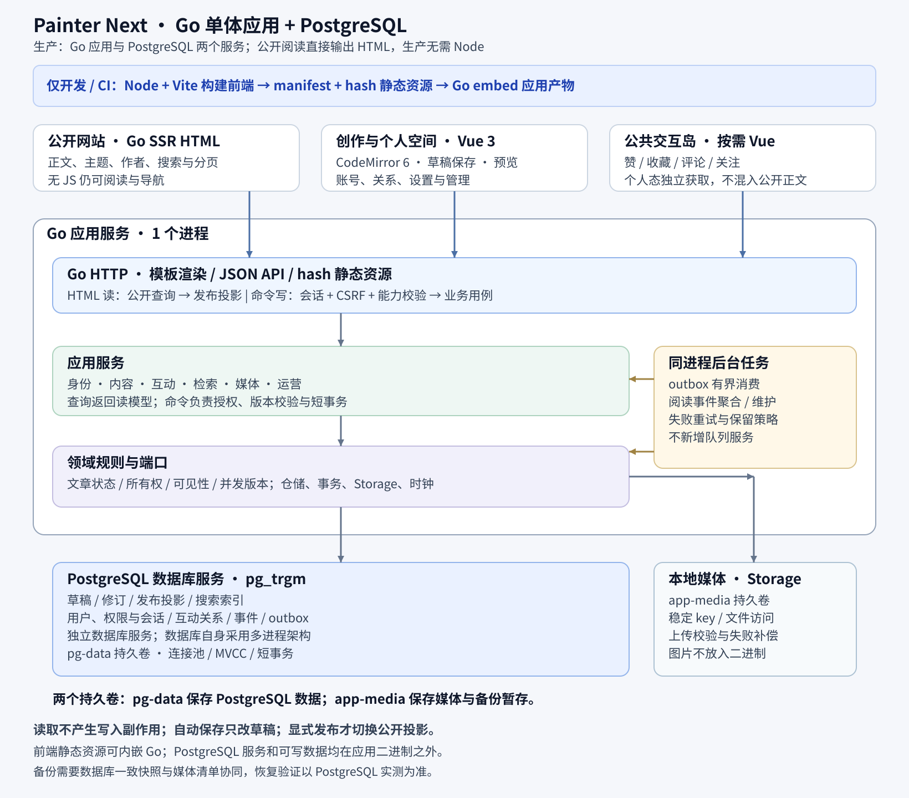

# 新架构原始设计基线

本目录保留 Go 模块化单体、PostgreSQL 18、前端嵌入、草稿与公开修订隔离、事务锁序、幂等、媒体状态机和事件处理的原始设计，供理解技术取舍及历史 API 语义。它不是当前产品说明，也不是部署或验收记录。

**当前事实以仓库根 [migrations](../../migrations)、[实现架构](../ARCHITECTURE.md)、实际代码及功能合同为准。** 原始设计中的表数、路由、GitHub-only 身份方案、资源目标和待实现项不代表当前表结构、能力范围或交付状态。当前认证与内容功能可查阅 [账号安全](../ACCOUNT_SECURITY.md)、[OIDC 接入](../IDENTITY_PROVIDER.md)、[专栏与分享](../SERIALS_AND_SHARING.md) 和 [内容卡片合同](../CONTENT_CARDS_V24.md)。

保留内容：

- [技术设计](TECHNICAL_DESIGN.md)：原始分层、事务、数据与可靠性决策。
- [API 与事件合同](API_CONTRACT.md)：原始请求、权限、错误、版本和事件语义。
- [初始 schema](schema.sql)：与原始方案配套的独立 DDL，不能用于升级当前部署。
- [设计检查项](DESIGN_CHECKLIST.md)：从旧实施计划保留的并发反例、迁移和恢复原则，不包含过期排期。
- [隔离验证工具](validation/README.md)：仅针对此历史 schema 与底层驱动能力；不验证当前应用迁移或 HTTP 功能。

历史执行报告、机器输出与发布过程记录不随本设计基线保留。需要验证当前版本时，使用根模块测试和显式的可丢弃 PostgreSQL 测试库，不以本目录脚本代替当前集成测试。
