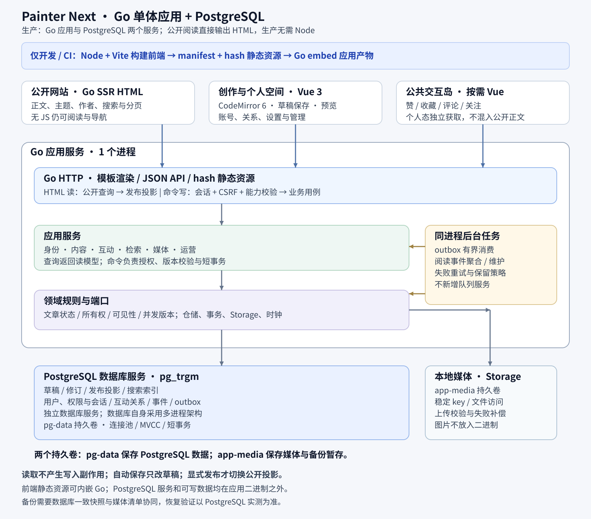
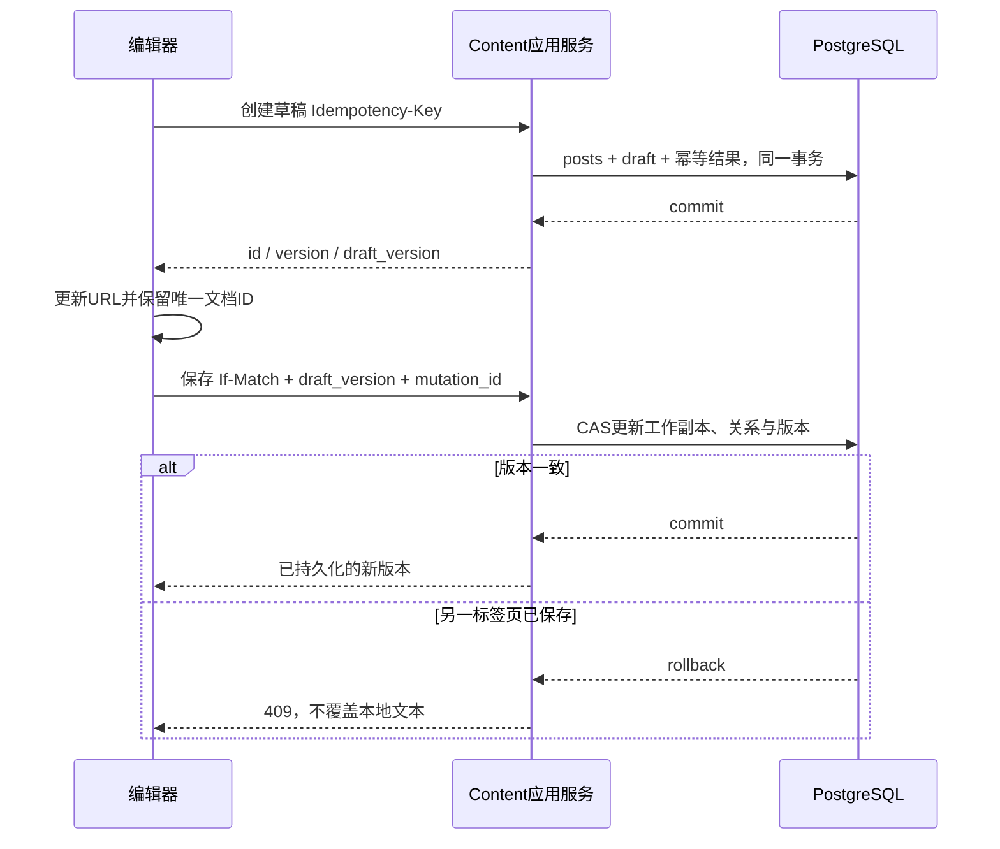
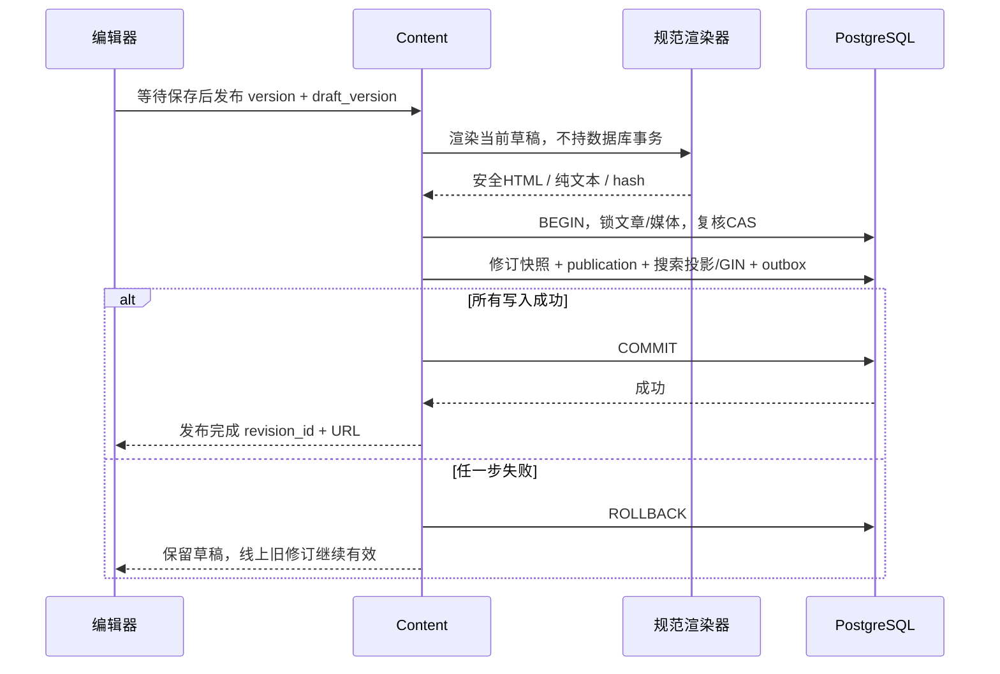
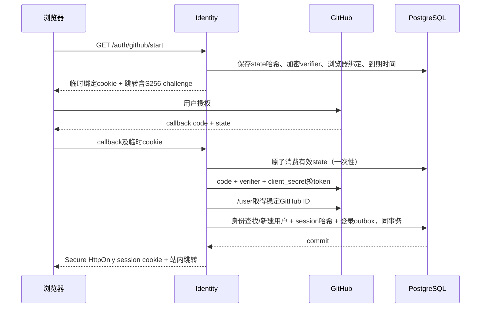
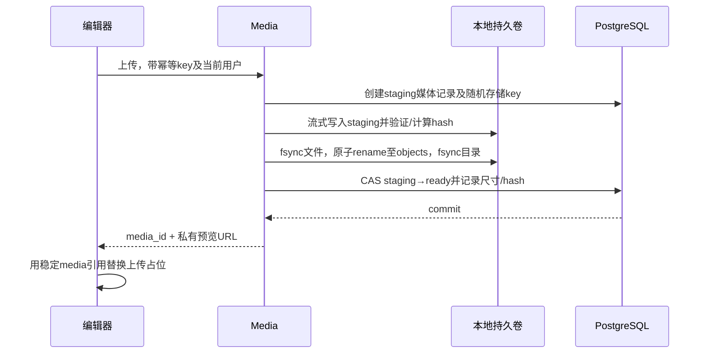
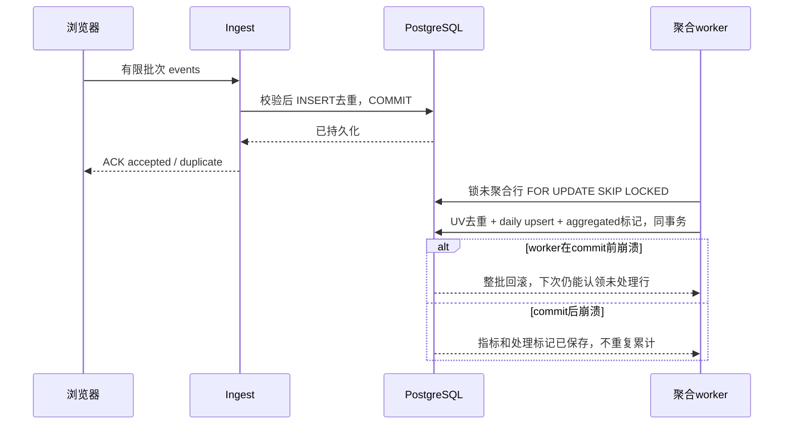

# Painter Next：新项目技术方案与全链路数据架构

版本：原始设计稿 1.1 · 2026-10-21。用于理解初始方案的技术决策。

**这是历史设计基线。表结构以根 [migrations](../../migrations) 为准，当前实现以 [实现架构](../ARCHITECTURE.md) 与对应功能合同为准。本文中的首期、待实现、表数和资源目标均不表示当前交付状态。**

**硬约束：禁止使用 SQLite，开发、测试和生产数据库统一采用 PostgreSQL。**

**决策：新建独立项目，用 Go 模块化单体 + PostgreSQL 18 + Go 服务端渲染公开页面 + Vue 3 后台。** Vue、编辑器和样式在 CI 构建后嵌入 Go；应用交付一个可执行文件或一个应用容器，数据库是另一个独立服务。生产不需要 Node、Redis 或外置搜索服务。首期只接 GitHub 登录，保留身份提供方扩展接口。公开页面采用克制的 Liquid Glass 视觉，编辑器升级为 CodeMirror 6。

本文替代旧文档中“继续在 Nuxt + Go + MySQL + Redis 上渐进改造”的目标方案。旧项目继续作为功能、内容和迁移数据来源。本文保留原始方案语义，不记录后续开发、部署与验收结果。

配套文件：

- [接口与事件契约](API_CONTRACT.md)：路由、权限、请求、错误、幂等和埋点定义。
- [初始数据库 DDL](schema.sql)：明确字段、外键、唯一约束、索引、公开检索投影。
- [设计检查项](DESIGN_CHECKLIST.md)：保留的并发反例、功能保护、迁移及恢复原则。
- [分层架构图](architecture.svg)。
- 旧项目证据：原仓库的 `docs/API_INVENTORY.md`（86 个业务接口）与 `docs/PRODUCT_MAP.md`（产品功能地图）保留在旧架构 Git 历史中；新架构分支仅保留本设计基线。

## 1. 为什么这样选

### 1.1 原始方案的产品背景

现有产品不是只有文章列表：还包含个人品牌首页、多作者、分类标签、Markdown 创作、草稿、文章赞、评论及评论赞、收藏、关注粉丝、资料头像、个人中心、权限分配、站点设置和基础访问统计。旧功能清单以代码为证据，尚未全部通过真实运行环境验收。

当前 Nuxt 页面、Go API、MySQL、Redis 分别运行；现有 Docker 构建还指向旧前端目录。前端存在客户端挂载后取正文、搜索未接通、窄屏导航缺失等问题。数据层存在草稿详情缺少可见性校验、保存和发布时序不完整、关系查询和统计口径有缺陷等问题。新项目保留产品能力，修复这些流程，不把旧缺陷当作兼容要求。

本次没有完成新版界面的截图验收。现状前端结论来自页面源码及此前 HTTP 页面检查；新视觉方案需要在实施阶段产出可操作页面再验收。

### 1.2 三种方案的同口径比较

| 方案 | 生产运行组件 | 优点 | 代价 | 决策 |
| --- | --- | --- | --- | --- |
| 集成式 Node 全栈 + PostgreSQL | Node 应用 + PostgreSQL | 全 TypeScript，页面与编辑器生态统一 | 依赖 Node 运行时；资源与后台任务仍需实测 | 可行备选，本次不选 |
| Go SSR + Vue 构建产物 + PostgreSQL | 一个 Go 应用 + 一个 PostgreSQL 服务 | 前后端同源、单应用交付；事务与扩展能力明确；无需单独搜索服务 | 需要维护数据库；公开模板和后台组件需共享视觉规范 | **采用** |
| Go SSR + Vue 构建产物 + MySQL | 一个 Go 应用 + 一个 MySQL 服务 | 旧库团队经验与迁移工具可复用 | 中文短词搜索需另一套索引策略；事务、DDL、驱动需要独立实现验证 | 不作为当前落地方案 |

这是按部署组件、维护成本和用户约束作出的工程选择，不是完成性能对比后的结论。应用保持模块化单体，PostgreSQL 独立承担持久化；不能把“两种服务”写成“整站只有一个进程”。PostgreSQL 18 当前受支持，设计核查时的维护版为 18.6；实施时固定当时受支持的补丁及镜像 digest。[官方版本支持表](https://www.postgresql.org/support/versioning/)。

### 1.3 固定技术栈

| 层 | 明确选型 | 约定 |
| --- | --- | --- |
| 应用运行时 | Go 1.26 系列，锁定受支持安全补丁 | CI 固定工具链；升级后重跑驱动、迁移、渲染回归 |
| HTTP / SSR | 标准库 `net/http`、`http.ServeMux`、`html/template` | 同源 `/api/v1`；公开页 Go 模板；不引入框架级反射模型 |
| 后台与交互 | Vue 3、TypeScript、Vite | 后台 SPA；公开页只在评论、搜索、互动等位置按需挂载交互岛 |
| 数据库 | PostgreSQL 18，Go `pgx/v5 v5.11.0` + `pgxpool` | 显式 SQL、版本化迁移；原生外键 / JSONB / BYTEA；无 ORM 自动建表 |
| 搜索 | PostgreSQL 官方 `pg_trgm` 扩展 + GIN + 短词字面扫描 | 只索引发布快照；UTF8 与 Unicode LC_CTYPE；中文行为见检索章节 |
| Markdown | CodeMirror 6 编辑；Go goldmark 规范渲染 + bluemonday 白名单净化 | 原文是事实；预览与发布复用同一服务端渲染器 |
| 样式 | 原生 CSS 变量、共享 token、局部 Liquid Glass | 不依赖常驻 WebGL、背景视频或整页模糊 |
| 身份 | GitHub OAuth App，Authorization Code + PKCE S256 | 本地 opaque session；不以 GitHub access token 充当站点会话 |
| 后台任务 | 同进程有界 worker + PostgreSQL outbox / 持久任务状态 | 无 Redis、Kafka、独立 cron 服务要求 |
| 媒体 | 本机持久目录；通过 `MediaStore` 端口访问 | 首期本地实现；将来可加 S3 适配器，不改变文章引用 ID |
| 交付 | 多阶段 CI 构建，`go:embed` 内嵌模板与带 hash 的资产 | Linux amd64 / arm64 分别产出，`CGO_ENABLED=0` |

Go 的 `embed.FS` 可供 HTTP 文件服务及模板使用；Vite 官方支持通过 manifest 与后端集成，这两项能力使“构建用 Node、运行只用 Go”成立。[Go embed](https://pkg.go.dev/embed)、[Vite 后端集成](https://vite.dev/guide/backend-integration.html)。

`pgxpool` 是 PostgreSQL 驱动的连接池；事务必须显式 `Commit` / `Rollback`，不能假定请求 context 取消会自动完成回滚。应用设有限连接池和查询超时，依赖版本在实施仓库锁定。[pgxpool 官方文档](https://pkg.go.dev/github.com/jackc/pgx/v5/pgxpool)。

## 2. 范围与功能继承

| 产品能力 | 新版首个可替换旧站版本 | 处理方式 |
| --- | --- | --- |
| 品牌首页、站点介绍、社交链接、ICP | 保留并配置化 | 不再把站主资料写死在组件里 |
| 文章流、详情、作者、分类、标签、分页 | 保留 | SSR；列表和计数统一只读发布快照 |
| 浅色 / 深色 / 跟随系统、移动导航 | 保留并完善 | 统一 token；菜单在窄屏仍可到达 |
| 标题、摘要、单分类、多标签、Markdown、代码高亮、图片 | 保留并升级 | CodeMirror 6；规范预览；附件按引用控制权限 |
| 创建、自动保存、草稿找回、发布、撤回、删除 | 保留并补齐 | 编辑工作副本与线上修订分离；加版本恢复与回收站 |
| 个人中心、头像、昵称、公开主页、多作者 | 保留 | 个人博客为默认，多作者仍受角色授权 |
| 点赞、评论、评论赞、收藏、关注、粉丝、历史 | 保留 | 明确幂等关系与私有列表权限；历史补可用页面 |
| 管理员、作者、读者、分类标签和设置维护 | 保留 | 统一角色名与资源归属；站长有明确审核权 |
| 访问统计 | 保留能力并重新定义 | PV、估算 UV、有效阅读、业务事实分开；旧口径单独展示 |
| 邮箱 / 用户名密码 / 邮件验证码登录、注册页 | **按本次要求替换** | GitHub 一键登录；不迁移密码作为新站凭据 |
| 邮件配置 | 作为通知适配器配置迁移 | 首期没有 SMTP 运行依赖；旧非敏感配置可导入，密钥需重新配置 |
| 站内搜索 | 本次新增必交付 | 全文检索、分类标签作者过滤、排序、分页、空态 |
| 埋点、编辑恢复、基础评论治理、SEO、RSS / sitemap | 本次补齐 | 是新站可用闭环，不以未来版本占位 |
| 评论树、通知中心、关注动态流、项目集、短文、外部搜索 | 后续扩展 | 本次不宣称旧站已有；扩展点保留，不阻塞核心上线 |

登录成功的新成员默认 `reader`，可以点赞、收藏、关注和评论；写作需 `author` 或 `owner`。封禁状态独立于角色。站点的 `registration_enabled=false` 表示不接纳新的 GitHub 身份，已存在用户仍可登录。

## 3. 分层与模块边界



### 3.1 运行视图

浏览器公开页请求进入 Go SSR，后台和交互岛调用同源 API；两者都调用同一应用服务。应用服务在单个 PostgreSQL 事务中修改事实及必要投影，提交后返回。媒体字节进入本地持久目录，后台任务负责统计聚合、清理、备份和 outbox 消费。构建系统不在生产请求链路中。

### 3.2 依赖方向

| 层 | 职责 | 禁止的依赖 |
| --- | --- | --- |
| 接入层 `transport` / `web` | HTTP 解析、DTO、cookie、CSRF、SSR ViewModel、错误映射 | 不写 SQL，不决定发布和计数规则 |
| 应用层 `app` | 用例编排、权限、事务、幂等、审计、时序 | 不依赖 Vue、HTTP context、具体文件路径 |
| 领域层 `domain` | 发布规则、角色策略、内容状态、事件类型、端口 | 不依赖数据库驱动和网络 SDK |
| 适配层 `adapters` | 显式 SQL、GitHub、磁盘媒体、渲染器、时钟 | 不反向调用 handler，不越过应用层修改其他领域 |
| 装配层 `cmd/painter` | 配置、迁移、连接池、模块注册、生命周期 | 不堆积业务逻辑 |

采用模块化单体，不采用微服务。模块内可以具体调用，跨模块通过小接口和类型化命令；需要强一致的内容、标签、媒体引用、公开投影共享同一 `UnitOfWork`。Repository 接受事务执行器，不能在一个事务内偷偷借用全局 DB，避免跨越事务快照或在有限连接池内自我等待。

### 3.3 业务模块与数据所有权

| 模块 | 唯一写入责任 | 对外契约 |
| --- | --- | --- |
| Identity | 用户、提供方身份、OAuth 临时状态、会话、角色 | `CurrentPrincipal`、`Authorize`、`IdentityProvider` |
| Content | 文章身份、工作副本、不可变修订、发布指针、分类标签 | `SaveDraft`、`PublishRevision`、`Unpublish`、`ReadPublished` |
| Interaction | 评论、赞、收藏、关注、阅读历史 | 显式 set / remove 命令；不提供 toggle 写接口 |
| Media | 上传状态、文件对象、修订引用、公开授权判断 | `Upload`、`ResolveForReader`、`ResolveForEditor`、`MediaStore` |
| Search | 公开搜索投影及查询 | 内容模块通过事务内索引端口更新；禁止异步旧事件重新公开已撤回文章 |
| Analytics | 接收的遥测、去重、聚合、统计查询 | `IngestBatch`、`Aggregate`；不决定业务是否成功 |
| Site / Operations | 类型化设置、审计、任务、迁移、备份 | 受限管理 API、健康和运维命令 |

扩展时新增领域模块、迁移和契约。例如项目展示新增 `projects` 表及页面，不把全部内容塞到 JSON/EAV 万能表；增加 Google 登录只实现 `IdentityProvider`；媒体切 S3 只更换存储适配器。PostgreSQL 是本次唯一落地数据库。未来换数据库必须另写 SQL、索引与迁移实现并双跑校验；端口隔离不代表换一个配置即可无损切库。

### 3.4 建议的新仓库

```text
painter-next/
  cmd/painter/                 # serve / migrate / import-legacy / backup / restore-check
  internal/
    identity/{domain,app,adapters,transport}/
    content/{domain,app,adapters,transport}/
    interaction/ media/ search/ analytics/ site/
    platform/{db,clock,crypto,observability,jobs}/
  web/
    templates/                 # Go公开页模板
    frontend/{admin,islands,editor,styles,generated}/
    dist/                      # CI生成，Go embed输入
  migrations/                 # 递增、显式、带checksum
  contracts/openapi.yaml       # 实施时按本文契约落地并生成TS类型
  deploy/{Dockerfile,compose.yaml,painter.service}/
  docs/ tests/{integration,e2e,migration}/
```

建议独立 Git 仓库或同级目录启动，不在旧目录内混用两套运行代码。新旧站通过导入器和 URL 映射连接；不会通过复制整个旧 Repository 层继承历史耦合。

## 4. 数据规则与数据库基础

### 4.1 所有写入共同遵守的规则

1. 时间统一写 UTC Unix 毫秒（BIGINT），统计日键用原生 DATE，布尔字段用 BOOLEAN，结构化数据 JSONB、加密字节 BYTEA；报表日界线显式使用 `Asia/Shanghai`，不依赖服务器本地时区。客户端时间只作辅助，服务端接收时间决定统计归属。
2. 公开 API 使用不可猜测性不作为授权。所有资源读取仍验证公开状态、会话、角色和所有权。
3. 用户、文章和主题 ID 用 `BIGINT GENERATED BY DEFAULT AS IDENTITY`；媒体、修订、事件用随机 TEXT ID；HTTP ID 一律序列化为字符串，避免前端整数精度问题。旧文章 ID 尽量保留，其他资源用导入映射。
4. 关系表以联合唯一约束保障一次关系；`PUT` 表示存在、`DELETE` 表示不存在，不用重试会反转状态的 toggle。
5. 每个命令最终只有一次提交；必须检查 `COMMIT` 结果。只有提交成功才回成功、发 session cookie 或清除编辑器“未保存”状态。
6. 外部 HTTP、文件解码、Markdown 渲染在写事务外完成；事务内再校验版本、权限及附件 ready 状态。外部网络不能占用数据库行锁和连接。
7. 公开页面、搜索、RSS、sitemap、作者文章数统一读取发布投影；编辑器只读工作副本和修订。不能“按 ID 查到文章就返回”。

### 4.2 PostgreSQL 连接、一致性与并发

首期固定一个 Go 应用实例和一个 PostgreSQL 18 服务，同机部署即可；也支持指向已有 PostgreSQL。应用 `pgxpool` 初始 `MaxConns=4 / MinConns=0`，后台任务初始只有一个 worker，避免任务占满连接。数据库 `max_connections=20` 是低配起点，预留迁移、备份和运维连接；不是吞吐承诺。每笔事务 `defer Rollback`，提交后回滚返回已结束可忽略；业务不能持有事务等待外部网络。

数据库必须为 `UTF8` 且 `LC_CTYPE=C.UTF-8` 或经过验证的 Unicode locale；搜索列使用确定性 `pg_c_utf8` collation，迁移启用 `pg_trgm`。**UTF8 编码或单独列 collation 并不替代数据库字符分类**：本次隔离实测 `LC_CTYPE=C` 的库不能提取中文 trigram，而 `C.UTF-8` 可以。初始化时从 `template0` 建符合条件的库，启动执行 `show_trgm('中文搜索测试')` 探针；为空拒绝 readiness，并给出重建数据库指引，不静默退回另一种数据库。

默认隔离级别 `READ COMMITTED`；它不自动串行所有业务。内容修改、撤回、互动写入先锁定相应 `posts` 行，再检查当前 publication、权限和 CAS。一次请求涉及多个用户、文章或媒体时，各集合按 ID 升序获取锁；统一顺序为：必要的站点 / 成员管理屏障 → 用户 → 文章 → 评论 / 分类标签 → 媒体 → 关系 / 投影。只需要某个后级资源的 GC 不反向加文章锁。成员权限和开关变更与命令校验使用兼容的共享 / 排他行锁；不能先无锁读到旧权限，随后直接写入。站长变更通过同一个管理屏障串行，再校验“至少一个有效 owner”。公开只读查询使用短事务；不为每篇阅读加排他锁。[PostgreSQL 行锁与死锁规则](https://www.postgresql.org/docs/18/explicit-locking.html)。

`If-Match` / draft CAS 和唯一约束继续保留；行锁负责互斥，版本负责拒绝过时用户意图，二者不能互相替代。新建资源时还没有可锁行，用联合唯一键和 `INSERT ... ON CONFLICT` 协调；先获得幂等命令的事务级锁，再读取 / 写入结果，幂等锁在任何业务行锁之前取得。相同 key 不同请求 hash 返回 `409`。SQLSTATE `40P01` / `40001` 可在确定事务已回滚时有限次重试整笔命令，并重做授权和版本检查；锁等待 / 连接池超限返回可重试 `503 WRITE_BUSY`。网络断开导致 COMMIT 结果不明时，通过同一幂等键查明，不直接用新 key 重发。

初始会话配置为 `lock_timeout=1s`、业务 `statement_timeout=3s`、`idle_in_transaction_session_timeout=5s`；搜索另设 500 ms deadline，备份 / 迁移用独立配置。保持 `fsync`、`synchronous_commit`、`full_page_writes` 开启；低资源通过连接数、查询和任务批量控制，不通过关闭耐久参数实现。运行角色仅有必要业务 DML / 受限函数权限，无建库、扩展安装、DDL、TRUNCATE 或禁用触发器权限；迁移角色独立保管。

冷启动：校验配置及媒体目录 → 等待 DB 可连接 → 迁移命令取得固定 advisory lock 并核对 checksum → 迁移 / 校验 schema、locale、扩展和中文探针 → 打开应用池 → 注册模块 → 启动 worker → readiness 成功。升级前备份是部署步骤；不能每次容器重启都重复整库备份。首次部署由安装流程建库 / 迁移，普通应用账号不自动获得管理权限。

### 4.3 内容的数据模型

**文章身份、工作副本、不可变修订、当前发布版本必须是不同概念。**

- `posts` 保存稳定文章 ID、作者、生命周期和乐观锁版本；这是授权及发布状态的入口。首期规范路径固定为 `/posts/{id}`，不因改标题改变链接。
- 工作副本保存最近确认的可编辑内容，自动保存只更新工作副本。
- 不可变修订保存一次明确内容快照及其分类、标签和媒体引用；历史恢复是生成新工作副本，不覆盖旧修订。
- 发布指针选择一个完整修订；公开投影保存该修订的安全 HTML、纯文本和展示信息。发布后继续写草稿，线上文章保持上一次发布内容。

精确表名、列类型与约束以 [schema.sql](schema.sql) 为准；后续章节按其对应实体解释。不能只改 `status` 就发布一份未保存或附件未完成的文章。

### 4.4 关键不变量

| 不变量 | 保证位置 |
| --- | --- |
| 一个 OAuth 身份只能属于一个本地账号 | 身份联合唯一约束 + 登录事务 |
| 一篇文章只有一个工作副本，发布修订必须属于该文章 | 主键 / 组合外键 + 应用校验 |
| 修订创建后不可原地编辑 | 写路径只 INSERT；数据库触发器或应用不变式验证 |
| 发布页、搜索和主题列表不出现草稿 | 公开投影存在性 + 发布状态 join；事务内撤销投影 |
| 自动保存不改变线上正文 | 工作副本与发布指针分离 |
| 多标签、文章赞、评论赞、收藏、关注不重复 | 联合主键 / 唯一索引 |
| 不允许自己关注自己 | CHECK + 应用规则 |
| 审核删除后不能继续新增评论 / 点赞 | 先取得文章及相关权限行锁，再读取当前状态 |
| 文件不存在或未 ready 不能发布 | 发布时校验媒体状态；磁盘补偿与巡检 |
| 服务端业务事件与业务状态同生共死 | 事实变更 + outbox 同一事务 |
| 遥测接收成功后可恢复处理，报表不重复累计 | 持久化确认 + event_id 去重 + 指标及待处理标记原子提交 |

### 4.5 完整表目录与查询边界

下列38个业务及运维表属于本历史基线配套 DDL，并非当前应用表数；GIN 是普通索引，不额外创建 FTS 虚拟表。所有具体字段、CHECK、FK和索引见schema.sql，不依靠ORM自动推断。

| 表 | 主键 / 关键约束与用途 |
| --- | --- |
| schema_migrations / policy_barrier | 迁移version及checksum；单例权限屏障version，普通命令共享锁 / 管理命令排他锁 |
| users | id；username唯一、资料version；私有email/phone不作身份键 |
| oauth_accounts / oauth_states / sessions | provider+issuer+subject唯一；一次state哈希/密文verifier；session哈希与独立management_id |
| site_profile / site_settings | id固定1、version；品牌/ICP和受限配置分开 |
| categories / tags | id、name唯一；归档标记，引用不硬删 |
| posts | id；author+client_draft_id唯一；聚合version、软删除 |
| post_drafts / post_draft_tags / post_draft_media_refs | 每文一工作副本及去重标签/图片关系 |
| post_revisions / post_revision_tags / post_revision_media_refs | 修订ID、逐文revision_no唯一；原文/安全HTML/TOC/hash/渲染版本及封存关系 |
| post_publications | post_id唯一；(post_id,revision_id)组合FK，不能跨文发布 |
| search_state / search_documents | 单例generation；每文当前公开检索文档；三个规范化字段的GIN trigram索引；由publication事务驱动 |
| media_assets / media_aliases | 随机ID、storage_key唯一；状态/hash/归属；旧路径映射 |
| comments / comment_likes / post_likes | 评论状态与正文；去重赞关系；按公开文章与visible评论查询 |
| bookmarks / follows / reading_history | 用户文章收藏、非自关注、本人文章最近访问；联合唯一 |
| idempotency_keys | actor+operation+key；请求hash、成功响应及到期时间 |
| outbox / outbox_consumptions / business_daily | 提交事件、consumer+event去重账本、事实日报；处理与计数同事务 |
| audit_logs / legacy_counters | 类型化审计；旧口径/来源/批次与新指标隔离 |
| analytics_events / analytics_daily / analytics_scope_visitors / analytics_rollup_state | raw自增seq与双重去重；待聚合标记；site/post日表和UV集合；进度仅作诊断 |

`public_posts`是只读视图，只join当前发布指针及不可变修订。普通公开DTO从该视图安全字段构建；原文即使存于视图，也不意味着任何公开接口自动序列化全部列。事实表与投影的写入责任不可混用。

## 5. 写入与发布：最重要的业务时序

### 5.1 新建、自动保存和修订

新建文章先以 `Idempotency-Key` 创建唯一 `posts + post_drafts`，取得 ID 后立即把编辑器切换为已有文章地址。客户端在收到响应前重试同一 key，得到同一文章，解决旧版连续快捷保存生成重复草稿的问题。

首次创建不带 `If-Match`；后续创作命令带 `If-Match`，其值是 `posts.version`。自动保存同时带 `draft_version`；成功响应返回两者。保存、检查点、发布、撤回、删除和恢复都会增加文章聚合版本，赞和阅读不增加该版本。`client_draft_id` 按作者长期唯一，创建响应丢失且超过幂等窗时，仍可据此查回同一文章。

自动保存的服务端处理顺序为：验证登录和作者权限 → 校验字段及请求体大小 → 事务内按锁顺序取得权限和文章行锁，确认文章未删除、角色未撤销、版本一致 → 更新工作副本和标签 / 媒体引用 → 增加版本 → 写幂等结果 → 提交。冲突返回 `409 VERSION_CONFLICT`，包含最新版本及获取地址，不做后写覆盖。

自动保存仅更新可变工作副本。手动保存、发布和显式“创建检查点”才生成完整不可变修订；避免每两秒保存一份全文修订。首期修订全量保留；幂等键避免请求重试产生重复快照。以后增加修订清理时，必须同时设计快照子表、媒体引用、审计和恢复策略，不能直接定时 DELETE。后台显示修订数量和占用，支持 Markdown 导出。



### 5.2 发布的原子边界

点击发布先停止自动保存调度、等待当前保存完成、保存尚未确认的修改，再以明确的 `draft_version` 发发布命令。客户端不能仅把下拉框改成“公开”便显示发布成功。

1. 应用服务读取工作副本，在事务外执行统一 Markdown 渲染、净化、纯文本提取、目录和摘要计算。输入大小上限 1 MiB；超限 `413`。生成内容 hash 与 `renderer_version`。
2. `BEGIN`，取得权限屏障及文章 `FOR UPDATE` 行锁后重新读取工作副本；检查 `If-Match`、`draft_version`、作者资格、分类标签仍存在、所有媒体 ready。渲染期间发生修改则 `409`，此次 HTML 不进入库。
3. 写不可变正文修订、分类标签和媒体引用快照；只有完整快照才可被发布指针引用。DDL采用快照子行先插入、修订父行最后插入，再由延迟外键在commit校验的封存方式；父行存在后不能再追加/改动子快照。实现必须按该顺序使用显式SQL。
4. 写 / 替换 `post_publications`；发布投影和 PostgreSQL GIN 索引在同一事务更新。增加聚合版本，写 `post.published.v1` outbox 和审计 / 幂等结果。
5. 检查提交结果，成功后返回 `revision_id`、版本及文章 URL。读者随后的新请求即可读取同一发布修订，搜索同步可见。



公开列表、详情和搜索只 join 当前 `post_publications`。已经发布的文章继续自动保存时，不更新它。撤回与软删除必须在同一事务删除发布指针、公开投影及其索引项，并写事件；公开读取被撤回 / 删除资源返回统一 `404`，作者在后台仍可找回内容。

首期不缓存可撤回的整页 HTML，不在 CDN 缓存文章 HTML 或需要可撤销授权的媒体；仅带 hash 的构建资产长期缓存。否则“数据库已撤回”不等于“公开 CDN 已撤回”。以后增加页面缓存必须连同失效与可接受泄露窗口重新设计。

### 5.3 编辑冲突、重复发布和历史恢复

| 场景 | 确定行为 |
| --- | --- |
| 自动保存与发布同时到达 | 客户端串行；服务端仍以 CAS 保底，失败的一方重新读取并由用户决定 |
| 已提交但响应丢失 | 相同 Idempotency-Key 返回原结果，不再创建文章 / 修订 / 业务事件 |
| 同一 key 携带不同正文 | `409 IDEMPOTENCY_KEY_REUSED`；记录 hash，不悄悄接受 |
| 两台设备编辑同一文章 | 第二次提交 `409`，展示本地和服务器差异，可复制 / 合并后重新保存 |
| 发布请求重复 | 相同 key 重放同一 revision；不同 key 但内容与当前发布完全相同可返回已有修订，仍检查 CAS |
| 恢复旧版本 | 把旧修订复制为新工作副本并增加版本；不自动上线；再次发布生成新修订 |
| 管理员撤回作者文章 | 明确审核权限，写原因及审计；作者随后保存因聚合版本变化收到冲突 |
| 文章进入回收站 | 工作副本和修订保留；恢复为草稿，不自行重新公开；首期不自动物理清除历史内容 |

幂等记录按 `actor + route + key` 隔离，默认保留 7 天；支持重放的是这个窗口内的同一请求。客户端超过窗口先查询资源状态再重试，不能假定永久 exactly-once。幂等查找在事务内先于 CAS；但已失效账号仍需拒绝，授权不可由旧结果绕过。

### 5.4 分类和标签的时序

一篇文章一个分类、多个标签；草稿关系和修订关系分开。分类 / 标签 ID 是稳定引用，修订保留当时名称用于历史比对。公开主题筛选按 ID；站长重命名主题时，公开导航显示最新名称，历史修订仍显示快照名称。检索首期覆盖文章标题、摘要、正文，不把主题名称复制成一份会过期的搜索事实；主题过滤独立执行。

已被使用的分类标签不能硬删除；管理 API 返回 `409 IN_USE`，先迁移引用或归档。合并主题是专门事务及后台批处理命令，不通过修改历史修订偷换归属。草稿保存时验证标签集合去重，发布时再次验证归档状态。

## 6. GitHub 登录、会话和旧账号归属

### 6.1 身份模型

本地用户是内容和权限主体，外部身份是登录方式。唯一键为 `(provider, issuer, subject)`；GitHub `subject` 使用 `/user` 返回的稳定数值 `id` 的字符串表示，不能使用可改名的 `login` 或邮件。

GitHub OAuth App 的当前官方流程支持 PKCE，且仅支持 `S256`；Web 兑换流程仍按其契约提供 client secret。只为登录读取公开 `/user`，首期不申请 `repo`、`user:email` 或离线访问；access token 用于取得身份后立即丢弃，不存入浏览器或业务数据库。[GitHub OAuth 流程](https://docs.github.com/en/apps/oauth-apps/building-oauth-apps/authorizing-oauth-apps)、[获取已认证用户](https://docs.github.com/en/rest/users/users#get-the-authenticated-user)。

### 6.2 登录时序



state 10 分钟到期，原始值不进日志；浏览器绑定防止把别人的回调拿来登录。callback 在外部请求前将 state 标为已消费；兑换失败或进程崩溃后重新开始登录，不能重新使用同一个 code / state。`return_to` 仅允许站内相对路径，阻断开放重定向。

首次创建账号和绑定身份在一个事务中完成；同身份事务级锁与唯一约束协调并发回调，竞争失败时整笔回滚并重新查询，不能留下无身份孤儿账号；账号封禁、关闭新用户注册、角色校验以事务内结果为准。首次站长只允许配置中的 `OWNER_GITHUB_ID` 对应身份取得 owner，且这一受限初始化可在成员注册关闭时完成；其余新身份仍被拒绝。绝不采用“第一个登录的人就是管理员”。至少保留一个有效 owner；角色变更先取得成员管理屏障再锁目标用户，不能让两个事务各自看到另一个 owner 而一起降权。转移站长先提升已验证继任者再降权原 owner，在同一事务完成并写审计。

### 6.3 会话与请求边界

session 为 CSPRNG 生成的至少 256 bit 随机 opaque token，数据库只存 SHA-256 哈希；绝不将 JWT 权限快照长时间留在浏览器。会话固定最长 30 天，闲置 7 天失效；`last_seen` 每 15 分钟最多写一次，避免每次读请求都写数据库。登录 / 权限提升时轮换 token，退出删除当前会话，封禁或高风险权限变更撤销相关会话。

cookie 使用 `HttpOnly; Secure; SameSite=Lax; Path=/`，生产要求 HTTPS。所有 cookie 会话写 API 验证允许的 Origin 和与 session 绑定的 CSRF token，不能把 OAuth state 当成后续写 API 的 CSRF token。代理头只信任显式代理地址，不接受任意 `X-Forwarded-Host` 决定回调域名。

### 6.4 旧用户迁移

导入旧账号资料、文章归属和互动，但不复制密码作为新版可登录凭据。既有身份数据中没有可信 GitHub ID，不能根据同名、GitHub 用户名字符串或相同 email 自动合并。

站主在迁移前通过管理员操作核对旧账号与 GitHub ID 并生成映射；其他成员经已核验的归属流程，由 owner 发放单次短期认领凭据，再在本人完成 GitHub 登录后绑定。绑定事务检查身份和旧账号都没有被他人认领，失败不移动内容。未认领账号保留历史作者与评论显示，禁止凭公开信息抢占。

未来增加其他登录提供方无需改变文章外键。账号绑定需要当前会话重新认证及新提供方回调，解绑后必须至少有一种可用登录方式。

## 7. 媒体：磁盘与数据库如何保持一致

### 7.1 写入流程

文件默认上限 10 MiB，首期允许 JPEG / PNG / WebP / GIF；验证真实内容及像素限制，生成安全预览尺寸。不直接内联用户 SVG / HTML。文件名仅用于展示，物理路径由服务端生成，不能拼接用户输入。



数据库和文件系统不能形成同一个 ACID 事务，必须承认并处理间隙。staging 超过 1 小时由清理任务检查：临时文件删除；对象存在但记录未 ready 时核验 hash 后完成或隔离。ready 记录的文件丢失时保留引用和元数据，读取返回存储错误并报警，从备份恢复对象，不把被引用对象改成failed后清除。新发布在渲染准备阶段验证文件存在及hash，缺失则拒绝。对象 key 不复用，引用不可变对象，避免替换图片时读到半份内容。只有 ready 对象能进入发布修订。

上传后还没有文章引用的文件不是永久素材；未引用对象保留 7 天。工作副本、任意保留修订、站点图片及当前头像都保护对象不被 GC；软删除文章并不释放其历史图片。首期只清理完全无引用的对象。GC 先标记候选，延时后取得媒体行锁，在锁内重新查询所有保护引用，无引用才将状态提交为 deleting。新增草稿 / 修订 / 头像 / 站点引用也先锁同一媒体行并要求 ready，因此与 GC 的决定互斥；不能只做一次无锁 NOT EXISTS。数据库提交 deleting 后再删除磁盘对象并提交 deleted，失败任务可重放。GC 不在持锁期间做磁盘 I/O；已进入 deleting 的对象不接受新引用。

### 7.2 公开与私有读取

Markdown 存储稳定的 `/media/{id}` 引用，不存机器绝对路径。预览访问要求所有权 / 编辑授权；公开访问要求该媒体被当前发布修订或公开头像引用。撤回文章时，若对象不再被任何公开内容引用，下一次媒体请求即失去公开资格。随机 URL 不构成草稿图片授权。

受授权控制的媒体统一经 Go 处理授权后流式返回，使用 `Cache-Control: private, no-store`；已发布也不直接暴露整个 `objects/` 静态目录。共享对象仍可能因另一个公开引用而公开，编辑器需提示公开引用状态。未来允许公开 CDN 时必须选择并说明撤回窗口，不能无条件承诺即时撤销。

头像更换先准备 ready 对象，再在资料更新事务中替换头像引用；失败保留原头像。用户资料修改不能按请求中的 user_id 写入其他人资料。

## 8. 检索：可用的中文全文搜索

### 8.1 索引内容与写入

`search_documents` 只保存当前发布修订的标题、摘要、规范化纯文本及 revision ID。publication 变更由数据库触发器同步投影，三个规范化文本字段各有 `GIN (... gin_trgm_ops)`；PostgreSQL 自动维护索引，应用不另写一份外置索引。公开查询仍 join 当前 publication。撤回、软删除在同一事务移除投影并推进 `search_state.generation`，避免结果数、摘要和高亮泄露私有内容。

首期搜索标题、摘要、正文，不索引评论和私人收藏；过滤作者 ID、分类 ID、标签 ID。相关性是明确的字面匹配评分：各词标题命中数降序 → 摘要命中数降序 → 正文命中数降序 → 发布时间降序 → ID 降序。用户选择最近发布时只按发布时间、ID 排序。首期不声称实现语言分词或 BM25，`pg_trgm` 的 similarity 也不冒充全文相关性。分页游标绑定查询 hash，查询变化重新开始。

### 8.2 中文、短词和特殊字符的确定行为

全文搜索采用 Unicode 规范化后的子串语义，而非默认 PostgreSQL 英文词干分词。迁移安装官方 `pg_trgm`；其 GIN 支持 `LIKE` / `ILIKE`，但无可提取 trigram 的模式可能退化为全索引扫描。中文是否能提取 trigram 还依赖数据库字符分类，必须满足第4.2节的 UTF8 / `LC_CTYPE` 初始化和中文探针要求。**不能承诺“任意三个字符都一定走索引”**。[pg_trgm 官方说明](https://www.postgresql.org/docs/18/pgtrgm.html)。

索引和查询共用同一 Go 函数：NFKC → Unicode case fold → 再次NFKC → Unicode空白压缩并去重分词（查询）。使用固定版 golang.org/x/text，规范化版本纳入renderer_version与索引重建版本；不按数据库默认 collation 猜测大小写行为。查询最多 64 个 Unicode 字符、8 个空白分隔词，各词 AND，每词在 title / summary / body 三个字段内 OR。查询参数始终绑定；不得拼 SQL。长度 ≥3 的词使用转义字面 `LIKE $pattern ESCAPE '!'`：依次把 `!`、`%`、`_` 转为 `!!`、`!%`、`!_`，再包首尾`%`；反斜线作为普通参数字符；1～2 字符用 `strpos(field, $n)>0`。`Go 中文` 两词都为短词，`Go 并发编程` 是长词索引候选再过滤 `go`，`Go语言` 是一个连续子串。不能拼接字段后匹配，避免跨字段假命中。

全短词、纯标点或优化器选择顺序扫描的查询受相同的站点并发 / 频率上限及 500 ms 查询 deadline 约束；超时返回 `503 SEARCH_TIMEOUT`，不返回偷偷截断的“全部结果”。查询计划由统计与成本决定，验收使用真实中文数据、`EXPLAIN (ANALYZE, BUFFERS)` 和冷热缓存结果，不通过关闭顺序扫描伪造性能证明。

默认每页20、最大50，只返回 `has_more`，不承诺昂贵的精确总数。高亮从规范化纯文本匹配位置生成结构化片段，由模板 / Vue 转义。游标最多前1000条，包含 query hash、offset、generation；每次检索使用一个只读 `REPEATABLE READ` 短事务读取 generation 与结果，代次改变返回 `409 SEARCH_CHANGED`。这避免同一请求内“旧 generation 配新结果”，不承诺多个 HTTP 页持有永久快照。

短词扫描是降低依赖与博客规模之间的取舍，必须用迁移后的真实中文数据测试。若未达目标，先在同库增加1/2-gram辅助倒排表及迁移，再评估外置搜索；首期仍须交付可用搜索，不把这些扩展点当作占位。

### 8.3 重建与渲染升级

索引损坏可由当前发布修订重建，不回读任意最新草稿。重建期间使用 maintenance 标记让搜索返回可重试状态，文章照常阅读；重建版本和行数核对成功再开放。

首期渲染器升级只影响新创建的修订，不自动重写存量 HTML，也不提供批量“发布工作副本”维护任务。存量需要升级时必须另行实现迁移：输入是当前发布修订原文及其标签 / 媒体快照，CAS核对当前发布revision ID后生成新修订；保留作者未发布工作副本。现有快照guard仅允许从当前草稿建修订，因此这项维护需新增明确的受限迁移契约，不能绕过约束偷偷执行；安全性紧急问题可先撤回受影响文章再修复。

## 9. 互动、权限和计数

### 9.1 用户命令与事务

| 业务 | 写入与幂等 | 并发 / 可见性规则 |
| --- | --- | --- |
| 文章点赞 | `PUT` 插入 `(user_id, post_id)`，存在即成功；`DELETE` 删除，缺失即成功 | 同一事务确认文章当前公开、用户未封禁；重复请求不重复计数 |
| 收藏 | 同点赞；我的收藏 join 当前公开文章 | 被撤回内容不泄露题目正文；关系可以保留，作者重新发布后恢复可见 |
| 评论 | 新增带幂等 key，服务端生成 ID；正文纯文本，最多 5000 字符 | 事务内检查评论开关、评论权限和文章 publication；不信任客户端 user_id |
| 删除评论 | 本人或 owner 有权；软删除 / 隐藏并写审计 | 仅当前 visible 评论进入公开列表和计数；首期平铺，不宣称已有回复树 |
| 评论点赞 | `(user_id, comment_id)` 唯一关系 | 需要评论可见且所属文章公开；取消赞不被解释为负向评价 |
| 关注 | `(follower_id, followed_id)` 唯一关系 | 禁止自关注；目标用户存在且可用；“我的粉丝 / 关注”按当前身份查询 |
| 阅读历史 | 有效公开阅读后 upsert `(user_id, post_id)` 最近访问时间 | 第一次访问必须 INSERT；编辑器 / 预览不记录；用户可清空自己的历史 |
| 修改资料 | 当前会话用户，字段白名单，头像必须 ready 且有权引用 | 资料 email / phone 为私有字段；不作为 GitHub 认证匹配依据 |
| 成员权限 | owner 变更角色 / 封禁并写审计 | 作者只能写本人文章；owner 审核与代编辑权限在 API 单独声明 |

点赞、评论数等当前业务计数从有索引的事实关系表计算；文章列表采用批量聚合，禁止每篇一次 N+1 查询。必要时增加可重建计数投影，同业务事务更新并周期对账，**不能依靠可能延迟的浏览器埋点决定业务计数**。

### 9.2 操作顺序决定结果

点赞与撤回都先取得同一个 `posts` 行锁，锁后再读取当前 publication。先点赞则当时成功，随后撤回使公开列表不可见；先撤回则随后点赞 `404`。`READ COMMITTED` 下单纯“先查询公开、再 INSERT”不够，必须执行这个共同锁协议。评论治理与评论点赞先锁所属文章，再锁评论，锁后检查 visible。事务开始时间或 HTTP 响应到达顺序不决定先后，锁与提交顺序决定结果。

前端可乐观呈现赞 / 收藏状态，但必须保存请求前状态，失败后回滚并显示可重试错误。快速连点采用最终期望状态的串行队列，不把 `PUT` 和 `DELETE` 并行发出后凭响应顺序决定 UI。

## 10. 埋点与可观测性：从采集到报表

### 10.1 两条数据链路

**行为遥测**：浏览器 → 同源 `/api/v1/analytics/events` → 校验 / 限流 → PostgreSQL 持久明细与去重 → ACK → 同进程聚合 → 日报 / 漏斗。

**业务事实**：应用命令 → 业务表 + outbox 同事务提交 → 消费者按事件 ID 去重 → 业务日报 / 后续订阅适配器。按钮点击属于行为，数据库中的成功发布才是业务事实。两条链路不混成一个可由浏览器任意伪造的“成功数”。

### 10.2 事件定义

| 事件 | 来源 | 唯一性和用途 |
| --- | --- | --- |
| `page_view.v1` | 浏览器，页面可见后一次 | `event_id` + `page_instance_id` 去重；仅公开阅读页计入站点 PV |
| `post_read.v1` | 浏览器，正文可见且前台累计 10 秒 | 每页实例一次；估算有效阅读，不等同真人认证 |
| `search_submit.v1` | 浏览器 | 记录词长、字符类型、筛选组合，不默认保存原始搜索词 |
| `search_result_open.v1` | 浏览器 | 记录结果位置及 post ID；用于搜索点击率 |
| `editor_open.v1` / `editor_error.v1` | 已登录客户端 | 功能使用 / 错误码；不采集正文、标题输入和粘贴内容 |
| `auth.login_succeeded.v1` | 服务端事务 | 本地身份和会话创建成功后写入 outbox |
| `post.published.v1` / `post.unpublished.v1` | 服务端事务 | post ID、revision ID、actor、聚合版本；发布漏斗事实 |
| `comment.created.v1`、`post.like_set.v1` 等 | 服务端事务 | 只有真实关系 / 状态改变时产生，重复 PUT 不新增事实 |

客户端事件字段为 `event_id/schema_version/event_name/page_instance_id/post_id/revision_id/client_at_ms/props`；user_id、接收时间、规范路径、统计日和访客散列均由服务端决定。详细字段、枚举、限制与示例见 [事件契约](API_CONTRACT.md)。

### 10.3 接收、确认和背压

客户端内存小批量收集，最多 50 条 / 64 KiB，周期或页面隐藏时通过 fetch keepalive / sendBeacon 尝试发送；网络失败只保留有限时长、有限数量的重试，不阻塞阅读。`sendBeacon` 成功排队不等于数据库已保存，因此报表明确是观测估算，不声称记录所有访问。[sendBeacon](https://developer.mozilla.org/en-US/docs/Web/API/Navigator/sendBeacon)。

服务端校验事件白名单、来源域、公开资源和字段长度；文章阅读附带SSR签发的24小时内read_receipt，以正确接受阅读期间旧发布版本的事件，撤回后不再接受；同批全部有效后用一个短事务插入，`event_id` 重复忽略，提交成功才返回 `accepted/duplicate`。不返回“内存队列已接收”的持久成功。写入繁忙或容量超限返回 `429/503` 和退避时间；丢弃率进入指标。上报接口不因失败导致文章读取失败。



### 10.4 UV、时间和聚合精度

匿名访问使用可关闭的随机第一方标识，cookie 不包含账号信息；服务端以日期派生 HMAC 计算 `visitor_day_key`，数据库不保存完整 IP、原始 UA、GitHub token、邮箱或未裁剪 referrer。IP 仅可在内存中短期用于限流；首期不保存 referrer，路径不保留 query。

每日 UV 是同一统计日、同一 scope 的访客散列集合基数。**站点 UV 与文章 UV 各自去重，不能把文章 UV 相加当作站点 UV，也不能把每日 UV 相加当作月 UV。** 首期月报提供月 PV、有效阅读及每日 UV 曲线；若增加“月 UV”需独立月级去重数据，不能沿用 daily hash 硬凑。

PostgreSQL 的 identity / sequence 只分配序号，不代表提交顺序：事务A拿到seq=1尚未提交，事务B的seq=2可先提交，因此不能以 `seq > last_seq` 推进正确性 checkpoint。worker 在事务内按 `(received_at_ms,seq)` 有界选择 `aggregated_at_ms IS NULL FOR UPDATE SKIP LOCKED`，写 UV 集合、更新日表并标记本批已聚合后共同提交；崩溃回滚后仍会认领原行，迟提交的小 seq 也不会被跳过。`analytics_rollup_state.last_seq` 仅供诊断，不能作为排除原始行的条件。离线迟到按服务端接收日计算，并保留有界客户端时间作排查。

首期只有一个聚合 worker；未来并行时 UV 集合 `INSERT ... ON CONFLICT DO NOTHING RETURNING` 的实际新增行决定 UV delta，日表用原子增量 upsert，所有日 / scope 按固定顺序写锁，避免丢计与死锁。全量校准暂停聚合并取得重算屏障，在同一快照内重算完整日分区并替换，再恢复 worker；不在既有结果重复累加。报表返回 `data_as_of`，默认目标延迟不超过 60 秒；日表保存identified_page_views，标识覆盖率为它除以page_views，不拿UV/PV冒充覆盖率。

已登录用户的历史更新由已验证的公开 `page_view` 触发，在同一接收事务调用历史用例，仅当事件首次插入时 upsert 本人历史，避免ACK后崩溃漏历史；不能由任意客户端指定另一人的历史。owner公开浏览、作者查看本人文章、编辑 / 预览、管理页面、健康检查和已识别爬虫不计公开 PV；作者阅读他人文章按普通public流量计算。识别未必完整，故 UV 与有效阅读均标为估算，不声称每次都是独立真人。

### 10.5 保留期与运行监控

| 数据 | 默认保留 | 规则 |
| --- | --- | --- |
| 行为事件明细 | 30 天 | 仅删除已被聚合且超过重放窗的数据；按小批次清理 |
| 每日访客去重集合 | 35 天 | 覆盖明细重放和对账；过窗不再支持逐事件重建 UV |
| 日聚合 | 400 天 | 不包含身份明细；需要更久可导出 |
| outbox 成功事件 | 30 天 | 与同窗消费去重账本同事务清理；失败 / 未处理项不按年龄删除 |
| 审计 | 180 天 | 记录 actor、动作、目标和结果；不记录秘密 / 完整正文 |
| 会话 / state / 幂等结果 | 按有效期清理 | 会话失效即时生效，物理清理由后台分批完成 |

同进程任务每次处理有界批次，默认单 worker，低优先级；业务命令有锁与连接池等待上限。outbox 在短事务中用 `FOR UPDATE SKIP LOCKED` 认领到期项，更新 `available_at/attempts/lease_until` 和本次 lease token；提交认领后才做外部 I/O，完成 ACK 必须匹配 token，防止过期 worker 覆盖新租约。内部业务日报消费把消费账本与增量放在同一事务；失败指数退避并进入可见的 dead 状态。语义是 at-least-once，消费者必须以 event ID 建唯一处理记录；不宣称跨外部通知服务 exactly-once。

运行指标和产品埋点分开：请求延迟 / 错误率、行锁 / 死锁、连接池等待、WAL 与 autovacuum 状态、磁盘余量、worker lag、事件拒收率、备份时间与恢复结果。结构化日志携带 request_id 和错误码；`/livez` 检查进程，`/readyz` 检查迁移完成、DB 和目录。指标端点只在受保护运维入口开放，不把用户或任意搜索词放到 metric label。

## 11. Markdown 编辑器的完整升级

### 11.1 固定实现

使用 CodeMirror 6 的 state / view / commands / lang-markdown 模块，Vue 管理编辑会话，编辑器自己管理文本 DOM 与撤销栈。工具栏包含标题、粗斜体、列表、链接、图片、引用、代码、查找替换、撤销重做；保留 Tab、Ctrl/Cmd+S、粘贴图、编辑 / 预览 / 分屏。桌面默认分屏，手机使用 tab 切换。[CodeMirror 系统设计](https://codemirror.net/docs/guide/)。

Markdown 原文是唯一事实来源，首期不做富文本和源码之间反复双向转换。规范明确为 CommonMark + 选定 GFM 扩展（表格、删除线、任务列表、自动链接）；代码高亮、中文目录 ID 和重复标题后缀算法有固定渲染版本。

预览通过无副作用的 `POST /api/v1/editor/preview` 调用与发布完全相同的 goldmark + 净化流程；公开阅读读取已经存储的安全 HTML，不在每次 GET 重编译全文。goldmark 提供 CommonMark 与扩展机制，bluemonday 用于对 HTML 做允许列表净化；模板自动转义仍保留，只有经过这条管线的正文可进入受控 HTML 插槽。[goldmark](https://github.com/yuin/goldmark)、[bluemonday](https://github.com/microcosm-cc/bluemonday)、[Go 模板](https://pkg.go.dev/html/template)。

### 11.2 编辑会话状态机

| 状态 | 显示与行为 |
| --- | --- |
| 本地有修改 | 更新 local seq；短延迟写 IndexedDB；不显示“云端已保存” |
| 等待保存 | 停止输入约 1 秒后调度；持续稳定编辑最长约 10 秒检查一次 |
| 保存中 | 同一文章最多一个写请求在途；新输入合并成下一份快照 |
| 已持久化 | 仅将响应 ack 覆盖到的 seq 标为已保存，不用旧响应正文覆盖新输入 |
| 冲突 | 暂停自动重试，显示服务器版本和本地副本，允许比对、合并、导出 |
| 离线 / 会话失效 | 保留文本和待上传提示；重新登录后比较版本，不盲目回放旧命令 |
| 发布中 | flush 保存；等待图片；使用确定版本发布；失败保留内容 |

中文输入法组合时不拦截选词 Enter / Tab、不强行格式化、不替换全文。判断 composition 状态，组合结束后再调度格式操作和预览；不能只靠一次键盘事件。Windows / macOS / iOS / Android 中文输入必须分别验收。

本地恢复键为 `site_id/user_id/post_id 或 client_draft_id`，保存文本、元数据、base version、seq 和时间；不同用户不能自动加载对方草稿。BroadcastChannel 仅用于提醒同浏览器多标签页，服务端 CAS 才是正确性依据。登出提示导出未同步内容并清理当前账号恢复数据，禁止下一个登录用户读取。

IndexedDB 是恢复辅助，会受配额、清理和浏览器回收影响；提供 Markdown 下载导出并识别本地存储失败，不把它称作备份。[IndexedDB](https://developer.mozilla.org/en-US/docs/Web/API/IndexedDB_API)。首期离线可编辑和恢复，不能离线发布，不依赖 Service Worker 或后台同步。

### 11.3 预览与上传时序

预览默认稳定输入 700 ms 后发请求，每份请求携带 `seq + content_hash`；取消旧请求，并只显示仍与当前文本相同的响应。取消不能保证服务端未执行，因此预览端点必须始终无持久写入、历史和访问计数副作用。离线显示“上一次联机预览”，不假装是最新结果。

粘贴 / 拖入图片先插入上传占位，通过 CodeMirror transaction 追踪范围；上传完成后检查当前文档和占位仍存在，再替换为稳定媒体引用。不使用上传开始时的旧光标坐标覆盖后来输入，也不能发布含 blob URL / 失败占位的文章。

## 12. 前端呈现与 Liquid Glass

### 12.1 页面与导航

公开：首页 `/`、文章 `/posts`、详情 `/posts/{id}`、主题 `/categories` `/tags`、作者 `/users/{id}`、搜索 `/search?q=…`、关于 `/about`。公开页必须在禁用 JavaScript 时仍可阅读、筛选、搜索和分页。

个人空间 `/me` 下有资料、收藏、关注 / 粉丝和足迹；创作 `/studio/posts`；站点运营 `/studio/settings`、`/studio/taxonomy`、`/studio/members`、`/studio/analytics`。登录页只呈现 GitHub 一键登录与清楚的注册关闭状态，不保留无法使用的密码表单。后台路由有单独壳和角色入口，后端独立鉴权。

首页以站主简介、最新文章、精选主题为主，不要求读者先滚过三屏介绍。公开布局最大约 1160 px，正文 720～780 px、18 px 正文字号和约 1.8 行高；目录与作者信息作为次栏，手机回到单列。旧分类 / 标签入口在窄屏折叠菜单中保留。

### 12.2 明确的视觉设计输入

| Token / 元素 | 首版规则 |
| --- | --- |
| 浅色背景 / 纸面 / 正文 | `#F6F7FB` / `#FFFFFF` / `#17212B` |
| 深色背景 / 纸面 / 正文 | `#0D1119` / `#161C27` / `#F2F5FA` |
| 强调色 | 浅色 `#235FDB`，深色 `#9DBCFF`；实际背景上校验对比度 |
| 字体与间距 | 本机中文字体栈；4 px 尺度，8 / 12 / 16 / 24 / 32 / 48 间距 |
| 玻璃 | 导航 / 短操作栏约 0.8 不透明底、12 px blur、轻边框及短阴影 |
| 纸面 | 文章、代码、编辑区、长列表使用稳定实色；卡片约 16 px 圆角 |
| 动效 | 120～180 ms opacity / transform；无持续 shader / 鼠标折射动画 |

Liquid Glass 用于导航与控制层，帮助区分浮动操作和正文，不把整篇文章做成透明玻璃。该原则与 Apple 的材料层次指导一致；网页是对应视觉语言的 CSS 实现，不宣称等价于原生系统材质。[Apple Materials](https://developer.apple.com/design/human-interface-guidelines/materials)。

默认先提供实色样式，支持时通过 `@supports` 增强 `backdrop-filter`；同屏大型模糊面最多两个。`prefers-reduced-motion`、减少透明度及高对比模式降级为实色，并提供手动“减少透明效果”开关。不能仅依赖兼容性不一的媒体查询。[backdrop-filter](https://developer.mozilla.org/en-US/docs/Web/CSS/backdrop-filter)、[减少透明度](https://developer.mozilla.org/en-US/docs/Web/CSS/@media/prefers-reduced-transparency)。

目标 WCAG 2.2 AA：正文至少 4.5:1、较大文字至少 3:1；键盘焦点可见且不被固定栏挡住，对话框返回焦点，控件有 label、错误说明及触控空间。设计目标 44 px 触控范围，不把它误写成所有 AA 场景的法定最小值。[WCAG 2.2](https://www.w3.org/TR/WCAG22/)。

### 12.3 构建与 SEO

Go 模板与 Vue 共享同一份 CSS token；公开入口不静态 import Vue / Router / CodeMirror，接近评论或用户操作时才加载岛。后台和编辑器拆 chunk；不需要把 Go 正文再次整页 hydration。SSR 直接调用应用查询层，不能 HTTP 请求自己绕一圈。

HTML 直接输出 title、description、canonical、Open Graph、文章结构化数据及真实 404；sitemap / RSS 只含当前公开内容。搜索页和后台 noindex；noindex 不是草稿鉴权。图片带尺寸与 alt，代码块不撑宽正文，打印样式去掉浮动操作。主题偏好在首屏确定，避免浅深色闪烁。

## 13. 单体部署、资源预算与备份

### 13.1 用户实际需要部署什么

发布包包含 Go 可执行文件、示例配置、PostgreSQL 配置示例及校验和；模板及前端产物已嵌入程序。默认 Compose 含两个服务：`app` 和 `db`，私有网络互通，数据库不映射公网端口。应用、数据库数据分别持久化：

```text
app-media volume  -> /var/lib/painter/media/{staging,objects}/
pg-data volume    -> /var/lib/postgresql/  # PGDATA=/var/lib/postgresql/18/docker
backup workspace -> /var/backups/painter/<snapshot-id>/  # 完成后加密异机保存
```

PG18 官方容器持久卷挂载点为 `/var/lib/postgresql`，实际 PGDATA 的版本目录由选定镜像配置确认；不能照搬旧版本的容器路径。镜像固定版本与 digest，首次初始化显式传入 `--encoding=UTF8 --locale=C.UTF-8`，应用启动再次探测中文 trigram；已有 volume 不会因为改初始化环境变量自动改变 locale。[官方 PostgreSQL 镜像说明](https://hub.docker.com/_/postgres)。

两种入口：下载 Go 二进制由 systemd 管理并连接 PostgreSQL；或使用预构建应用镜像与数据库 Compose。服务器不执行 npm install / build。可复用已有 PostgreSQL 18，但需满足 locale、扩展和权限要求。Compose 的数据库 healthy 只说明可连接，应用 readiness 还要校验迁移版本 / 搜索探针 / 媒体目录；应用应有有界连接重试，不能只依赖启动顺序。

TLS 使用已有 HTTPS 代理；无代理时给出可选 Caddy 配置，此时有第三类服务。OAuth 回调固定 `PUBLIC_BASE_URL`。数据库同机私有网络使用 SCRAM 凭据；跨机连接启用 TLS 并 `sslmode=verify-full`，受限信任证书，不能将数据库公开后关闭校验。

必要配置：`PUBLIC_BASE_URL`、`DATABASE_URL`、`MEDIA_DIR`、`GITHUB_CLIENT_ID`、`GITHUB_CLIENT_SECRET`、`OWNER_GITHUB_ID`、`APP_ENCRYPTION_KEY`、`ANALYTICS_HMAC_KEY`；备份与迁移使用单独受限凭据。秘密来自权限受限文件 / secret，不放公开 API、镜像、日志或包含密码的命令行。首次安装默认关闭成员注册，受限 owner 初始化仍可完成。

实施须提供 `setup` 校验、健康探针、目录检查、清楚错误和升级指南。以下是**待实现的部署接口合同，不是当前仓库可执行命令**：

```text
painter setup --config /etc/painter/config.yaml
painter migrate --config /etc/painter/migrate.yaml
painter serve --config /etc/painter/config.yaml
painter backup --output /var/backups/painter/<snapshot-id>
painter import-legacy --source <readonly-export> --dry-run
painter restore-check --snapshot <snapshot-id>
```

### 13.2 可测量的低资源目标

新版联合验收基线为 **1 vCPU / 1 GiB RAM / 本地 SSD，Go 应用 + PostgreSQL 同机**；数据库独立运行后，不再把512 MiB整机稳定运行当作已有结论。数据集为1万篇文章、约100 MiB可搜索纯文本、100万条互动、30万条行为事件，并用真实导入数据复测。混合负载为持续10个并发公开请求、每秒2个编辑 / 互动命令、每秒20条批量事件，持续30分钟。

| 项目 | 初始目标 / 验收方式 |
| --- | --- |
| Go 应用内存 | 空闲 RSS≤96 MiB，混合负载≤192 MiB；应用容器上限256 MiB，无 OOM |
| PostgreSQL 内存 | 数据库容器上限512 MiB作为压测起点；测容器memory.current / 峰值，不把多进程RSS简单相加 |
| 数据库初始预算 | shared_buffers=64MB，work_mem=2MB，maintenance_work_mem=32MB，autovacuum_work_mem=16MB，max_connections=20；索引构建 / 备份单独测峰值 |
| 整机余量 | 1GiB内为系统、代理、页缓存留余量；app+db+代理整机无OOM，CPU / iowait / swap单独记录 |
| 非渲染保存 p95 | ≤250ms；分开报告连接池等待、行锁等待和执行时间 |
| 公开页服务端 p95 | ≤150ms，不含公网RTT；正文HTML预渲染 |
| 搜索 p95 | ≤300ms，短中文高命中词单列；查询deadline初值500ms |
| 冷启动 readiness | DB已就绪、小型库且无大迁移时≤5秒；DB冷启和大迁移另报 |
| 埋点聚合滞后 | 正常负载≤60秒；过载能拒收、恢复，不拖垮保存 |
| 公共初始 JS / CSS | gzip≤15 / 35KiB，不含主动打开互动 |
| 首次互动与后台 JS | 互动新增≤80KiB；后台基础≤130KiB；编辑器额外≤220KiB |

这些是实施验收目标，尚未测得。`work_mem` 是每个操作的预算，多个查询、排序、hash和并行 worker会叠加；shared_buffers也不是数据库总内存。低配初始关闭查询并行（`max_parallel_workers_per_gather=0`），保留 autovacuum，观察表膨胀与长事务；不通过停 vacuum 或降低耐久换数字。[PostgreSQL 资源参数](https://www.postgresql.org/docs/18/runtime-config-resource.html)。

未达标先定位查询索引、N+1、连接数、批量、模板和前端包，再调整预算。512MiB整机仅可作为额外实验档，测通之前不列为支持基线；连接已有数据库时Go主机预算可单独评估。磁盘为数据、索引、WAL、媒体、逻辑备份和恢复临时空间预留容量，低水位先拒收遥测 / 上传，保住已确认业务。

### 13.3 数据库与媒体的一致备份

数据库使用 PostgreSQL 18 `pg_dump -Fc` 生成一致的逻辑备份，恢复用 `pg_restore --exit-on-error` 到隔离新库。不能直接复制正在运行的 PGDATA，也不能将应用媒体当成数据库已包含的内容。备份客户端版本与源主版本匹配；数据库角色 / 授权及运行配置另存受限恢复清单。[官方 SQL dump 与恢复](https://www.postgresql.org/docs/18/backup-dump.html)。

首期采用清楚可验证的维护窗：申请全站维护门，暂停业务写、worker、上传finalize和GC，等待在途事务结束；在固定状态下完成 `pg_dump` 并冻结媒体manifest（revision、storage key、尺寸、sha256、schema版本）。dump及manifest冻结成功后恢复写入，但GC一直暂停到对象复制完成；媒体是不可变对象，因此后续新写不会改变快照引用的字节。维护门是应用协议，运维脚本也必须遵守；不能让旁路管理SQL破坏固定状态。若dump耗时超过可接受维护窗，后续再实现导出同一PG快照与manifest的协调方案，不先承诺在线零停写。

数据库归档、对象、manifest全数校验后才标记complete并加密异机保存。`APP_ENCRYPTION_KEY` 等恢复密钥独立备份。初始每日一次，保留7日备份及4周备份；目标RPO≤24小时、RTO≤1小时，恢复演练后才成立。首期没有持续WAL归档 / PITR，不声称能恢复到任意秒。

恢复步骤：关闭新应用写入 → 校验manifest/hash → 新建相同locale及扩展条件的隔离PG库 → pg_restore恢复结构 / 数据 / 索引 / 约束 → 核验外键和公开投影、中文探针、关键行数、身份序列下一值 → 恢复媒体及密钥 → 只读抽查草稿、正文、私有媒体、搜索 → 切应用连接 / 媒体目录并开放写。失败回到原实例，不能半覆盖生产库。恢复旧备份会丢失备份后写入；首次上线及每月做隔离恢复演练。

### 13.4 扩容触发条件

先维持单应用 + 单库。持续行锁或连接池等待p95>100ms、业务超时>1%、遥测积压>5分钟或备份无法满足维护窗时评估容量。先优化SQL / 索引 / 批次，按模块限流，必要时把PG迁到独立主机或托管服务；这不要求拆业务成微服务。

以后多应用实例需要同时解决媒体共享、迁移锁、任务租约、全站维护门、会话 / 限流配置和代理，不能单纯调副本数。拆遥测库时业务outbox仍在原事务库，通过可重放消费者转移，不声称跨库原子提交。对象存储、外置搜索是端口的后续实现；多机高可用需要独立的数据库备份 / 复制 / 故障切换设计。

## 14. 全链路数据读写责任表

| 数据 | 从哪里进入 | 写入及提交 | 后续流转 / 读取 | 清理与恢复 |
| --- | --- | --- | --- | --- |
| GitHub 身份 | 受固定端点验证的 `/user` | user + identity + session + outbox 同事务 | 当前权限查询；公开主页仅安全字段 | token不保留；状态过期清理；外部身份映射可审计 |
| 草稿 | 已授权编辑命令 | CAS 工作副本 + 关系 + 幂等结果 | 仅作者 / 授权管理读取；本地恢复独立 | 全量保留最近工作副本；备份恢复 |
| 修订与发布 | 确定版本的发布 / 检查点 | 规范渲染后，快照 + publication + GIN投影 + outbox 同事务 | SSR / RSS / sitemap / 搜索只读当前发布修订 | 不可变，首期不物理清除；索引可重建 |
| 图片 | 流式上传 | staging文件 → fsync/rename → ready记录 | 工作副本 / 修订引用；每次访问判断公开资格 | 未引用GC + 状态巡检；manifest备份 |
| 评论及关系 | 当前用户命令 | 校验当前公开状态 + 唯一关系 + outbox | 有索引的列表、当前计数、本人态 | 评论软删除；事实关系对账 |
| 阅读历史 | 登录用户的有效公开阅读事件 | 可信用户身份 + 幂等upsert | 仅我的足迹 | 用户可清空；不公开他人历史 |
| 浏览埋点 | 字段白名单的批次 | 限流→持久明细去重→commit后ACK | 待处理行锁认领→指标及处理标记同事务→日报 | 明细30天，去重35天，日报400天 |
| 业务事实 | 应用事务 | 业务事实与outbox共同提交 | 独立consumer去重、日报、未来通知 | SKIP LOCKED / lease token重试 / dead可见；不删未处理事件 |
| 站点配置 | owner命令 / 配置文件 | 类型化校验 + CAS + 审计；秘密只写不回显 | public DTO与private配置分离 | 版本与备份；密钥独立管理 |
| 旧站资产 | 只读导出及离线文件 | dry-run清洗→映射→导入事务 | legacy URL重定向、归属认领、旧口径报表 | 留导入报告 / 原始导出，不覆盖旧站数据 |

每条写链路都需要记录请求 / 命令 ID，输出错误码并保留原子边界。跨库、磁盘和外部网络没有神奇的全局事务；通过不可变对象、幂等、补偿、outbox 和恢复演练闭环。

## 15. 迁移与上线顺序

新项目先使用旧库的只读导出建设导入器。导入前盘点用户、文章与内容一对多异常、软删除状态、标签重复、收藏关注唯一冲突、孤儿图片和旧访问统计。文章按 ID 保留旧链接，若 ID 无法保留则写映射；不能把重复内容简单全部覆盖为最后一条而不出报告。

迁移模型：已发布旧文 → 工作副本 + import 修订 + publication；旧草稿 → 私有工作副本；旧软删除 → 回收状态；作者、赞、评论、收藏、关注、历史尽量原 ID 关系保留。旧未实现的状态 2/3/4 进入隔离报告，默认不公开。文本编码、图片路径、Markdown 引用和时区逐项校验。新库是PostgreSQL，导入器不能复用MySQL方言SQL；检查 BOOLEAN / JSONB / BYTEA 转换、大小写归一后username和主题唯一冲突。保留旧数值ID后对每个identity序列重置为大于MAX(id)的下一值，并验证随后正常创建不撞ID；不能仅导完行数就切流量。

旧 `/article?id=…`、`/articleList` 筛选、`/user?id=…` 等公开入口由 Go 兼容 handler 解析并 301 到新地址；未知参数不携带身份信息。`/fs/…` 和历史 `/f/…` 图片通过 media alias 查找后仍执行新媒体授权，不能直接把旧图片全目录公开。

旧账号关系认领按身份章节执行。旧访客数 / read_count 独立保留为 `legacy` 口径，不补造 page_view 原始事件，不与新 PV / UV 相加；后台可展示“迁移前累计阅读”及日期边界。

上线采用短维护切换：完成全量演练 → 旧站进入只读 → 最终导出 / 增量核对 → 新库导入及校验 → 新站只读抽查 → 备份 → 切代理 → 开写。避免长期双写两套数据库。迁移失败在开放新站写入前直接切回旧站；**开放新站写入后**，回退必须先冻结新站、导出新发生的内容和互动并规划回灌，不能直接换旧数据库丢掉新写入。

## 16. 原始方案的验证要求

### 16.1 原始方案的应用检查项

- 旧功能矩阵逐项通过，GitHub-only 是明确替换项，其余有效能力不能因“个人博客”被静默删除。
- 草稿词、草稿图片、撤回文章的标题 / 摘要 / 搜索计数不可从公开接口泄露；新的读取请求遵守提交后的可见性。
- 重复创建、响应丢失、双标签页、自动保存竞争发布、上传中断、磁盘满和 worker 重启有确定恢复结果。
- PostgreSQL schema 真实执行并校验外键、修订封存、跨文章发布拒绝、关系唯一、媒体状态、GIN投影及短中文搜索；覆盖两连接竞争、提交乱序聚合；最终Go驱动还须跑应用集成。
- OAuth state / PKCE / session 失败分支、关闭注册、最后 owner、旧身份认领及权限撤销经过集成测试。
- 埋点 commit / ACK 和聚合崩溃重放、站点 UV 跨文章去重、明细清理与报表不重计通过。
- 目标低配部署、无 Node 启动、混合负载、中文输入法、深浅主题、手机、键盘及减少透明效果完成实测。
- 全量迁移演练、只读抽查、备份及隔离恢复通过，旧 URL 和媒体兼容可用。

### 16.2 设计检查与当前版本验证

配套 [隔离验证工具](validation/README.md) 只检查本目录原始 schema 与基础驱动能力，不会应用当前迁移，不能作为当前应用业务、认证、部署或性能的通过依据。历史运行结果不随设计文档保留；当前版本需要按根模块测试与相关功能合同验证。

实施版本冻结时再次检查 Go / Vue / Vite / CodeMirror 与驱动的安全更新、官方维护地址和支持矩阵，写入 go.sum / package lock / 构建镜像 digest；文档中的库名不能代替实际依赖锁定。
