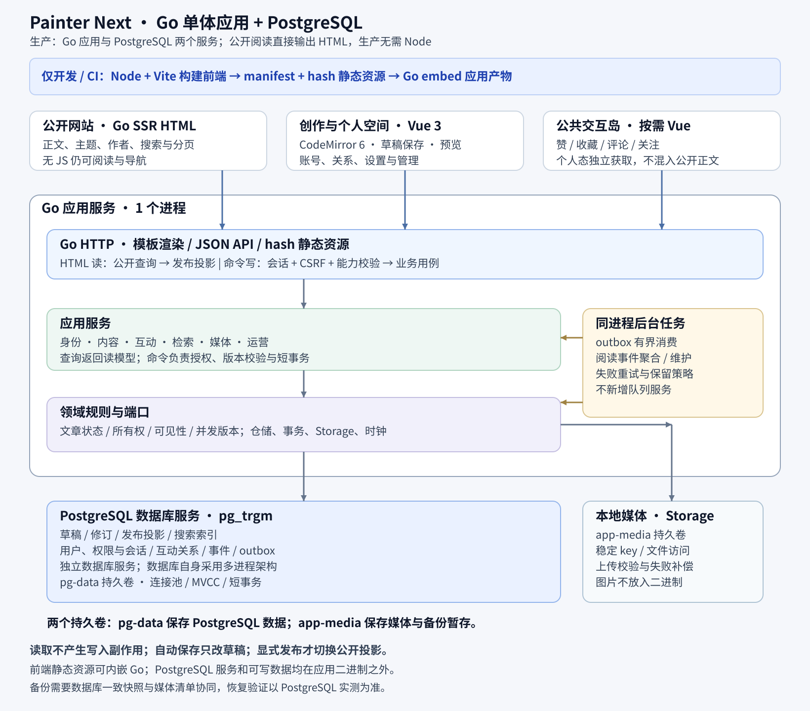

# Painter Next 设计包

新项目、快速部署、低资源、保留功能、Go模块化单体 + PostgreSQL、Liquid Glass、GitHub登录、全文搜索、埋点和编辑器升级。

数据库禁止使用SQLite；开发、测试与生产统一PostgreSQL。部署为一个Go应用服务 + 一个PostgreSQL服务，前端产物嵌入Go。

飞书完整版：[Painter Next：低资源单体技术方案与全链路数据架构](https://wcno45oaikgv.feishu.cn/docx/LgzzdgLFVoNUb9xoWKCc4UbhnWe)。含架构图、5张业务时序图、接口合同、完整DDL、实施计划及验证边界。

阅读顺序：

1. [技术方案与全链路数据架构](TECHNICAL_DESIGN.md)
2. [接口与事件契约](API_CONTRACT.md)
3. [可执行初始数据库设计](schema.sql)
4. [实施、迁移与验收计划](IMPLEMENTATION_PLAN.md)
5. [验证记录与边界](VALIDATION.md)

2026-10-21修订：38张PostgreSQL表，52项数据库检查及Go驱动连接通过；部署为Go+PostgreSQL两个服务。具体执行证据与尚未验证部分见[验证记录](VALIDATION.md)。

本目录是技术设计，不是已经实现的新应用。旧项目和已有本地代码变更保持原样。
