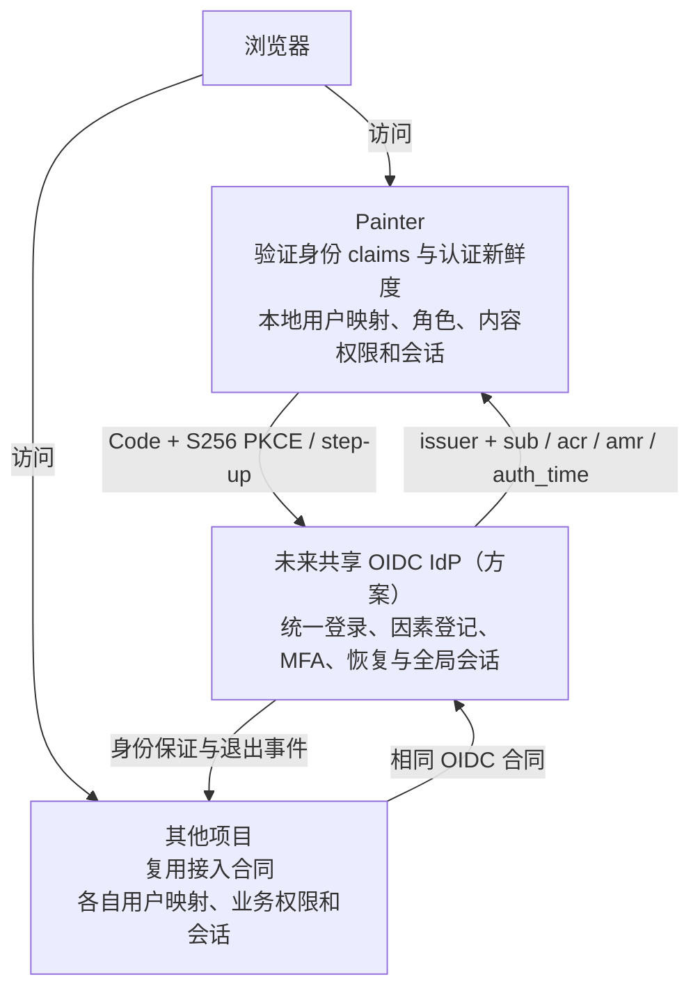

# V7：身份认证检查与统一 MFA 方案

2026-10-29 补充：[ButtonAuth 登录中台立项评估](BUTTONAUTH_ASSESSMENT.md)进一步评估独立服务的选型、范围、工期、Painter 绑定迁移与会话合同。下文仍区分已实现保护和待建能力。

检查日期：2026-10-28。范围为 Go 身份认证、授权、配置、迁移与相关测试代码。本轮已完成安装向导、后台 GitHub 配置和 GitHub 登录时的旧会话替换；下文区分当前保护、已修复问题及尚未实现的控制。初次检查与随后集成复查的证据分别记录在文末，整体交付验收见 [VALIDATION.md](VALIDATION.md)。本审查未读取真实凭据、连接正式数据库、注册外部应用或执行部署。

现有本地账号和 GitHub 登录已有多项明确保护，适合继续在当前 Go 模块化单体上迭代；目前还不是完整的统一身份平台。主要缺口是 MFA、敏感操作再次认证、密码泄漏/常用值检查，以及跨服务的身份和会话生命周期。统一二次验证应由一个标准 OIDC 身份服务管理，各项目接入同一合同；本轮只提出方案，不建设或上线该服务。

## 已有保护及边界

| 范围 | 已核实的代码行为 | 证据 |
| --- | --- | --- |
| 密码存储 | Argon2id，19 MiB、2 次、并行度 1；每个密码有随机 16 字节盐；摘要常数时间比较。同进程最多两个派生任务，避免无限内存并发。允许 15–1024 个字符、最多 4096 字节，不截断。 | [passwords.go](../internal/app/passwords.go) |
| 登录失败 | 用户不存在、没有本地密码、密码错误、账号停用统一为 `401 INVALID_CREDENTIALS`；未知账号同样进行一次密码派生。12 KiB 请求限制和严格 JSON 解码避免过大或未知字段请求。 | [local_auth.go](../internal/app/local_auth.go)、[core.go](../internal/app/core.go) |
| 会话 | 使用加密安全随机的 192 位 opaque token，仅存哈希；cookie 为 HttpOnly、SameSite=Lax，HTTPS 公共地址下有 Secure。身份读取检查撤销、过期和停用状态。 | [core.go](../internal/app/core.go)、[auth.go](../internal/app/auth.go) |
| CSRF | 登录/注册也要求精确同源 Origin，以及与匿名 HttpOnly cookie 绑定的 HMAC token。已有会话的写入同时校验 Origin 和会话 CSRF token。 | [local_auth.go](../internal/app/local_auth.go)、[core.go](../internal/app/core.go) |
| 角色与并发 | 注册只能得到 reader。管理写入经过 `Write` 的角色检查、policy barrier 与用户行锁；等待锁后重新查询会话，避免旧快照授权已撤销会话。最后一个启用的 owner 不能被降权或停用。 | [local_auth.go](../internal/app/local_auth.go)、[core.go](../internal/app/core.go)、[auth.go](../internal/app/auth.go)、[admin.go](../internal/app/admin.go) |
| 撤销 | 本地和 GitHub 再次登录均轮换 token，并在创建新会话的同一事务中撤销请求携带的旧会话。改密、离线重置、角色/停用状态变化撤销该用户全部会话；用户能列出和撤销自己的会话。 | [local_auth.go](../internal/app/local_auth.go)、[local_auth_cli.go](../internal/app/local_auth_cli.go)、[admin.go](../internal/app/admin.go)、[auth.go](../internal/app/auth.go) |
| GitHub OAuth | 服务端保存 state 哈希、浏览器绑定哈希及加密 PKCE verifier；10 分钟过期，原子单次消费，先消费再交换；S256 PKCE。用认证后的 `/user` 数字 ID 作为稳定 subject，拒绝无效 ID/非用户类型。 | [auth.go](../internal/app/auth.go) |
| 数据与权限 | GitHub access/refresh token 不持久化。兼容的 GitHub owner 引导只匹配配置中的数字 ID；普通新增账号遵守注册开关。另有受安装码保护的首位本地 owner 向导和受信任操作者的离线创建命令。provider/issuer/subject 联合主键和用户/provider/issuer 唯一约束避免重复绑定。 | [auth.go](../internal/app/auth.go)、[setup.go](../internal/app/setup.go)、[local_auth_cli.go](../internal/app/local_auth_cli.go)、[001_initial.sql:59](../migrations/001_initial.sql#L59) |
| 重定向与 SSRF | `return_to` 限制为站内路径，拒绝绝对地址、`//`、反斜杠、换行和 `/auth/` 回跳。身份端点来自可信进程配置；除 `test` 外的所有环境（包括 development）只允许 GitHub 官方固定端点。默认 HTTP client 禁止跟随重定向、有 10 秒超时及响应体上限。公开请求和后台配置均不接受 provider URL；隔离测试使用 mock 端点。 | [auth.go](../internal/app/auth.go)、[config.go](../internal/app/config.go)、[github_settings.go](../internal/app/github_settings.go) |

上述结论限于已检查路径，不是渗透测试、第三方认证或“绝对安全”声明。用户资料中的 email/phone 没有验证状态，不应被当作已验证身份、恢复地址或自动合并依据；参见 [users.go](../internal/app/users.go)。

## 具体缺口与修复状态

严重程度按当前单站部署的影响排序；Medium 表示需要排期的安全控制缺口，并不表示已经证明存在远程未认证接管。

| 编号 / 程度 | 现状与实际影响 | 建议 |
| --- | --- | --- |
| AUTH-01 / Medium | session 和 Principal 没有认证方法、保证等级或认证时间；owner 的角色/站点设置等敏感操作只要求仍有效的会话、角色和 CSRF。窃取一个 owner 会话后的窗口内，无需再次证明密码或第二因子即可执行这些操作。GitHub 登录成功也没有“本次已完成 MFA”的可信证明。证据：[sessions schema](../migrations/001_initial.sql#L87)、[Principal](../internal/app/core.go#L38)、[Write](../internal/app/core.go#L261)、[角色管理](../internal/app/admin.go#L529)。 | 为敏感操作建立可验证的 recent-auth/step-up 合同，优先覆盖 owner、身份绑定/解绑、恢复、MFA 变更和认证配置；统一身份服务提供 MFA 后再启用强制策略。不能把“重新跳了一次 GitHub”当成二次验证。 |
| AUTH-02 / Medium | `validatePassword` 只检查长度、编码和 NUL，没有常见/泄漏密码或站点上下文 blocklist；足够长的常见密码仍会被接受。强哈希保护数据库泄漏后的离线成本，不能阻止已泄漏密码的直接登录。证据：[passwords.go](../internal/app/passwords.go)。 | 本地新增/改密/重置共用离线常见和泄漏值检查；不向外部传送原密码；保留长口令、空格和无强制字符组合。最终迁入统一身份服务的密码策略。NIST 的密码要求包含 blocklist，并非只看最短长度；见 [NIST 密码验证要求](https://pages.nist.gov/800-63-4/sp800-63b/authenticators/#passwordver)。 |
| AUTH-03 / Medium（取决于部署） | 登录、注册、OAuth 和写入限速都是进程内 fixed-window 计数；重启清零，多副本互不共享。使用 direct peer 能避免伪造转发头，但反向代理后的用户会共用代理 IP 桶，可能相互影响。已有代码注释明确要求代理边缘限速。证据：[local_auth.go](../internal/app/local_auth.go)、[core.go](../internal/app/core.go)。 | 单实例可继续保留本地保护；对公网部署补充可信代理层连接/IP 限制，多实例认证计数使用共享存储，保留账号维度。不要直接信任任意 X-Forwarded-For。 |
| AUTH-04 / Medium（会话策略） | 会话固定最长 30 天，未实现独立的闲置过期或 owner 短会话策略。GitHub token 不持久化且只在登录时校验，因此 GitHub 端撤销授权、停用或凭据变化不会自动撤销已建立的 Painter 会话。证据：[auth.go](../internal/app/auth.go)。 | 明确普通登录与高权限会话的 absolute/idle lifetime 和敏感操作 freshness；统一 IdP 后建立退出、停用、恢复与本地撤销的传播合同。现有本地 role/disable/password 撤销应保留。 |
| AUTH-05 / Low，**本轮已修复** | 初次检查发现 GitHub 登录生成新 token 后仍保留请求携带的旧 Painter token。现已由 `completeGitHubLogin` 在同一事务中撤销旧 token、创建新 session；失败 callback 保留原会话。这是会话生命周期一致性修复，初次检查并未证明 session fixation。证据：[auth.go](../internal/app/auth.go)、[github_settings_test.go](../internal/app/github_settings_test.go)。 | 已完成当前浏览器旧 token 的替换；不等同于默认撤销所有其他设备会话。 |
| AUTH-06 / Low | `last_seen_at_ms` 只在插入 session 时赋值，认证读取没有刷新；会话管理 API 因此把创建时间展示为最近活动。证据：[auth.go](../internal/app/auth.go)、[local_auth.go](../internal/app/local_auth.go)。 | 节流更新最近活动并用于闲置过期，或在实现前准确标为创建时间，避免用户误判被盗会话是否活跃。 |

在线自助找回密码、MFA 恢复、成功/失败认证事件的专门安全审计也尚未形成完整流程。现有离线重置属于拥有服务器和数据库权限的运维能力；它不是在线用户可用的恢复功能。不要将尚未配置的邮件通道或未验证资料包装成恢复保障。

## 本地账号、GitHub 身份和再次认证

- GitHub 身份匹配键是 `github + https://github.com + numeric subject`，不是 GitHub 登录名或邮箱。GitHub 改名后仍进入原用户。
- 一个本地用户名恰好与 GitHub 登录名相同，不会合并；GitHub 新账号会尝试带 subject 的用户名。现有代码没有公开的身份绑定/解绑接口。schema 中的 `flow='link'`、`initiating_user_id` 和 audit action 只是预留结构，不代表功能完成。证据：[auth.go](../internal/app/auth.go)、[路由](../internal/app/auth.go#L27)、[oauth_states](../migrations/001_initial.sql#L71)。
- 离线 `ResetLocalPassword` 可以为操作者明确指定的现有 GitHub 用户增加本地密码，并撤销所有旧会话；停用账号不能重置。操作者必须先确认目标用户，用户名不是不可变 identity。证据：[local_auth_cli.go](../internal/app/local_auth_cli.go)。
- 在线改密必须验证当前本地密码；只有 GitHub 身份而没有本地密码的会话不能直接增设密码。其他 owner 管理操作目前没有类似再次认证边界。证据：[local_auth.go](../internal/app/local_auth.go)。
- GitHub 的 OAuth 文档定义 code、PKCE、state 与 `/user`，没有为当前流程提供本次 MFA 的 `amr`/`acr`/`auth_time` 合同。上游浏览器会话可能已存在；不能从“GitHub 已登录”推导“这次刚输入第二因子”。[GitHub OAuth web flow](https://docs.github.com/en/apps/oauth-apps/building-oauth-apps/authorizing-oauth-apps)

未来增加绑定时，应要求当前账户的近期强认证，再完成目标身份的独立认证，事务内保证身份尚未属于别人；不得按邮箱/用户名自动绑定。解绑必须确保仍有可用登录或恢复方法，记录审计并通知。可参考 [OWASP 认证与账号绑定指导](https://cheatsheetseries.owasp.org/cheatsheets/Authentication_Cheat_Sheet.html#secure-federated-account-linking)。

## GitHub 接入成本及实施范围

当前代码使用自己登记的 GitHub OAuth App，登录时做一次 code 交换和一次用户查询，不需要为这些调用接入一个第三方付费认证 SaaS。官方登记步骤和公开定价没有列出该流程的按次登录收费；按此做小型站点通常无需新增 GitHub 登录服务费，这是根据公开文档作出的成本判断，不是价格合同。域名、HTTPS、服务器、数据库、运维和后续统一 IdP 的成本仍需自担。[OAuth App 登记](https://docs.github.com/en/apps/oauth-apps/building-oauth-apps/creating-an-oauth-app)、[GitHub 定价](https://github.com/pricing)

登录查询仍受 API 配额与可用性影响。普通 OAuth 用户 token 的 REST 请求通常共享该用户每小时 5,000 次的额度，也有 secondary limits；不是整个站点可无限调用。当前代码未请求 repo、邮件等额外 scope，public profile 足以得到稳定数字 ID。应为 Painter 单独登记应用，避免同一个 OAuth App 历史授权 scope 扩大 token 权限。[GitHub REST limits](https://docs.github.com/en/rest/using-the-rest-api/rate-limits-for-the-rest-api)、[OAuth scopes](https://docs.github.com/en/apps/oauth-apps/building-oauth-apps/scopes-for-oauth-apps)

本轮已实现服务端保存 Client ID、加密保存 Client Secret、后台启停与配置状态，以及启停/冲突/失败恢复验证。callback 固定从 `PUBLIC_BASE_URL` 推导；除 `test` 外，provider/token/profile URL 均固定为 GitHub 官方端点，后台不提供 URL 配置。读取 API 不返回密钥明文或密文，写入仅在配置提交时接收密钥，日志和审计不记录密钥值；备份可能包含数据库中的加密密文，须与应用加密密钥共同妥善恢复。仍需由站长登记自己的 OAuth App 并完成真实 callback 连通验收，文档和 mock 测试不能代替这一步。

## 可复用的统一 MFA 架构

### 责任划分

以下为后续架构方案，当前尚未部署共享 IdP、实现 OIDC 客户端或添加 MFA 因素。建议保留 Painter 的本地 user ID、owner/author/reader、内容权限和 PostgreSQL 事务写入，在现有 local/GitHub 登录实现外引入 identity adapter，再增加共享 IdP 的 OIDC 接入。各项目复用 OIDC 客户端配置、claim 校验、step-up 中间件和契约测试，认证因素的登记、验证、恢复、审计由统一身份服务集中管理。



图中 OIDC 接入、MFA 和跨项目退出传播均为待建能力；各项目的业务授权继续由项目自身负责，中心不会直接授予 Painter owner。

共享服务宜采用成熟 OIDC Provider（例如评估自托管 Keycloak）；选择需要结合备份、密钥轮换、升级、可用性和维护能力，并不因存在开源软件而自动免运维成本。Keycloak 已提供 discovery、授权、token、JWKS、注销与撤销端点，可作为后续独立工程的实现起点。[Keycloak OIDC endpoints](https://www.keycloak.org/securing-apps/oidc-layers)

浏览器进入统一身份域名认证，再回到各项目独立 callback。项目不接收统一密码、TOTP seed 或恢复码；项目间不共享宽域 cookie 或统一 session 数据表。统一身份服务发生故障时，既有应用会话的到期和撤销策略必须明确，不因异常静默绕过 MFA。

### OIDC 接入合同

1. 使用 Authorization Code + S256 PKCE、单次 state、浏览器绑定与 nonce，准确登记每个应用的 redirect URI；通过成熟 OIDC 库验证 token，不自行实现 JWT 解析验签。禁用 implicit、password grant 和任意返回地址。[OAuth Security BCP](https://datatracker.ietf.org/doc/html/rfc9700#section-2.1.1)
2. 固定受信任 issuer 与 client ID；验证签名、允许的算法、issuer、audience、到期、nonce，以及适用的 authorized party。用户按 `issuer + sub` 唯一匹配，首次接入现有用户须经过明确绑定；邮件只是资料。IdP discovery/JWKS 端点同样需要可信配置与网络边界。[OIDC ID Token validation](https://openid.net/specs/openid-connect-core-1_0.html#IDTokenValidation)
3. 明确定义项目需要的 `acr` 值及其含义；`amr` 描述实际认证方法，`auth_time` 记录认证时间。敏感操作请求满足指定保证等级及例如 5 分钟内的 recent-auth；通过 `max_age`/必要 claims 请求后，仍需在回调检查返回的等级与时间，不满足即拒绝，不能只相信请求参数或前端布尔值。会话仅存已验证的必要元数据。[OIDC claims](https://openid.net/specs/openid-connect-core-1_0.html#IDToken)、[authentication request](https://openid.net/specs/openid-connect-core-1_0.html#AuthRequest)
4. 每个应用仍检查自己的角色、停用状态和对象权限。中心负责身份与因素，不直接授予 Painter owner。仅经 GitHub 上游登录的身份不能凭 broker 名称自动升级为已满足 MFA；IdP 必须按策略补做独立因素。
5. 定义全局退出、账号停用、因素重置和风险事件对各项目 session 的撤销传播。可使用 OIDC back-channel logout，验证签名、issuer/audience、事件、时间与 replay ID，再按 `sid`/`sub` 终止本地会话；保留短时到期策略作为传播失效边界。[OIDC Back-Channel Logout](https://openid.net/specs/openid-connect-backchannel-1_0.html)

上述 `acr`/`amr` 的语义需由 IdP 和客户端共同约定；`amr` 数组中存在两个字符串不能单独证明某个自定义高保证等级。不得宣称通过某个 NIST AAL 或合规认证，除非完整评估相应全部要求。

### 统一服务中的因素与生命周期

- 优先提供 WebAuthn/passkey，服务端检查挑战、RP ID、origin、用户验证要求与签名；高权限用户可要求具备 user verification 的凭据。TOTP 可作为兼容方式，但不具备 phishing resistance。[NIST OTP 与加密认证要求](https://pages.nist.gov/800-63-4/sp800-63b/authenticators/)
- TOTP seed 仅在中心加密保存，密钥与数据库分离并有版本/轮换方案；不记录 OTP/seed。登记先创建有期限的 pending factor，完成当前身份的近期认证，再用一次有效证明原子激活。
- 每个挑战绑定用户、用途与当前认证交易，短期有效；尝试次数和账号/IP 限速共享存储。TOTP 在可接受时钟漂移范围内验证，并事务性记录已经消费的时间步，两个并发请求不得重复使用同一有效 OTP。续发挑战不重置累计失败计数。
- 恢复码高熵随机、只展示一次、服务端只存哈希且单次原子消费；重新生成使旧码失效。更换/移除因素和恢复必须有同等强度的再次认证或专门恢复流程，撤销相关旧会话，审计并通知。不能只凭一个已登录但没有强认证保证的 session 移除 MFA。[OWASP MFA lifecycle](https://cheatsheetseries.owasp.org/cheatsheets/Multifactor_Authentication_Cheat_Sheet.html)
- 首位 owner 的安装凭据、遗失全部因素、离线救援、离职/封禁、密钥丢失和备份恢复均要演练。以后强制中心 MFA 时，现有 local/GitHub 入口必须纳入相同策略；保留离线救援时，应限定受信任操作者，完整审计并触发 session 撤销，避免在线备用入口绕过 MFA。

## 分阶段交付与验收

1. **当前站点，本轮已实现**：受安装码保护、一次性、事务性的首位 owner 向导和服务端 GitHub 配置；保留现有单体、数据库与内容权限。已有身份与不可逆安装标记共同关闭公开安装，owner、站点资料、封存与审计在同一事务提交。具体实现与证据见下文复查补记及总验收记录。
2. **本地加固，待实施**：针对 AUTH-01/02/03/04/06 另排小范围变更，先定义会话时长、recent-auth 和日志合同，再实施；AUTH-05 已修复，不再列为待办。新增安全需求不得凭审计文档宣称已完成。
3. **共享身份服务独立项目**：选型并部署一个 IdP、完成 owner 因素登记/恢复与生命周期，交付配置模板、因素策略、备份/密钥/恢复手册和 OIDC 契约测试。Painter 作为第一个客户端验证；稳定后其他项目复用同一接入包。无需把 Painter 拆成多个服务后才能开始。
4. **接入验收**：覆盖错误 issuer/audience/signature/nonce、跨客户端混用、过期与重复 callback、state 浏览器绑定、低保证或过旧认证的拒绝、TOTP 重放/并发消费、WebAuthn 错 origin/challenge/UV、过期登记与恢复码重用、因素移除与角色变更撤销、IdP 故障及 logout 重放。证明本地登录、GitHub、API 和救援入口均不存在 MFA 策略绕行。

## 初次检查记录（历史）

执行了不连接数据库的命令：

```sh
env -u PAINTER_TEST_DATABASE_URL go test ./internal/app -run '^TestPassword' -count=1 -v
```

`TestPasswordHashSaltLongPassphraseAndNoTruncation` 和 `TestPasswordConcurrencyBound` 均通过，耗时 0.219 秒；只证明其覆盖的 salt、长口令、空格、不截断和并发上限行为。

初次静态阅读了现有集成测试：GitHub PKCE/state 单次消费/稳定 subject/错误浏览器、会话 CSRF/撤销/隐私、权限刷新/最后 owner、账号注册与失败一致性、全 session 改密撤销、限速/请求大小，以及等待 policy/user 锁后的密码和 session 重新校验。入口见 [auth_test.go](../internal/app/auth_test.go)、[local_auth_test.go](../internal/app/local_auth_test.go)、[core_test.go](../internal/app/core_test.go)。**初次检查阶段尚未运行 PostgreSQL 集成用例；随后已运行下节记录的选择集。真实 GitHub callback 仍未验通。**

## 本轮实现后的复查补记

本轮增加安装流程和后台 GitHub 配置后，复查结果如下；前文已同步注明已修复状态。这些实现不包含规划中的 MFA 或其他仍开放的控制。

- **安装授权与原子性**：`setupComplete` 在密码派生前检查精确 Origin、匿名 cookie 绑定的 CSRF，以及服务器 `SETUP_TOKEN` 的固定长度哈希常数时间比较。安装码只从受信任配置取得，公开 status 不返回安装码。12 KiB 请求上限和每直连 IP 10 分钟 10 次限制沿用现有有界限速；代理/多实例的 AUTH-03 边界仍存在。[setup.go](../internal/app/setup.go)、[config.go](../internal/app/config.go)、[core.go](../internal/app/core.go)
- **首位 owner 与封存**：密码派生完成后取得维护锁和排他的 policy barrier，在同一事务内重新检查安装资格，然后创建 owner/本地凭据、站点资料、关闭注册、写 outbox、封存标记及审计。没有在 Argon2 期间持有数据库锁。审计 action 已采用 schema 允许的 `system.bootstrap`，避免安装在最后的审计写入处因约束失败而回滚。[setup.go](../internal/app/setup.go)、[ops.go](../internal/app/ops.go)
- **已有身份保护**：迁移为已有 owner、local/OAuth 身份预置封存状态；运行时也检查任意 owner（包括停用 owner）和任意 local/OAuth 身份，因而迁移后的 reader-only 身份导入同样不能开放安装。封存标记通过不可逆更新和禁止删除的 trigger 保护。本地 CLI owner 创建及 GitHub owner bootstrap 都在创建事务内写入封存标记。[0010_installation.sql](../migrations/0010_installation.sql)、[local_auth_cli.go](../internal/app/local_auth_cli.go)、[auth.go](../internal/app/auth.go)
- **GitHub 后台配置**：owner-only GET/PUT、Origin/CSRF 和事务内角色重检；版本 CAS、Client Secret 加密保存、读取脱敏、首次保存保留有效环境密钥、数据库明确停用覆盖环境回退。公开请求不能配置 provider URL；非 test 环境继续固定官方端点。在途 OAuth 绑定配置版本/凭据指纹，并在网络交换前及创建会话事务内复查；配置变化拒绝建立身份或会话。不可解密的可选 GitHub 配置会关闭该登录入口，同时保留本地登录的恢复能力。[github_settings.go](../internal/app/github_settings.go)、[0011_github_settings.sql](../migrations/0011_github_settings.sql)
- **AUTH-05 已修正**：GitHub 登录成功在新 session 的同一事务中撤销请求携带的旧 token；失败 callback 保留原 session。没有新增账号绑定功能；本地 owner 不会凭同名或同邮箱自动获得 GitHub 绑定。其余 AUTH-01/02/03/04/06 仍需另行实施。配置使用说明见 [后台配置 GitHub 登录](GITHUB_LOGIN_V7.md)。

本审查在实现复查阶段使用明确的 disposable PostgreSQL 18 连接和 mock GitHub 执行了下面的 race 选择集。16 个顶层测试及 5 个子场景全部通过，耗时 3.858 秒；原始结果保存在 [github-auth-race.txt](../tests/artifacts/v7/github-auth-race.txt)。新增 setup 复查用例通过迁移后插入 local reader、OAuth reader、停用 owner 三类夹具，证明 status 关闭安装、命令拒绝且用户数量不变；这不是实际旧库导入演练。

```sh
go test -race ./internal/app \
  -run 'TestGitHub|TestOAuth|TestBootstrap|TestSession|TestWriteFreshPolicy|TestPassword|TestSetupReview' \
  -count=1 -v
```

所选用例覆盖设置权限/CSRF/CAS（含同时保存）、密钥保留/脱敏/损坏关闭、有效数据库凭据、会话替换、配置变更竞争、GitHub owner 封存以及原有 OAuth/会话/权限保护。TypeScript 检查也已通过。安装成功/回滚/并发提交的完整向导用例、最终浏览器布局和真实 GitHub callback 验收由总验收记录分别说明；此处不据静态检查宣称已经验证这些场景。本审查未执行部署或外部 OAuth 应用创建，正式升级与后续验收另见总记录。
