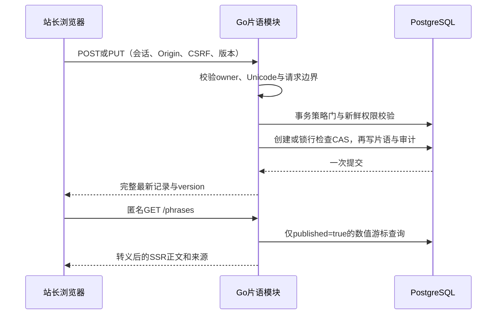

# V8：独立工作台与片语

后台入口仍是 `/studio/posts`，片语管理为 `/studio/phrases`，公开展示为 `/phrases`。首页末尾增加片语入口，公开顶部继续只有文章、标签与搜索。沿用 Painter 的纸面、墨色、蓝色和原 Logo；没有新增前端运行服务、图片生成服务或动画依赖。

## 工作台结构

桌面移除公开站点的顶部栏、页脚与右侧浮控。左侧为全高实色导航，Logo 位于顶部，导航按写作、个人空间和运营分组；查看网站、主题和账户操作放在下方。右侧使用独立内容画布与清晰标题。窄屏以最小品牌/菜单入口打开原生 `dialog` 抽屉，使用项目样式，并保留浏览器的焦点隔离和 Escape 退出。

站点设置拆成网站信息、功能与通知、登录安全三部分，支持键盘左右/Home/End切换及 hash 深链接。GitHub 的权限、加密与配置合同不变。成员角色、文章封面来源/版式/配色、段落样式和主题均使用同一自定义 combobox/listbox；Arrow/Home/End选择活动项、Enter提交、Escape取消、Tab离开，点击外部关闭。弹层定位避开视口边缘，在移动抽屉内部进入同一模态层。文件与日期继续使用实际设备/浏览器选择能力。

退出、清空足迹、版本恢复及片语删除使用项目样式确认框。未保存页面的关闭/刷新仍依靠浏览器 `beforeunload` 保护，这种系统提示由浏览器控制。没有替换密码、会话或内容保存协议。

## 片语使用与公开边界

仅站长可以管理片语。编辑区可选句子/词语，填写正文、可选来源并选择公开；不勾选时保存为草稿。列表有已加载内容筛选、状态和分页，支持编辑与明确确认后删除。公开中的片语保存后立即更新；取消公开后立即退出公开查询。删除不可恢复，当前没有片语修订历史、评论、投稿或定时发布。

正文为1–280个Unicode码点，来源最多120个，去首尾空白；服务端拒绝无效UTF-8、控制字符和换行。前端计数按码点计算。来源是站长输入的文字，不是经过外部验证的作者身份。未保存状态会提示，切换编辑内容需要明确放弃；离开页面有保护。版本冲突保留本地输入，只有明确确认且成功获取服务器内容才替换；加载失败不会用旧缓存清除冲突。

公开页以一屏一句、大字排版与原生滚动呈现；词语使用更大的字级，长句自然延伸，来源跟随正文。上一条/下一条定位真实记录，复制在LAN HTTP下提供兼容路径及明确结果。正文、来源与下一条链接是SSR，禁JavaScript仍能读。滚动呈现采用支持时的CSS scroll timeline，没有持续JS渲染循环；减少动态效果关闭动画，关闭JavaScript或不支持该CSS时保留正文。浮动阅读导航使用现有玻璃材质，减少透明时改实色。

正式部署不预置词句，空库显示真实空状态。验收克隆库中的“界面验收样例”只用于排版/流程测试，不复制到正式站点。

## 数据表与写入时序

新迁移 `0012_phrases.sql` 添加一张表，schema总数11→12、业务表总数44→45。旧迁移不改写。

| 字段 | 类型 / 约束 |
| --- | --- |
| id | BIGINT identity主键，HTTP以字符串返回 |
| version | 正整数，初始1，每次更新递增 |
| text | TEXT，1–280字符、非空白 |
| kind | sentence或word |
| source | TEXT，默认空，最多120字符 |
| published | BOOLEAN，默认false |
| created_at_ms / updated_at_ms | UTC毫秒；更新保留创建时间 |

公开查询有 `id DESC WHERE published` 部分索引，按数值ID游标翻页，不能按 `id::text` 别名排序。所有公开调用在SQL固定 `published=true`，携带owner cookie或伪造查询参数也不能读取草稿。

写入先检查owner、Origin/CSRF、请求大小与字段，再进入已有 `Write` 事务：取得维护与policy门、等待后复查会话和角色，修改片语，并在同一事务写 `phrase.create/update/delete` 审计。更新/删除锁定记录并检查If-Match，冲突不提交。迁移独立扩展审计action和target类型白名单；审计不复制正文或来源。

没有异步搜索或发布投影，因而本功能不新建outbox消费者；公开读取直接使用同一提交后的表。发布/撤回无需等待后台任务，避免两套状态不同步。片语不进入原文章搜索，避免把短句作为文章误返回；独立全文检索不在本轮范围。

## API合同

| 方法与路径 | 权限及行为 |
| --- | --- |
| GET `/api/v1/phrases` | 匿名可读，仅公开项 |
| GET `/api/v1/admin/phrases` | owner，可读公开和草稿 |
| POST `/api/v1/admin/phrases` | owner、Origin/CSRF、Idempotency-Key；201 |
| PUT `/api/v1/admin/phrases/{id}` | owner、Origin/CSRF、If-Match；完整替换，200 |
| DELETE `/api/v1/admin/phrases/{id}` | owner、Origin/CSRF、If-Match；204 |

请求字段 `{text,kind,source?,published?}`；创建时published默认false，PUT为完整快照，省略的可选字段恢复默认值。JSON严格拒绝未知字段，请求最多12KiB。DTO包含id/version/text/kind/source/published/created_at/updated_at，不包含任何其他私有集合。

列表返回 `{items,next_cursor,has_more,limit,max_limit:200}`，默认/上限200；`limit`可取更小正整数，过大值截到200。`cursor`为上一页最后一条ID。公开SSR使用同一分页合同；HTML下一页链接保留查询参数。

创建重复键相同请求返回原结果，不创建重复片语。改写/删除版本过期返回409，缺失If-Match返回428；不存在的记录404，匿名401、reader/author403。现有维护锁使备份和迁移与写入串行。完整数据库备份自然包含新表，不另建媒体对象或词句文件。

## 观测与交付边界

公开片语页复用现有 `page_view.v1` 记录站点PV/UV，不收集正文、来源或复制内容，不新增片语级阅读量。后台操作由事务审计覆盖。公开页不因埋点失败阻止阅读。

真实PG18 race、浏览器业务、原编辑器回归及截图记录见 [VALIDATION.md](VALIDATION.md) 和 [V8汇总](../tests/artifacts/v8/summary.json)。只在独立克隆库创建/发布验收样例；正式升级保留原库与私有配置。实际视觉结论、切换结果以总验收记录为准。实体设备、屏幕阅读器、跨平台日期/文件选择器、真实Docker和目标小服务器负载不由本机Chromium结果替代。
